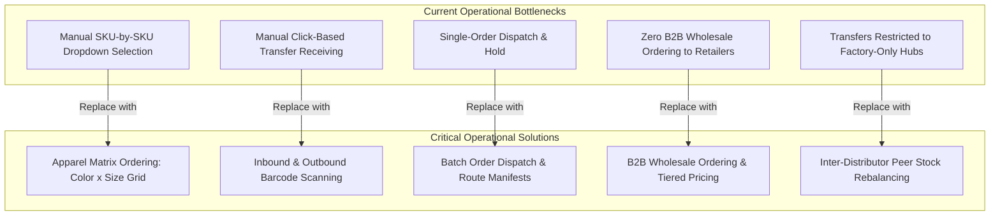
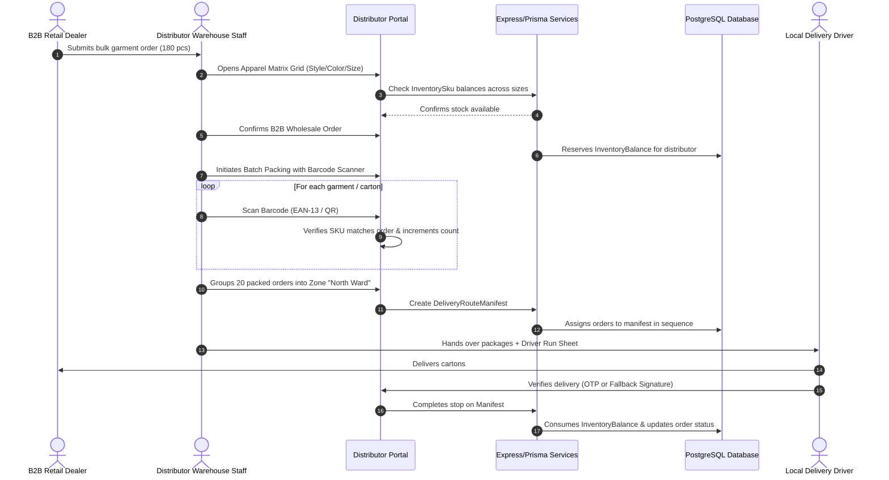
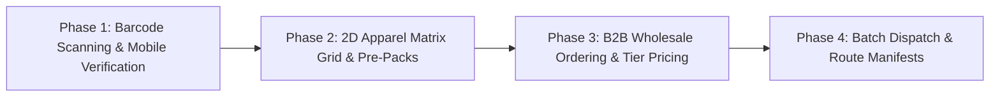

# Critical Project Analysis & Requirements: Distributor Perspective
**Document Ref:** `docs/distributor-perspective-analysis-and-roadmap.md`  
**Target Platform:** Clothes-Store-ECommerce Multi-Tier Distribution & Retail Platform  
**Focus Scope:** High-Priority Operational Deficits, Critical Apparel Distributor Requirements, and Target Solutions (Excluding Payment Method Upgrades)  
**Status:** Architecture & Requirements Specification (No Code Modifications Applied)

---

## 1. Executive Summary: Core Operational Dilemma

In the apparel distribution industry, a **distributor** manages high volumes of inventory across styles, colors, and sizes, serving as the commercial and logistical backbone connecting factories with regional retail networks. Distributors operate under tight fulfillment windows, high labor costs, and severe risk of stock imbalances across size curves.

### Current System Assumption vs. Critical Operational Reality
* **Current Software Implementation:** The system models the distributor primarily as a **consignment-based last-mile dispatch depot**. The platform retains 100% inventory ownership, assigning single-parcel B2C customer orders or basic counter retail checkouts, while the distributor earns piecemeal service/delivery fees.
* **Distributor's Critical Requirement:** A regional apparel distributor cannot survive as a single-package parcel carrier. To be viable, the distributor requires software that supports **bulk wholesale operations, rapid variant data entry, barcode-driven physical warehouse handling, batched delivery dispatch, and regional stock mobility**:
  1. Garments cannot be managed or ordered one unit at a time; distributors need **2D Color $\times$ Size Matrix Grids and Pre-Pack size curves**.
  2. Warehouse staff cannot manually verify sizes and colors by reading labels on polybags; they require **fast Barcode/QR scanning** to eliminate mispicks.
  3. Distributors must supply downline retail merchants with **wholesale bulk orders and tier pricing**.
  4. Local deliveries cannot be dispatched as isolated individual tickets; they must be **clustered into batch routes with driver run manifests**.
  5. Regional stock-outs must be addressed via **Inter-Distributor Stock Transfers (Peer-to-Peer Rebalancing)** rather than forcing stock to return to the central factory.

---

## 2. Deep Integrity Audit of Current Distributor Workflows

An analysis of `backend/prisma/schema.prisma`, `backend/controllers/distributor*`, and `backend/services/` highlights critical operational bottlenecks:



### 2.1 Transactional & Concurrency Invariants
* **Serialization Failures on High Concurrency:** In `distributorInventoryController.js` and `stockTransferController.js`, inventory adjustments use PostgreSQL `Serializable` transactions. Under concurrent checkout bursts or simultaneous counter sales, updates to the same `InventoryBalance` row trigger serialization failure (`40001`). The backend lacks an automated retry handler with exponential backoff.
* **Dual Inventory Desynchronization:** The platform maintains legacy variant arrays (`ManufacturerInventory.variantsStock`) alongside canonical `InventorySku` tables. Decreasing inventory via `decreaseDistributorInventory` updates canonical balances and triggers `syncProductStock`. A partial transaction or network hiccup can create an inventory discrepancy between web storefront stock and physical warehouse stock.

### 2.2 Operational Friction in Earnings & Settlements
* **Single Settlement Token Lockout:** In `distributorCashSettlementService.js`, `ensureNoActiveUnifiedSettlementRequest` blocks creating new earnings settlement requests while any prior request is pending review (`REQUESTED`, `EVIDENCE_SUBMITTED`, `PAYMENT_SENT`). If an older weekly claim is delayed in administrative audit, the distributor is locked out from claiming subsequent legitimate delivery service fees.
* **Consignment Float Liability:** In `distributorCashSettlementService.js`, cash collected from COD self-deliveries immediately creates a direct liability document (`DISTRIBUTOR_COD_SALE`). The distributor bears full balance-sheet liability before transit cash from individual delivery riders is reconciled at the depot.

---

## 3. The 6 Most Critical Weaknesses for a Distributor

| # | Operational Domain | Current Implementation Deficit | Distributor Impact & Severity |
| :- | :--- | :--- | :--- |
| **1** | **Apparel Variant Order Entry** | Single-line SKU dropdown selection in stock requests and direct orders. | **CRITICAL:** Ordering 100 shirts across 5 sizes and 3 colors requires 15 separate line additions. Completely unworkable for commercial wholesale volumes. |
| **2** | **Physical Warehouse Verification** | 100% manual UI click-based transfer receiving and order packing. | **CRITICAL:** High human error. Folded garments in polybags look identical; staff routinely mix up Navy vs. Black or Size M vs. L without barcode verification. |
| **3** | **Commercial Wholesale Channel** | Only individual B2C customer orders and single-item retail counter sales. | **CRITICAL:** The distributor cannot sell bulk inventory to their primary customer base: local clothing stores, boutiques, and regional dealers. |
| **4** | **Last-Mile Dispatch & Fleet** | Individual order dispatch; one courier integration (NCM); single-order self-delivery. | **HIGH:** Inability to batch assign 20–50 packages to a delivery driver, sequence stops by neighborhood, or print physical run manifests. |
| **5** | **Inventory Mobility** | Stock transfers only flow Factory $\rightarrow$ Distributor with multi-tier admin pre-approvals. | **HIGH:** If Distributor A (Pokhara) is out of stock of a trending winter jacket while Distributor B (Kathmandu) has excess, stock cannot be transferred peer-to-peer. |
| **6** | **Replenishment Visibility** | No automated velocity tracking or safety stock alerts. | **HIGH:** Distributors run out of fast-moving sizes (M, L) while accumulating dead stock of extreme sizes, with no automated reorder recommendations. |

---

## 4. Critical New Features Expected by an Apparel Distributor

*(Note: Payment method upgrades, digital wallets, split tenders, and payment instruments are excluded per directive. Focus is strictly on operational, warehouse, inventory, and fulfillment capabilities.)*

### 4.1 Apparel Matrix Ordering (Color $\times$ Size Grid) & Pre-Packs
*Global Benchmark:* **NuORDER by Lightspeed**, **JOOR**, **SAP Apparel and Footwear (AFS)**

In the fashion and apparel trade, clothing is structured as **Style $\rightarrow$ Color $\rightarrow$ Size**. Distributors require a standard 2D matrix entry interface for both requesting factory stock and billing downline retailers:

```
          Apparel Matrix Order Entry Grid (Industry Standard)
========================================================================
Product: Men's Heavyweight Cotton Hoodie (Style #HWT-804)
------------------------------------------------------------------------
Color / Wash   |  S  |  M  |  L  | XL  | XXL | Total Pcs | Wholesale Unit
------------------------------------------------------------------------
Heather Grey   |  5  | 20  | 20  | 10  |  5  |    60     | NPR 1,800
Onyx Black     | 10  | 25  | 25  | 15  |  5  |    80     | NPR 1,800
Olive Green    |  5  | 15  | 15  |  5  |  0  |    40     | NPR 1,800
------------------------------------------------------------------------
Total Units: 180 pcs | Price Tier: Wholesale Tier 1
Total Order Value: NPR 324,000 [Confirm Matrix Order]
========================================================================
```

1. **2D Matrix Grid Component:** One-click entry for multi-variant quantities across all active sizes and colors simultaneously.
2. **Standard Pre-Pack Ratios (Ratio Packs):** Ability to order and distribute standardized manufacturer cartons (e.g., Pre-Pack Curve A: 1xS, 2xM, 2xL, 1xXL = 6 units/carton), preventing size fragmentation and orphan stock.

### 4.2 Inbound & Outbound Barcode / QR Scanning Engine
*Global Benchmark:* **Cin7 Omni**, **NetSuite WMS Mobile**

Distributors require barcode scanning capabilities directly within the portal (supporting both mobile camera scanning and USB/Bluetooth hardware scanners):
1. **Transfer Receiving Verification:** When a bulk shipment arrives from the factory, the warehouse receiver scans each garment/carton barcode. The system increments `receivedQuantity` and verifies against the authorized dispatch manifest in real time.
2. **Order Pick-and-Pack Validation:** When preparing orders for delivery, the picker scans items before boxing. Scanning the wrong size or color immediately triggers an audible and visual warning, eliminating customer return rates due to picking errors.
3. **Rapid Cycle Count Audits:** Warehouse staff scan rack/shelf tags and items to perform blind physical audits, instantly highlighting stock variances.

### 4.3 B2B Wholesale Ordering & Downline Dealer Tiering
*Global Benchmark:* **Shopify Plus B2B**, **TradeGecko (QuickBooks Commerce)**

Distributors must be able to conduct wholesale trade with their downline dealer network:
1. **Dealer Account Management:** Maintain downline commercial client profiles (Store Name, Tax PAN/VAT Number, Contact Person, Delivery Address).
2. **Wholesale Pricing Tiers:** Assign price tiers (e.g., *Wholesale Tier 1* for bulk dealers, *Wholesale Tier 2* for smaller boutiques) that automatically discount catalog pricing on bulk orders.
3. **B2B Bulk Sales Orders:** Generate formal commercial Wholesale Sales Orders and printable Packing Slips distinct from retail B2C consumer receipts.

### 4.4 Batch Delivery Run Manifests & Route Clustering
*Global Benchmark:* **Onfleet**, **Routific**

To make self-delivery viable and cost-effective, distributors require batched logistics:
1. **Geographic Order Clustering:** Filter and group assigned online orders by delivery zones, municipal wards, or geographic clusters.
2. **Batch Dispatch & Run Manifests:** Select 20–50 orders simultaneously, assign them to an internal delivery driver, and generate a printable/digital **Driver Run Manifest** detailing drop sequences, package numbers, and customer contact information.
3. **Multi-Stop Driver Run Sheet:** Provides drivers with an optimized drop checklist and enables bulk delivery status confirmation at the end of the shift.

### 4.5 Inter-Distributor Stock Transfers (Peer-to-Peer Balancing)
*Global Benchmark:* **SAP S/4HANA Multi-Location Logistics**

Regional demand varies by climate, season, and geography:
1. **Peer-to-Peer Rebalancing Requests:** When a distributor experiences a stock-out on a trending item, they can request stock directly from a nearby regional distributor holding excess inventory.
2. **Automated Inter-Hub Custody Transfer:** Upon mutual confirmation and central routing approval, the stock moves between distributor custody locations without forcing goods through an expensive return-to-factory loop.

### 4.6 Automated Inventory Replenishment & Safety Stock Alerts
*Global Benchmark:* **Blue Yonder Replenishment Engine**

1. **Velocity-Based Reorder Points (ROP):** Calculates minimum thresholds based on 14-day and 30-day sales velocity:  
   $$\text{ROP} = (\text{Daily Sales Velocity} \times \text{Lead Time Days}) + \text{Safety Stock}$$
2. **One-Click Reorder Generation:** Automatically populates an inbound stock transfer request to the primary factory when fast-moving variants fall below safety thresholds.

---

## 5. Critical Updates Required for Existing Features

### 5.1 Inbound Stock Transfer Receiving (`stockTransferController.js`)
* **Current State:** Line-by-line manual entry on web screens; any minor carton damage or shortage halts receipt.
* **Required Updates:**
  1. *Barcode Scan Mode:* Enable continuous scanning to increment good quantities directly.
  2. *Tolerable Defect Threshold:* Minor packaging discrepancies within a 1% threshold should be logged as notes and cleared immediately, allowing sellable stock to enter inventory without blocking the entire shipment in administrative dispute.
  3. *Peer Distributor Source:* Extend stock transfer sources to include peer distributor locations in addition to manufacturer factories.

### 5.2 Direct Orders / Counter Billing (`distributorDirectOrderController.js`)
* **Current State:** Single-item customer checkout designed for walk-in retail; slow manual dropdown search.
* **Required Updates:**
  1. *Fast Barcode Search:* Instant item entry via barcode scan or quick SKU keyboard entry.
  2. *Wholesale vs. Retail Toggle:* Switch between a walk-in retail customer (standard retail price) and a registered B2B dealer (automatically applies assigned wholesale price tier and tax PAN).
  3. *Thermal Receipt Printing:* Native support for 80mm/58mm ESC/POS thermal receipt printers.

### 5.3 Order Fulfillment & Self-Delivery (`distributorDeliveryController.js`)
* **Current State:** Single-order hold, single-order dispatch, and mandatory SMS OTP.
* **Required Updates:**
  1. *Bulk Selection & Dispatch:* Multi-select checkboxes to transition 20+ orders to `DISPATCHED` in a single action.
  2. *Driver Run Sheet Generation:* Export assigned batch orders into a consolidated delivery manifest.
  3. *Flexible Delivery Confirmation:* If customer SMS OTP fails due to network outage or battery depletion, allow driver fallback confirmation via on-screen signature or doorstep parcel photo.

### 5.4 Distributor Financial Statements & Transparency (`distributorFinanceController.js`)
* **Current State:** Blended cash statement; single active settlement token lock halts submissions.
* **Required Updates:**
  1. *Pipeline Multi-Token Settlements:* Allow distributors to submit a new service claim for the current cycle while an earlier settlement undergoes bank transfer verification.
  2. *Transparent Per-Order Commission Breakdown:* Itemize exact earnings formulas per order (Base Fulfillment Fee + Delivery Allowance + Volume Bonus - Return Deductions) so distributors can audit their earnings without discrepancies.

---

## 6. Global Platform Benchmarking: Critical Capabilities

| Operational Capability | Current Clothes-Store-ECommerce | Shopify Plus B2B | NuORDER / JOOR (Fashion) | NetSuite Wholesale / WMS | Target Distributor Architecture |
| :--- | :--- | :--- | :--- | :--- | :--- |
| **Apparel Variant Entry** | Single-item dropdown lines | Basic line items / third-party apps | Best-in-class 2D Color $\times$ Size Matrix | Native Matrix Items | **Native 2D Apparel Matrix Grid** |
| **Pre-Pack Size Curves** | Not supported (individual units only) | Bundles only | Standard ratio packs (e.g., 1-2-2-1) | Assembly items & pre-pack kits | **Pre-Pack Master SKUs with auto-breakdown** |
| **Physical Barcode Scanning** | None (desktop clicks only) | Shopify POS scanner | Barcode scanning on iPad app | NetSuite Mobile WMS scanner | **PWA Barcode Scanner (Camera + Bluetooth)** |
| **B2B Wholesale Ordering** | None (consignment & retail B2C only) | Company accounts & B2B price lists | Digital wholesale showrooms | Full B2B Quotes, Sales Orders, Invoicing | **B2B Dealer Accounts with Price Tiers** |
| **Logistics Dispatch** | Single-order dispatch (NCM / Bike) | Third-party shipping apps | EDI carrier integrations | Integrated multi-carrier shipping | **Zone Route Clustering & Driver Run Manifests** |
| **Stock Rebalancing** | Factory-to-distributor only | Multi-location transfers | Logistics partner network | Inter-company & inter-location transfers | **Peer-to-Peer Inter-Distributor Transfers** |

---

## 7. Probable Engineering & System Solutions

### 7.1 Proposed Additive Data Models (Prisma Schema Extension)
These models extend the distributor's operational capabilities additively without modifying existing transactional schemas:

```prisma
// ============================================================
// B2B WHOLESALE & DOWNLINE DEALER NETWORK
// ============================================================

model B2BDealerAccount {
  id                  String             @id @default(uuid())
  distributorId       String
  dealerName          String             @db.VarChar(191)
  panVatNumber        String?            @db.VarChar(32)
  contactPerson       String?            @db.VarChar(120)
  phone               String             @db.VarChar(40)
  email               String?            @db.VarChar(191)
  shippingAddress     String             @db.Text
  priceTier           String             @default("WHOLESALE_TIER_1") // WHOLESALE_TIER_1 | WHOLESALE_TIER_2 | CONTRACT
  status              String             @default("ACTIVE") // ACTIVE | SUSPENDED
  createdAt           DateTime           @default(now())
  updatedAt           DateTime           @updatedAt
  
  distributor         Distributor        @relation(fields: [distributorId], references: [id], onDelete: Cascade)
  wholesaleOrders     B2BWholesaleOrder[]

  @@index([distributorId, status])
  @@index([panVatNumber])
}

model B2BWholesaleOrder {
  id                  String             @id @default(uuid())
  orderNumber         String             @unique @db.VarChar(40)
  distributorId       String
  dealerId            String
  totalUnits          Int
  subtotalAmount      Decimal            @db.Decimal(20, 2)
  taxableAmount       Decimal            @db.Decimal(20, 2)
  vatAmount           Decimal            @db.Decimal(20, 2)
  grandTotal          Decimal            @db.Decimal(20, 2)
  orderStatus         String             @default("CONFIRMED") // CONFIRMED | PICKED | PACKED | DISPATCHED | DELIVERED | CANCELED
  createdAt           DateTime           @default(now())
  updatedAt           DateTime           @updatedAt

  distributor         Distributor        @relation(fields: [distributorId], references: [id], onDelete: Restrict)
  dealer              B2BDealerAccount   @relation(fields: [dealerId], references: [id], onDelete: Restrict)
  lines               B2BWholesaleOrderLine[]

  @@index([distributorId, orderStatus])
  @@index([dealerId])
}

model B2BWholesaleOrderLine {
  id                  String             @id @default(uuid())
  orderId             String
  inventorySkuId      String
  quantityOrdered     Int
  unitPrice           Decimal            @db.Decimal(20, 2)
  lineTotal           Decimal            @db.Decimal(20, 2)

  order               B2BWholesaleOrder  @relation(fields: [orderId], references: [id], onDelete: Cascade)
  inventorySku        InventorySku       @relation(fields: [inventorySkuId], references: [id], onDelete: Restrict)

  @@index([orderId])
  @@index([inventorySkuId])
}

// ============================================================
// BATCH LOGISTICS & DRIVER RUN MANIFESTS
// ============================================================

model DeliveryRouteManifest {
  id                  String             @id @default(uuid())
  manifestCode        String             @unique @db.VarChar(32)
  distributorId       String
  driverName          String             @db.VarChar(120)
  driverPhone         String             @db.VarChar(40)
  vehicleIdentifier   String?            @db.VarChar(32)
  assignedStopsCount  Int                @default(0)
  status              String             @default("PREPARING") // PREPARING | IN_TRANSIT | COMPLETED | RECONCILED
  dispatchedAt        DateTime?
  completedAt         DateTime?
  createdAt           DateTime           @default(now())

  distributor         Distributor        @relation(fields: [distributorId], references: [id], onDelete: Cascade)
  assignedStops       DeliveryManifestStop[]

  @@index([distributorId, status])
}

model DeliveryManifestStop {
  id                  String                @id @default(uuid())
  manifestId          String
  orderId             String
  stopSequence        Int                   // 1, 2, 3...
  status              String                @default("PENDING") // PENDING | DELIVERED | FAILED | RESCHEDULED
  podMethod           String?               // OTP | SIGNATURE | PHOTO_GEO
  podSignatureUrl     String?               @db.Text
  podPhotoUrl         String?               @db.Text
  completedAt         DateTime?

  manifest            DeliveryRouteManifest @relation(fields: [manifestId], references: [id], onDelete: Cascade)
  order               Order                 @relation(fields: [orderId], references: [id], onDelete: Restrict)

  @@index([manifestId, stopSequence])
  @@index([orderId])
}
```

### 7.2 Critical Operational Sequence: Matrix Order to Manifest Dispatch



---

## 8. Strategic Implementation Roadmap (Distributor Essentials)

To deliver immediate operational efficiency without disrupting ongoing B2C functionality, execution should focus on four concise phases:



### Phase 1: Barcode Scanning & Mobile Verification (Weeks 1–3)
* **Objective:** Eliminate warehouse mispicks and manual counting errors.
* **Deliverables:**
  1. Integrate barcode/QR scanning into Inbound Stock Transfer Receiving in the distributor portal.
  2. Implement pack-verification barcode scanning prior to dispatching customer orders.
  3. Add flexible e-POD fallback (digital signature and doorstep parcel photo) when SMS OTP is unavailable.

### Phase 2: 2D Apparel Matrix Grid & Pre-Packs (Weeks 4–6)
* **Objective:** Streamline multi-variant ordering from hours to seconds.
* **Deliverables:**
  1. Build the reusable 2D Color $\times$ Size Matrix Grid UI component.
  2. Enable matrix-based stock requests to manufacturer factories.
  3. Support standardized Pre-Pack ratio cartons (e.g., 1S-2M-2L-1XL) in inventory tracking.

### Phase 3: B2B Wholesale Ordering & Tier Pricing (Weeks 7–9)
* **Objective:** Enable distributors to sell bulk apparel to downline retail stores.
* **Deliverables:**
  1. Deploy `B2BDealerAccount`, `B2BWholesaleOrder`, and `B2BWholesaleOrderLine` models additively.
  2. Implement dealer account management and wholesale price tier selection.
  3. Create commercial packing slip and B2B wholesale sales invoice generators.

### Phase 4: Batch Route Clustering & Driver Run Manifests (Weeks 10–12)
* **Objective:** Modernize local self-delivery fleet operations.
* **Deliverables:**
  1. Build multi-order selection and geographic clustering for assigned orders.
  2. Deploy `DeliveryRouteManifest` and printable Driver Run Sheets with stop sequencing.
  3. Enable Peer-to-Peer Inter-Distributor Stock Transfers for regional rebalancing.

---

## 9. Conclusion
By addressing these **core apparel distribution requirements**—apparel matrix grids, barcode-driven warehouse verification, B2B wholesale ordering, batched route manifests, and regional stock mobility—the platform transforms the distributor from a bottlenecked parcel depot into a high-capacity, profitable regional distribution engine, matching the standards set by global enterprise platforms (Shopify Plus B2B, NuORDER, and NetSuite WMS).
