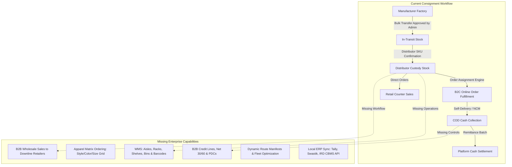
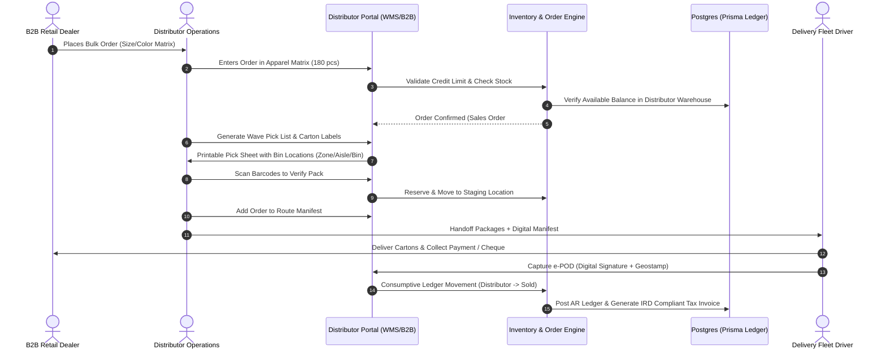
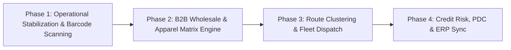

# Comprehensive Project Analysis from the Perspective of an Apparel Distributor
**Document Ref:** `docs/distributor-perspective-analysis-and-roadmap.md`  
**Target Platform:** Clothes-Store-ECommerce Multi-Tier Distribution & Retail Platform  
**Evaluation Scope:** Codebase Audit, Operational Integrity, Gap Analysis, Feature Specifications, and Global Platform Benchmarks  
**Status:** Architecture & Business Strategic Report (No Code Changes Applied)

---

## 1. Executive Summary & Strategic Distributor Perspective

### 1.1 The Distributor's Reality vs. Current System Assumption
In modern apparel supply chains, a **distributor** is an independent, capital-investing commercial entity that bridges bulk manufacturing factories and regional retail ecosystems. Distributors generate profit through high-velocity inventory turnover, multi-channel wholesale order processing, regional logistics optimization, and risk management across credit, cash, and seasonal dead-stock.

In the current implementation of `Clothes-Store-ECommerce`, the distributor is modeled primarily as a **captive, consignment-based regional fulfillment depot and last-mile parcel dispatch agent**:
1. **Title & Ownership:** The platform retains 100% legal and balance-sheet ownership of all inventory (`platform-owned outlet stock in distributor custody`). The distributor is treated strictly as a bailee/custodian.
2. **Revenue Model:** The distributor earns small, fixed service fees, delivery allowances, or commissions per unit delivered or per direct counter sale.
3. **Fulfillment Focus:** The distributor operates largely as a localized parcel fulfillment center for assigned B2C online customer orders (via Nepal Can Move [NCM] courier or self-delivery bike/van).
4. **Counter Sales:** Direct orders are limited to single-customer retail counter checkouts rather than bulk commercial wholesale trade.

While this consignment model solves inventory visibility for the central platform, it **severely constrains the distributor's commercial viability, warehouse throughput, and growth**. A genuine apparel distributor in regional markets (such as Nepal, India, or Southeast Asia) manages a network of dozens or hundreds of downline retail outlets, boutique stores, franchisees, and institutional buyers (schools, corporations). They require **wholesale buy-sell workflows, volume price tiering, apparel-specific matrix order entry (size/color grids), pre-pack carton handling, warehouse bin management, barcode scanning, route planning, B2B credit management, and localized ERP/tax synchronization**.

---

## 2. Integrity & Deep Codebase Architecture Audit

A thorough examination of `backend/prisma/schema.prisma`, `backend/controllers/`, `backend/services/`, and frontend portals reveals key structural insights and architectural boundaries:



### 2.1 Concurrency, Inventory Ledger, and Invariant Integrity
1. **Transactional Safety in Inventory Movements:**
   - The platform uses `applyInventoryMovement` within Prisma transactions (`Serializable` isolation level in `distributorInventoryController.js` and `stockTransferController.js`).
   - *Strengths:* Stock adjustments create immutable `InventoryLedgerEntry` records alongside optimistic balance decrements, guaranteeing an audit trail for stock losses and damages.
   - *Vulnerabilities:* Under high-concurrency order assignments (e.g., promotional flash sales or high-volume counter sales), serializable transactions on PostgreSQL can trigger `40001` serialization failures (deadlocks or read-write dependency cycles). The application lacks an automated retry mechanism with exponential backoff for transactional retries.
2. **Dual-Model Inventory Divergence Risk:**
   - The codebase is transitioning from legacy JSON-based variant stock (`ManufacturerInventory.variantsStock`) to canonical normalized SKUs (`InventorySku`, `InventoryLocation`, `InventoryBalance`).
   - *Integrity Issue:* Both schemas exist concurrently. Certain order paths still execute synchronization routines (`syncProductStock`). If a distributor performs an inventory decrease via `decreaseDistributorInventory`, it writes to canonical balances and attempts to trigger legacy sync. A failure in legacy sync or a desynchronized transaction can lead to discrepancy between storefront availability and warehouse balances.

### 2.2 Financial Subledger and Cash Float Risk
1. **COD Remittance & Floating Liability:**
   - The distributor collects cash-on-delivery (COD) from customers for self-deliveries.
   - In `distributorCashSettlementService.js` and `DistributorCashEvent`, cash collected is immediately posted as a platform receivable against the distributor (`sourceType: "DISTRIBUTOR_COD_SALE"`).
   - *Integrity Issue:* If a delivery rider collects cash, gets robbed, receives counterfeit currency, or disputes an order return, the distributor carries full balance-sheet liability to the platform before reconciliation. There is no intermediate "Rider Float / Transit Cash" staging entity between the individual delivery rider and the distributor hub.
2. **Settlement Token Concurrency:**
   - `ensureNoActiveUnifiedSettlementRequest` blocks creating new earnings settlement requests while one is active (`REQUESTED`, `EVIDENCE_SUBMITTED`, `PAYMENT_SENT`).
   - While preventing double payouts, this serial lock blocks the distributor from submitting legitimate weekly delivery service invoices if an older settlement has administrative review delays.

### 2.3 Identity, RBAC, and Context Isolation
1. **Dual-Role Contamination Risk:**
   - Many manufacturers also operate as distributors. In `unifiedAuth.js`, tokens carry active workspace context (`setDistributorContext`, `req.distributorId`).
   - *Integrity Issue:* If an operator switches workspaces in the frontend while having multiple tabs open, or if a request omits `req.distributorId`, fallback resolution logic in older controllers (`req.auth?.distributorId`) could resolve stale or conflicting workspace permissions. Strict header/token context validation is required across all routes.

---

## 3. Systematic Weaknesses from a Distributor's Perspective

| Area | Current System Implementation | Operational & Financial Weakness for Distributor |
| :--- | :--- | :--- |
| **Commercial Model** | 100% consignment & platform-owned inventory. | Distributor cannot purchase stock outright (Buy-Sell Wholesale) to capture higher margins, offer local wholesale discounts, or collateralize stock for bank credit. |
| **Customer Hierarchy** | System only recognizes individual B2C `User` / `Customer`. | Distributor cannot register downline retail shops, boutiques, corporate clients, or sub-dealers with B2B tax identifiers (PAN/VAT) and negotiated credit terms. |
| **Order Entry** | Single-line SKU dropdowns in web forms. | Placing an order for apparel (e.g., 50 shirts across 5 sizes and 3 colors) requires 15 manual line additions instead of a fast, standard apparel Matrix Grid. |
| **Warehouse Operations** | Flat location (`InventoryLocation` per hub). No bin, shelf, rack, or aisle tracking. | Warehouse pickers have no bin-location guidance. In a warehouse with 5,000 apparel SKUs, finding a specific Size M Navy Blazer causes extreme labor inefficiency and mispicks. |
| **Barcode / Scanner Support** | 100% manual UI click-based receiving, picking, and dispatching. | Zero native camera/scanner barcode input (EAN-13, UPC, Code 128). Transfer receiving requires clicking buttons on a screen, causing high human error in size/color verification. |
| **Logistics & Dispatch** | Individual order dispatch; one courier API (NCM). | No multi-order route sequencing, vehicle load optimization, driver dispatch manifests, or alternative carrier integrations (e.g., Pathao, local van fleets). |
| **Proof of Delivery (e-POD)** | Delivery OTP sent to customer phone. | High failure rate when customer phone is unreachable, battery dead, or when a family member receives the package. No fallback signature capture or photo-at-door proof. |
| **Stock Transfer Constraints** | Requires multi-tier admin pre-approval and rigid factory allocation. | No Inter-Distributor Stock Rebalancing (peer-to-peer transfers between adjacent regional hubs). Urgent stock-outs cannot be satisfied by a nearby distributor. |
| **Tax & Fiscal Compliance** | Manual physical Paper Bill allocation and acceptance. | High administrative friction and risk of tax fines under Nepal Inland Revenue Department (IRD) regulations. No direct integration with IRD Central Billing Monitoring System (CBMS) or VCTS (Vehicle Consignment Tracking). |
| **Accounting Interoperability** | Proprietary web-based financial statement. | No automated export or API synchronization with standard regional SME accounting software (Tally Prime, Swastik, Busy, QuickBooks). Requires duplicate manual data entry. |

---

## 4. New Features Expected by an Apparel Distributor

### 4.1 B2B Wholesale Portal & Sub-Dealer Ordering Engine
*Global Benchmark:* **Shopify Plus B2B**, **NuORDER by Lightspeed**, **JOOR**

Distributors primarily sell in bulk to local retail merchants, clothing stores, and sub-dealers.
1. **Company & Dealer Hierarchy:**
   - Ability for distributors to create and manage **Downline B2B Accounts** (Business Name, PAN/VAT Number, Trade License, Multiple Delivery Addresses, Assigned Sales Rep).
2. **Tiered B2B Price Lists:**
   - Multi-tier pricing engine:
     - *Wholesale Tier 1 (Key Accounts / Sub-Distributors):* Deep bulk discount.
     - *Wholesale Tier 2 (Independent Retailers):* Standard wholesale rate.
     - *Contract / Corporate:* Negotiated fixed rates.
3. **Apparel Matrix Ordering (Grid Interface):**
   - Garments are classified by Style -> Color -> Size. A matrix grid enables B2B buyers and distributor sales reps to enter quantities across a 2D table (Rows = Colors, Columns = Sizes: XS, S, M, L, XL, XXL) and add 100+ units in a single click.
4. **Pre-Packs & Master Carton Ordering:**
   - Apparel manufacturers package garments in standardized size curves (e.g., Ratio Pack A: 1xS, 2xM, 2xL, 1xXL = 6 units/box).
   - Ordering by pre-pack guarantees balanced inventory and avoids orphan/odd sizes.
5. **B2B Purchase Orders (PO) & Quotation Workflow:**
   - Draft Quote -> Sales Order Approval -> Pro-forma Invoice -> Pick/Pack -> Dispatch -> Tax Invoice.

```
       Apparel Matrix Order Entry Grid (Industry Standard)
========================================================================
Product: Men's Slim-Fit Oxford Shirt (Style #MSF-102)
------------------------------------------------------------------------
Color / Wash   |  S  |  M  |  L  | XL  | XXL | Total Pcs | Line Total
------------------------------------------------------------------------
Classic White  | 10  | 25  | 25  | 10  |  5  |    75     | NPR 97,500
Sky Blue       |  5  | 15  | 15  |  5  |  0  |    40     | NPR 52,000
Midnight Navy  | 10  | 20  | 20  | 10  |  5  |    65     | NPR 84,500
------------------------------------------------------------------------
Total Units: 180 pcs | Price Tier: Wholesale Tier 1 (NPR 1,300/unit)
Grand Total: NPR 234,000 [Add Matrix to Order]
========================================================================
```

### 4.2 Light Warehouse Management System (WMS) & Mobile Barcode Operations
*Global Benchmark:* **Cin7 Omni**, **NetSuite WMS**, **Manhattan Active**

Distributors manage thousands of cubic feet of physical storage.
1. **Multi-Level Storage Locations (Bin Management):**
   - Hierarchical storage structure: `Zone` -> `Aisle` -> `Rack` -> `Shelf` -> `Bin` (e.g., `Z1-A03-R02-S1-B04`).
   - System recommends optimal put-away bins based on product category, turnover velocity (fast-moving vs. slow-moving), and available volume.
2. **Barcode / QR Code Generation & Scanning:**
   - GS1-compliant or internal EAN-13/Code 128 barcodes printed for every SKU and master carton.
   - Mobile camera scanning or hardware Bluetooth/USB barcode scanner support for:
     - Inbound transfer receiving verification.
     - Outbound order pick & pack validation.
     - Periodic cycle counts (blind stock audits).
3. **Pick Lists & Packing Slips:**
   - Generation of wave picking sheets (grouping items across 20 orders located in the same warehouse aisle) and printable packing slips with customer details and itemized SKUs.

### 4.3 Intelligent Stock Replenishment & Demand Forecasting
*Global Benchmark:* **Blue Yonder**, **TradeGecko (QuickBooks Commerce)**

Distributors cannot afford to tie up working capital in slow-moving items or lose sales to stock-outs.
1. **Automated Reorder Point (ROP) & Safety Stock:**
   - Formula: $\text{ROP} = (\text{Average Daily Velocity} \times \text{Lead Time in Days}) + \text{Safety Stock}$
   - Automated alerts when distributor stock crosses below minimum thresholds.
2. **One-Click Replenishment Requisitions:**
   - System auto-populates a bulk stock transfer request to the primary manufacturer based on 30-day sales velocity and pending B2B backorders.
3. **Seasonal Indent / Pre-Booking:**
   - Apparel is strictly seasonal (Summer, Festive/Dashain, Winter). Distributors require a seasonal ordering module where they can commit to pre-orders 60–90 days ahead of production runs.
4. **Inter-Distributor Stock Rebalancing (Peer-to-Peer):**
   - Decentralized inventory transfer: Distributor A (Kathmandu) transfers 50 surplus jackets to Distributor B (Pokhara) upon mutual consent and administrative routing, with automated freight cost and custody transfer.

### 4.4 Advanced Delivery Route Optimization & Fleet Management
*Global Benchmark:* **Onfleet**, **Routific**, **Lalamove for Business**

Distributors conducting self-delivery currently dispatch orders individually without spatial awareness.
1. **Route Clustering & Drop Sequencing:**
   - Grouping assigned deliveries by geographic clusters, postal codes, or municipal wards.
   - Automatic sequencing of delivery stops to minimize travel time and fuel consumption.
2. **Delivery Driver Run Manifests:**
   - Generation of printed or digital driver manifests detailing package IDs, cash to collect (COD), customer phone numbers, and special delivery instructions.
3. **Flexible Electronic Proof of Delivery (e-POD):**
   - Three-way verification:
     - Primary: Customer OTP.
     - Fallback A: On-screen digital signature capture on driver's mobile browser.
     - Fallback B: Doorstep / parcel photo upload with automatic GPS geostamping.

### 4.5 B2B Credit Risk, PDC & Receivables Aging Management
*Global Benchmark:* **SAP S/4HANA Finance**, **Oracle NetSuite AR**

Apparel wholesale in South Asia relies heavily on trade credit and post-dated cheques.
1. **Credit Limits & Payment Terms:**
   - Configurable credit limits per retail dealer (e.g., NPR 500,000 maximum outstanding balance).
   - Terms: Net 15, Net 30, Net 60, or Cash on Delivery.
   - Automated order block / credit hold if a dealer has past-due invoices exceeding grace periods.
2. **Post-Dated Cheque (PDC) Vault:**
   - Tracking physical cheques received from retailers: Bank Name, Cheque Number, Amount, Maturity Date, Clearing Status (`IN_VAULT`, `DEPOSITED`, `CLEARED`, `BOUNCED`).
3. **Accounts Receivable (AR) Aging Schedule:**
   - Visual aging buckets: Current, 1–30 Days, 31–60 Days, 61–90 Days, 90+ Days past due, with automated WhatsApp/SMS payment reminders.

### 4.6 External Accounting & Fiscal ERP Sync
*Global Benchmark:* **Tally Connector**, **SAP Business One Integration**

1. **ERP Ledger Export:**
   - One-click export of sales invoices, cash receipts, and inventory journals into XML/Excel formats mapped to **Tally Prime**, **Swastik ERP**, and **Busy Accounting**.
2. **Nepal Tax Compliance (IRD CBMS & VCTS):**
   - Real-time API integration with the Inland Revenue Department (IRD) Central Billing Monitoring System (CBMS) for electronic tax billing.
   - Generation of Vehicle and Consignment Tracking System (VCTS) entry forms for highway bulk stock movements between cities.
3. **TDS Withholding Management:**
   - Automatic deduction and reporting of Tax Deducted at Source (TDS 15% on service earnings / commissions under Income Tax Act 2058).
   - Self-service download of quarterly TDS tax deposit vouchers.

---

## 5. Updates Required for Already Existing Features

### 5.1 Stock Transfers & Inbound Receiving (`stockTransferController.js`)
- **Current Limitation:** Flat SKU selection, manual line-by-line entry, no size curves, single-step confirmation without barcode verification.
- **Required Updates:**
  1. *Transfer Grid Interface:* Replace single-item selector with an apparel matrix (Color x Size).
  2. *Barcode Verification Mode:* During receipt, the distributor scans carton/garment barcodes. The UI auto-increments `goodQuantity` on match.
  3. *Tolerable Defect Threshold:* Minor stitching/packaging discrepancies below a set threshold (e.g., 1%) should be fast-tracked to clearance rather than locking the entire shipment in administrative dispute.
  4. *Inter-Distributor Transfers:* Add destination distributor selection in addition to manufacturer dispatch.

### 5.2 Direct Orders / Counter Sales (`distributorDirectOrderController.js`)
- **Current Limitation:** Minimal counter checkout for single items, manual customer entry, single payment mode.
- **Required Updates:**
  1. *POS Fast-Billing Interface:* Keyboard-driven or barcode-scanner driven search with instantaneous stock lookup.
  2. *B2B vs. B2C Toggle:* Switch between walk-in retail customer (standard retail price, simplified VAT receipt) and registered wholesale dealer (applies dealer tier price, credit validation, tax PAN invoice).
  3. *Split Payment Modes:* Support multi-tender checkout (e.g., 50% Cash, 30% Fonepay/QR, 20% on Store Credit).
  4. *Thermal Receipt Generation:* 80mm / 58mm ESC/POS thermal printer layout with QR code and return policy.

### 5.3 Order Assignment & Delivery Workflow (`distributorDeliveryController.js`)
- **Current Limitation:** Single-order management, hardcoded reliance on NCM courier or single-bike self-delivery, rigid OTP requirement.
- **Required Updates:**
  1. *Batch Order Processing:* Select 20 assigned orders at once -> print batch shipping labels -> dispatch to driver manifest in one click.
  2. *Driver Profile & Rider Management:* Assign deliveries to specific in-house riders with trackable rider cash balances.
  3. *Fallback e-POD:* When OTP is unavailable, allow driver to submit a photo of the package delivered at the customer doorstep with device geolocation coordinates.
  4. *Multi-Carrier Courier Hub:* Integrate plug-and-play local courier APIs alongside NCM (e.g., Pathao Cargo, Nepal Post, Delhivery).

### 5.4 Paper Bill Allocations (`paperBillController.js`)
- **Current Limitation:** Manual allocation of paper bill books, basic serial acceptance, disconnected from sales transactions.
- **Required Updates:**
  1. *Sequential Serial Validation:* Enforce strict sequential issuance. Disallow skipping invoice numbers.
  2. *Spoiled / Voided Bill Workflow:* Formal declaration of damaged or canceled paper bills with mandatory photo evidence and audit logging.
  3. *E-Billing Upgrade Path:* Provide direct digital tax invoice generation approved by the tax authority, reducing dependency on manual paper bill pads.

### 5.5 Distributor Financial Statements & Settlements (`distributorFinanceController.js`)
- **Current Limitation:** Blended cash statement, rigid single settlement token, no clear subledger breakdown between consignment fees and wholesale trading.
- **Required Updates:**
  1. *Dual Ledger Separation:* Clean separation between **Consignment Operations** (Platform Stock, Delivery Fees, COD Cash Remittances) and **Wholesale Operations** (Distributor-Owned Stock, Wholesale Revenue, Dealer AR).
  2. *Itemized Commission Breakdown:* Transparent commission ledger displaying the exact formula snapshot (Base Delivery Fee + % Net Order Value + Performance Bonus - Returns Deduction) per order line.
  3. *Multi-Token Pipeline:* Allow overlapping settlement cycles (e.g., processing this week's delivery service claim while last week's bank payout is clearing).
  4. *Withholding Tax (TDS) Certificate Generator:* Display gross earnings, 15% TDS deducted, net payable, and downloadable TDS deposit statement.

---

## 6. Global Platform Benchmarking & Architectural Reference Patterns

The table below contrasts `Clothes-Store-ECommerce` with world-class B2B commerce and distribution platforms:

| Capability | Current Project | Shopify Plus B2B | NetSuite Wholesale / WMS | NuORDER / JOOR (Fashion) | Proposed Target Architecture |
| :--- | :--- | :--- | :--- | :--- | :--- |
| **Wholesale Commerce** | None (Consignment & B2C counter only) | Dedicated B2B storefront & wholesale checkout | Full B2B Quotes, Sales Orders, Invoicing | Digital Wholesale Showrooms & Line Sheets | **Hybrid:** Consignment fulfillment + B2B Wholesale ordering portal |
| **Apparel Matrix Entry** | None (Single SKU dropdown) | App-based / Basic variants | Native Style-Color-Size Matrix Items | Best-in-Class visual 2D apparel matrix | **Native 2D Grid:** Fast multi-size/color bulk entry |
| **Pre-Packs & Ratios** | None (Unit-level only) | Basic bundles | Pre-pack assembly & ratio distribution | Standard fashion size curves (e.g., 1-2-2-1) | **Pre-Pack Master SKUs:** Automatic breakdown to variant balances |
| **Warehouse Tracking** | Flat location ID | Multi-location (flat per warehouse) | Hierarchical Bins: Zone, Aisle, Shelf, Bin | Warehouse integration via EDI/API | **Light WMS:** Zone-Aisle-Rack-Shelf-Bin hierarchy |
| **Scanning & Mobility** | None (Desktop web clicks) | Shopify POS / Hardware scanner | NetSuite WMS Mobile (Handheld terminals) | Barcode scanning on iPad app | **Responsive PWA Scanner:** Mobile camera & Bluetooth scanner support |
| **B2B Payment Terms** | Immediate cash/online only | Net 30, Net 60, Vaulted Cards | Credit limits, Aging, PDC, Dunning letters | Integrated wholesale payment terms | **Configurable Terms:** Net 15/30/60, Credit limits, PDC vault |
| **Route & Fleet Dispatch** | Single order NCM/Self-delivery | Third-party apps | Integrated 3PL & freight carrier modules | Courier logistics integrations | **Fleet Dispatch:** Route clustering, run manifests, fallback e-POD |
| **Tax & Fiscal Interop** | Physical paper bill pad allocation | Avalara / TaxJar integration | SuiteTax / Global Tax engines | Third-party ERP tax connectors | **Nepal IRD CBMS API + Tally Prime / Swastik XML Sync** |

---

## 7. Probable Engineering & System Solutions

### 7.1 Proposed Data Model Additions (Prisma Domain Extensions)

To transition the distributor capabilities to enterprise grade without breaking existing code, the following additive data models are proposed:

```prisma
// ============================================================
// B2B WHOLESALE & DEALER NETWORK EXTENSION
// ============================================================

model B2BDealerAccount {
  id                  String             @id @default(uuid())
  distributorId       String
  dealerName          String             @db.VarChar(191)
  panVatNumber        String?            @db.VarChar(32)
  contactPerson       String?            @db.VarChar(120)
  phone               String             @db.VarChar(40)
  email               String?            @db.VarChar(191)
  billingAddress      String             @db.Text
  shippingAddress     String?            @db.Text
  priceTier           String             @default("TIER_1") // TIER_1 | TIER_2 | TIER_3 | CONTRACT
  creditLimit         Decimal            @default(0) @db.Decimal(20, 2)
  creditTermsDays     Int                @default(0) // 0 = COD, 15 = Net 15, 30 = Net 30
  currentOutstanding  Decimal            @default(0) @db.Decimal(20, 2)
  status              String             @default("ACTIVE") // ACTIVE | SUSPENDED | CREDIT_LOCKED
  createdAt           DateTime           @default(now())
  updatedAt           DateTime           @updatedAt
  
  distributor         Distributor        @relation(fields: [distributorId], references: [id], onDelete: Cascade)
  orders              B2BWholesaleOrder[]
  cheques             PostDatedCheque[]

  @@index([distributorId, status])
  @@index([panVatNumber])
}

model B2BWholesaleOrder {
  id                  String             @id @default(uuid())
  orderNumber         String             @unique @db.VarChar(40)
  distributorId       String
  dealerId            String
  totalUnits          Int
  subtotalAmount      Decimal            @db.Decimal(20, 2)
  discountAmount      Decimal            @default(0) @db.Decimal(20, 2)
  taxableAmount       Decimal            @db.Decimal(20, 2)
  vatAmount           Decimal            @db.Decimal(20, 2)
  grandTotal          Decimal            @db.Decimal(20, 2)
  paymentTerms        String             @default("COD") // COD | NET_15 | NET_30 | PDC
  paymentStatus       String             @default("UNPAID") // UNPAID | PARTIAL | PAID
  orderStatus         String             @default("DRAFT") // DRAFT | CONFIRMED | PICKED | PACKED | DISPATCHED | DELIVERED | CANCELED
  dueAt               DateTime?
  createdAt           DateTime           @default(now())
  updatedAt           DateTime           @updatedAt

  distributor         Distributor        @relation(fields: [distributorId], references: [id], onDelete: Restrict)
  dealer              B2BDealerAccount   @relation(fields: [dealerId], references: [id], onDelete: Restrict)
  lines               B2BWholesaleOrderLine[]

  @@index([distributorId, orderStatus])
  @@index([dealerId, paymentStatus])
}

model B2BWholesaleOrderLine {
  id                  String             @id @default(uuid())
  orderId             String
  inventorySkuId      String
  quantityOrdered     Int
  quantityFulfilled   Int                @default(0)
  unitPrice           Decimal            @db.Decimal(20, 2)
  lineDiscount        Decimal            @default(0) @db.Decimal(20, 2)
  lineTotal           Decimal            @db.Decimal(20, 2)

  order               B2BWholesaleOrder  @relation(fields: [orderId], references: [id], onDelete: Cascade)
  inventorySku        InventorySku       @relation(fields: [inventorySkuId], references: [id], onDelete: Restrict)

  @@index([orderId])
  @@index([inventorySkuId])
}

// ============================================================
// WMS & BIN STORAGE EXTENSION
// ============================================================

model WarehouseBinLocation {
  id                  String             @id @default(uuid())
  inventoryLocationId String
  zoneCode            String             @db.VarChar(16)  // e.g. "Z1"
  aisleCode           String             @db.VarChar(16)  // e.g. "A03"
  rackCode            String             @db.VarChar(16)  // e.g. "R02"
  shelfCode           String             @db.VarChar(16)  // e.g. "S1"
  binCode             String             @db.VarChar(16)  // e.g. "B04"
  barcodeScanKey      String             @unique @db.VarChar(64) // e.g. "BIN-Z1-A03-R02-S1-B04"
  isActive            Boolean            @default(true)
  
  location            InventoryLocation  @relation(fields: [inventoryLocationId], references: [id], onDelete: Cascade)
  binBalances         WarehouseBinBalance[]

  @@unique([inventoryLocationId, zoneCode, aisleCode, rackCode, shelfCode, binCode])
  @@index([barcodeScanKey])
}

model WarehouseBinBalance {
  id                  String               @id @default(uuid())
  binId               String
  inventorySkuId      String
  quantityOnHand      Int                  @default(0)

  bin                 WarehouseBinLocation @relation(fields: [binId], references: [id], onDelete: Cascade)
  inventorySku        InventorySku         @relation(fields: [inventorySkuId], references: [id], onDelete: Restrict)

  @@unique([binId, inventorySkuId])
  @@index([inventorySkuId])
}

// ============================================================
// ROUTE PLANNING & DRIVER MANIFEST EXTENSION
// ============================================================

model DeliveryRouteManifest {
  id                  String             @id @default(uuid())
  manifestCode        String             @unique @db.VarChar(32)
  distributorId       String
  driverName          String             @db.VarChar(120)
  driverPhone         String             @db.VarChar(40)
  vehicleNumber       String?            @db.VarChar(32)
  plannedStopsCount   Int                @default(0)
  totalCodToCollect   Decimal            @default(0) @db.Decimal(20, 2)
  status              String             @default("PREPARING") // PREPARING | DISPATCHED | COMPLETED | RECONCILED
  dispatchedAt        DateTime?
  completedAt         DateTime?
  createdAt           DateTime           @default(now())

  distributor         Distributor        @relation(fields: [distributorId], references: [id], onDelete: Cascade)
  assignedStops       DeliveryManifestStop[]

  @@index([distributorId, status])
}

model DeliveryManifestStop {
  id                  String                @id @default(uuid())
  manifestId          String
  orderId             String
  stopSequence        Int                   // 1, 2, 3...
  codAmount           Decimal               @db.Decimal(20, 2)
  status              String                @default("PENDING") // PENDING | DELIVERED | FAILED | RESCHEDULED
  podMethod           String?               // OTP | SIGNATURE | PHOTO_GEO
  podSignatureUrl     String?               @db.Text
  podPhotoUrl         String?               @db.Text
  podCoordinates      String?               @db.VarChar(64)
  completedAt         DateTime?

  manifest            DeliveryRouteManifest @relation(fields: [manifestId], references: [id], onDelete: Cascade)
  order               Order                 @relation(fields: [orderId], references: [id], onDelete: Restrict)

  @@index([manifestId, stopSequence])
  @@index([orderId])
}

// ============================================================
// POST-DATED CHEQUE (PDC) VAULT
// ============================================================

model PostDatedCheque {
  id                  String             @id @default(uuid())
  distributorId       String
  dealerId            String
  bankName            String             @db.VarChar(120)
  chequeNumber        String             @db.VarChar(64)
  amount              Decimal            @db.Decimal(20, 2)
  chequeDate          DateTime
  status              String             @default("IN_VAULT") // IN_VAULT | DEPOSITED | CLEARED | BOUNCED | RETURNED
  clearedAt           DateTime?
  bouncedReason       String?            @db.Text
  createdAt           DateTime           @default(now())

  distributor         Distributor        @relation(fields: [distributorId], references: [id], onDelete: Cascade)
  dealer              B2BDealerAccount   @relation(fields: [dealerId], references: [id], onDelete: Restrict)

  @@index([distributorId, status, chequeDate])
}
```

### 7.2 Wholesale & Logistics Operational Sequence



---

## 8. Strategic Implementation Roadmap

To transform the platform into a high-capacity distributor operating system without disrupting current B2C operations, execution should proceed in four modular phases:



### Phase 1: Operational Stabilization & Barcode Mobility (Weeks 1–3)
- **Goal:** Eliminate manual error in existing stock transfers and outlet receiving.
- **Actions:**
  1. Add camera and scanner barcode lookup to the Distributor Inventory and Transfer Receipt interfaces.
  2. Implement responsive PWA scanning mode for mobile smartphones and Android barcode terminals.
  3. Introduce multi-tier fallback for e-POD (Digital Signature + Geotagged Photo) when SMS OTP fails.
  4. Build automatic retry handlers for PostgreSQL `Serializable` transaction rollbacks (`40001`).

### Phase 2: B2B Wholesale & Apparel Matrix Engine (Weeks 4–7)
- **Goal:** Enable the distributor to conduct commercial wholesale operations with downline retailers.
- **Actions:**
  1. Deploy `B2BDealerAccount`, `B2BWholesaleOrder`, and `B2BWholesaleOrderLine` models additively.
  2. Implement the 2D Apparel Matrix Grid ordering interface (Color x Size) in the Distributor Portal.
  3. Support pre-pack carton bundles and automatic stock reservation.
  4. Create B2B Pro-forma and Tax Invoice generators with wholesale pricing tiers.

### Phase 3: Warehouse Bin Management & Route Optimization (Weeks 8–11)
- **Goal:** Transform the physical warehouse and optimize last-mile fleet operations.
- **Actions:**
  1. Deploy `WarehouseBinLocation` and `WarehouseBinBalance` models.
  2. Build bin put-away guidance and wave picking list generation for warehouse staff.
  3. Develop Route Clustering and Driver Manifest generation for multi-drop dispatch.
  4. Enable Inter-Distributor Stock Transfers for regional inventory rebalancing.

### Phase 4: Credit Risk, Financial Interoperability & Tax Compliance (Weeks 12–15)
- **Goal:** Protect distributor working capital and achieve full fiscal compliance.
- **Actions:**
  1. Deploy Post-Dated Cheque (PDC) vault and Accounts Receivable (AR) aging schedules.
  2. Build one-click XML/Excel export connectors for Tally Prime and Swastik ERP.
  3. Integrate Nepal Inland Revenue Department (IRD) CBMS electronic billing API.
  4. Automate TDS withholding tax certificate generation and VAT Annex 13 reporting.

---

## 9. Conclusion
By expanding beyond a pure consignment B2C delivery model to incorporate **B2B wholesale trading, apparel matrix entry, barcode-driven warehouse operations, fleet dispatch, and automated tax/credit compliance**, the platform can empower distributors as profitable regional hubs. This evolution aligns the software with leading global benchmarks (Shopify Plus B2B, NetSuite WMS, and NuORDER) while preserving the platform's rigorous transactional and accounting integrity.
