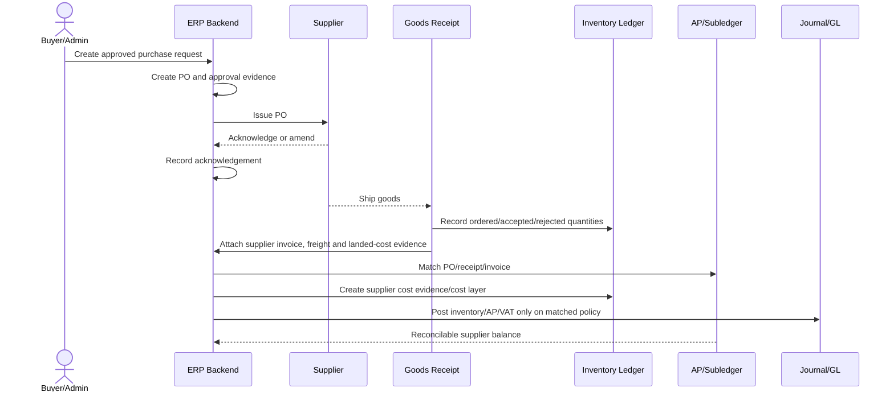
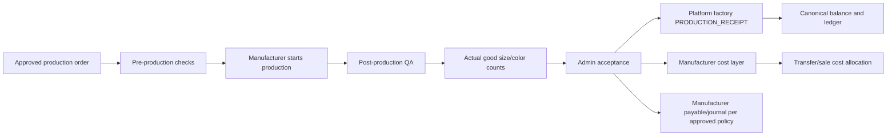
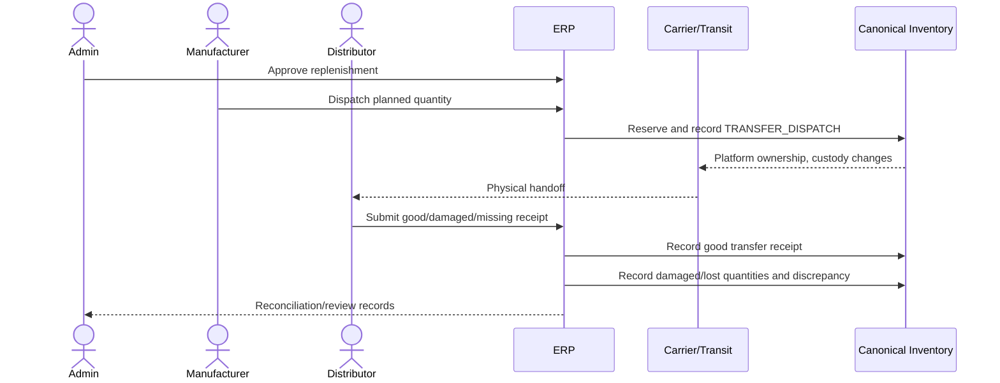
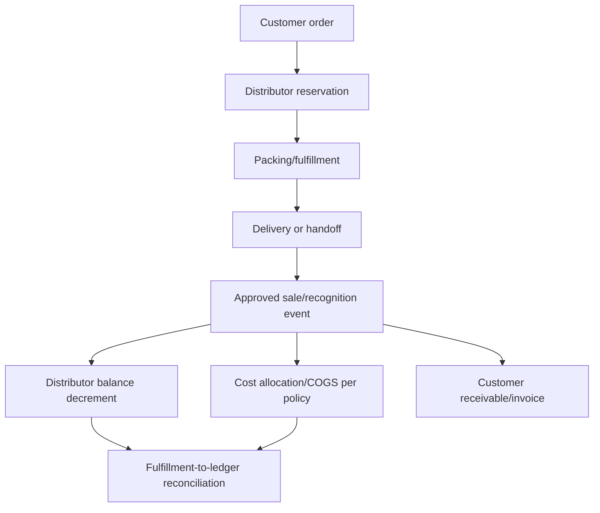
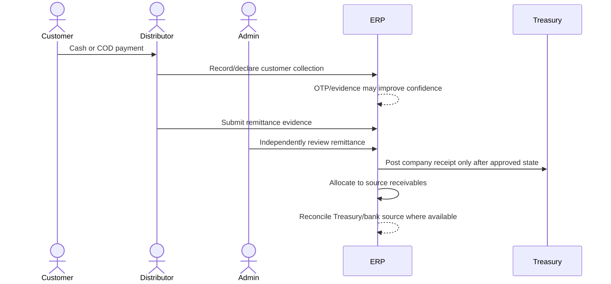
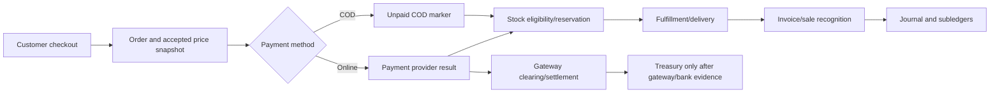
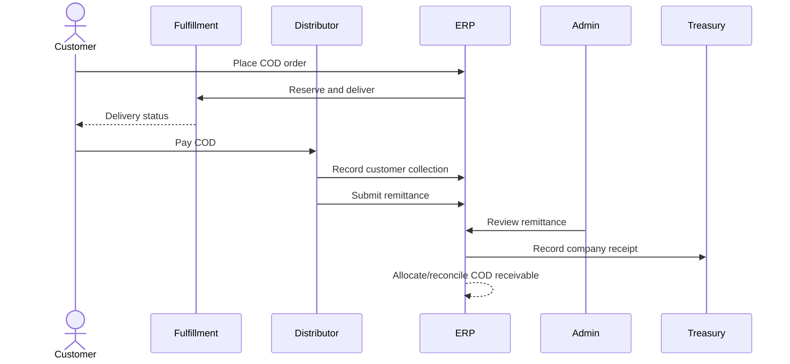
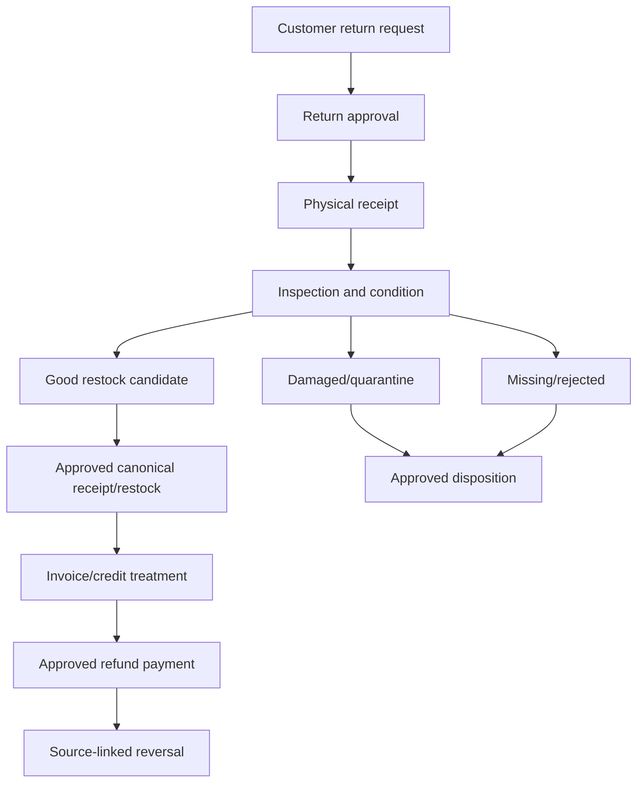
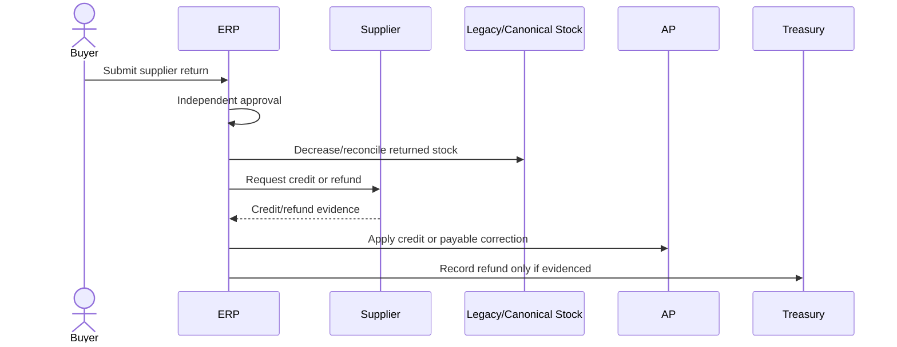
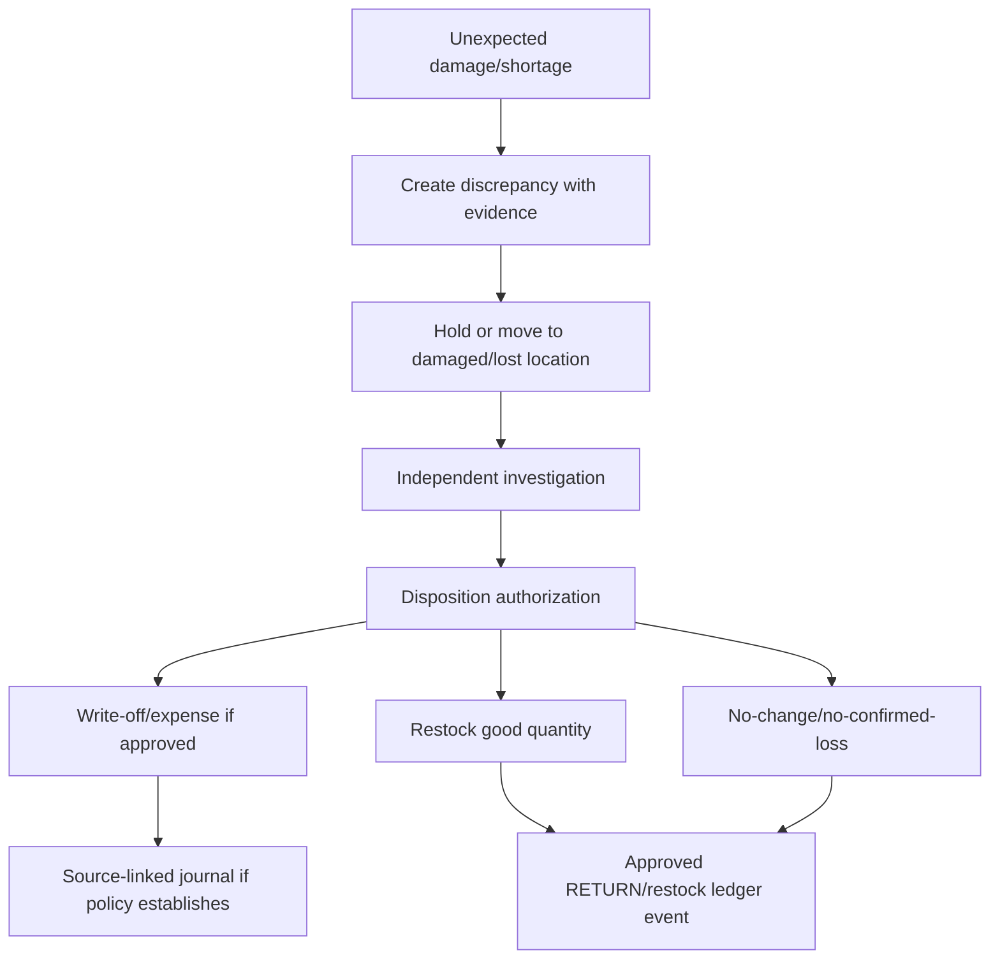

# P6-R1 - Integrated Multi-Party ERP Architecture and Implementation Blueprint

**Status:** IN PROGRESS - ARCHITECTURE AND PLANNING
**Review scope:** Static, repository-grounded architecture analysis
**Evidence boundary:** This iteration defines the target architecture and implementation sequence. It does not implement production functionality, change Prisma, run migrations or seeds, connect to a database, access external systems, or claim persisted or physical validation.

## 1. Evidence and status vocabulary

- `VERIFIED_IN_CODE`: a mounted route, caller, controller/service, or Prisma model path is present in current source.
- `PARTIAL`: an end-to-end path exists but evidence, source coverage, reversal, accounting, or deployment validation is incomplete.
- `MISSING`: no mounted end-to-end implementation was found.
- `LEGACY_OR_UNMOUNTED`: code or a schema model exists, but no current mounted/canonical route establishes the workflow.
- `NOT_VERIFIABLE_WITHOUT_DATABASE`: persisted migration state, transactions, concurrency, balances, or production history cannot be established statically.
- `PROPOSED`: a future architecture or role/control, not an existing capability.

Static inspection confirms the following implementation anchors:

- Express mounting and middleware: `backend/server.js`, `backend/middleware/unifiedAuth.js`, `backend/middleware/authorize.js`
- Canonical data model: `backend/prisma/schema.prisma`
- Customer, order, delivery: `backend/routes/orderRoute.js`, `backend/routes/deliveryRoute.js`, `backend/controllers/orderController.js`, `backend/services/orderService.js`
- Distributor: `backend/routes/distributorRoute.js`, `backend/routes/adminDistributorDetailRoute.js`, `backend/services/distributorOrderInventoryService.js`
- Production: `backend/routes/manufacturerProductionRoute.js`, `backend/services/manufacturerProductionWorkflowService.js`
- Transfer: `backend/routes/stockTransferRoute.js`, `backend/services/stockTransferService.js`
- Canonical inventory: `backend/services/inventoryLedgerService.js`, `InventorySku`, `InventoryLocation`, `InventoryBalance`, `InventoryLedgerEntry`
- Accounting: `backend/routes/accountingRoute.js`, `backend/routes/financialRoute.js`, `backend/services/accountingPostingEngine.js`
- Reconciliation: P5-R16 through P5-R19 calculator, formatter, bounded data loader and Admin reader API

No route or UI presence was treated as proof of deployment or persistence.

## 2. Current integrated system shape

The repository is a set of five application surfaces:

```text
Customer storefront (frontend/)
  -> customer identity, catalog, cart, order, delivery and return callers

Admin portal (admin/)
  -> catalog, order, manufacturing, transfer, Treasury, AP/AR, GL and reconciliation

Manufacturer portal (manufacturer/)
  -> production, factory inventory projection and stock transfer workspace

Distributor portal (manufacturer/ but distributor workspace context)
  -> replenishment, receipt, inventory, fulfillment, collection and remittance

Marketing partner portal (marketing/)
  -> campaigns, cards and partner reporting

All portal surfaces
  -> Express API
  -> Domain services
  -> Prisma and MySQL
  -> Accounting, audit, outbox and external-boundary integrations
```

The backend is not a single transaction ledger for all domains. It contains canonical inventory models, legacy stock representations, source-linked accounting documents, legacy AP/AR rows, outbox patterns and several route-specific implementations. P6 must connect these sources through explicit domain events without silently replacing or merging incompatible records.

## 3. Domain architecture

### A. Commerce and customer management

**Responsibility**

- Identity, customer profile and consent.
- Catalog, variants, pricing and location discounts.
- Cart, checkout and order capture.
- Invoice, receipt, payment, COD and delivery status.
- Customer returns, exchanges and refunds.

**Authoritative records**

- Identity: `AuthAccount`, `User`, role mappings and `CustomerTermsAcceptance`.
- Catalog and commercial snapshot: `Product`, `InventorySku`, order records and accepted order-item JSON.
- Order lifecycle: `Order`, `OrderAssignment`, `DeliveryOrder`, delivery events and return/exchange records.
- Internal sales evidence: `SalesInvoice`, `AccountingDocument`, `AccountingAllocation`, `AccountingEvent` and delivery/accounting outbox.
- Treasury receipt: `CashTransaction`, `FinancialAccount`, `AccountingAllocation` and posted journals.

**Lifecycle**

Customer account -> catalog selection -> cart -> order -> reservation/assignment -> fulfillment/delivery -> invoice/sale recognition -> collection/remittance -> Treasury receipt -> return/reversal as independently evidenced.

**Verified in code**

- `/api/order/place`, user order reads and Admin order routes.
- Product and location pricing.
- Cart, direct and assigned order flows.
- NCM and distributor self-delivery.
- Delivered-sale accounting outbox for supported delivery flows.
- Customer return and exchange routes.

**Partial or missing controls**

- Checkout may reserve canonical distributor stock only after the operational order path.
- Online payment and COD are distinct.
- Order placement is not revenue recognition or proof of collection.
- Delivery completion is not proof of company Treasury receipt.
- Some legacy order, direct-order and return paths modify catalog stock instead of canonical SKU/location stock.
- Customer-initiated generic receipt capture is not a complete lifecycle.

**Accounting integration**

- Revenue recognition at approved delivery/sale policy.
- COGS only from authoritative layer, verified snapshot or explicitly unresolved evidence.
- Customer receivable for supported delivered sales.
- COD collection by distributor and company Treasury receipt remain separate.
- Refund/reversal must preserve original invoice, allocation, journal and inventory references.

### B. Inventory and warehouse management

**Responsibility**

- Product SKU and location stock.
- Reservation, dispatch, transit, receipt and custody.
- Good, damaged, missing, quarantine and lost states.
- Stock adjustment, return and discrepancy authorization.
- Cost-layer linkage and reconciliation.

**Authoritative records for supported canonical flows**

- `InventorySku`
- `InventoryLocation`
- `InventoryBalance`
- `InventoryLedgerEntry`
- `ManufacturerInventoryCostLayer`
- `StockTransfer` and shipment/receipt/discrepancy records

**Legacy or parallel records**

- `Product.stockQuantity`
- `Product.variants`
- `StockLog`
- `ManufacturerInventory`
- `ManufacturerInventoryMovement`
- `ManufacturerInventoryCostAllocation`

**Transaction lifecycle**

Approved source quantity -> reservation -> shipment dispatch -> custody/transit -> receipt/checklist -> good/discrepant disposition -> stock sale/return/adjustment -> reconciliation.

**Verified in code**

- Canonical inventory balance and ledger movements for selected production, transfer, receipt and fulfillment paths.
- Platform ownership on canonical inventory.
- Distributor replenishment with dispatch and separate receipt.
- Evidence-backed distributor damage/loss discrepancies.
- Distributor stock-return collection and quarantine workflow.

**Missing or partial**

- No general central-warehouse operator domain or central-warehouse transfer route.
- No complete purchase-GRN-to-accepted-stock-cost-layer chain.
- No uniform stock movement writer for every legacy projection.
- Canonical and legacy stock can diverge.
- Discrepancy, inspection and physical count do not by themselves prove disposition or write-off.
- No approved universal costing method or complete cost lineage.

**Cross-domain invariant**

The distributor is a custodian. Aama Clothings retains inventory ownership after transfer. Dispatch and receipt are custody events; neither is a sale or distributor purchase.

### C. Procurement and suppliers

**Responsibility**

- Supplier identity and commercial terms.
- Purchase request and approval.
- Purchase order, acknowledgement and amendments.
- Goods receipt and condition acceptance.
- Supplier invoice and 3-way match.
- Supplier payable, credit, refund and statement reconciliation.
- Acquisition cost, freight and landed cost.

**Current records**

- Local supplier identity: `AccountingParty(partyType: VENDOR)`
- Expense/vendor bill: `OperatingExpense`, `AccountPayable`, `AccountingDocument`
- Legacy acquisition snapshot: `InboundShipment`
- Supplier return: `SupplierReturn`
- Supplier credit: `SupplierReturnCreditApplication`, `SupplierCreditApplication`
- Payout: `FinancialPayout`, `CashTransaction`, `AccountingAllocation`

**Lifecycle**

Supplier selection -> purchase authorization -> PO -> acknowledgement -> goods receipt -> acceptance/rejection -> invoice -> PO/receipt/invoice match -> AP -> supplier settlement -> supplier statement reconciliation.

**Status**

`MISSING` for purchase request, PO, supplier acknowledgement and active accepted-GRN models/routes. `PARTIAL` for expense/vendor bills and AP payout. `LEGACY_OR_UNMOUNTED` for `InboundShipment` and its posting helper.

**Required evidence**

- Supplier legal/business identity and approved bank details.
- Commercial approval and PO version.
- Ordered and acknowledged quantities.
- Accepted, rejected, damaged and missing quantities.
- Receipt location and actor.
- Supplier invoice, VAT evidence and approval, where applicable.
- Landed-cost and freight allocations.
- Link to canonical SKU/location and cost layer.
- Supplier statement and actual bank settlement, where relevant.

**Accounting integration**

Inventory, AP and acquisition cost must remain separate until their evidence chain is complete. An expense or operating bill is not proof of inventory receipt. A supplier invoice is not proof of acceptance or payment.

### D. Manufacturing

**Responsibility**

- Manufacturer profile and production capability.
- Production request, specification and target date.
- Pre-production checks and start approval.
- Raw-material consumption, if implemented.
- Production stages and post-production QA.
- Actual good size/color counts.
- Accepted production receipt and cost layer.
- Manufacturer payable and settlement.

**Authoritative or best-supported records**

- `ManufacturerProductionRequest`
- `ManufacturerProductionRequestLine`
- `ManufacturerInventoryCostLayer`
- `InventoryLocation`, `InventoryBalance`, `InventoryLedgerEntry`
- `ManufacturerSettlementRequest`
- Production and accounting journals

**Lifecycle**

Admin/approved production order -> pre-production checks -> manufacturer start -> production -> QA and actual counts -> Admin acceptance -> factory inventory/cost/ payable recognition -> distributor replenishment.

**Status**

`VERIFIED_IN_CODE` for the supported current production acceptance and factory receipt path, but the production title policy, persisted results and physical count remain open. The old target accounting document describes manufacturer consignment and a delivery-based recognition model that conflicts with current production-completion code. P6 must not reinterpret or reverse historical postings until management/accounting policy is ratified.

**Required accounting integration**

- Accepted good units create a production cost layer.
- Damaged output is separately accounted where policy permits.
- Inventory owner remains platform in canonical location ledgers.
- Manufacturer payable/production recognition follows the approved current policy.
- Transfer dispatch is not an additional manufacturer sale or payable recognition.

### E. Distributor management

**Responsibility**

- Profile, territory and coverage.
- Stock replenishment request and approval.
- Receipt and custody confirmation.
- Good/damaged/missing discrepancy evidence.
- Customer order fulfillment and direct orders.
- Customer collection and remittance.
- Distributor return/adjustment and settlement.

**Authoritative or best-supported records**

- `Distributor`, `DistributorLocation`
- `StockTransfer`, shipment, receipt and discrepancy
- `InventoryBalance`, `InventoryLedgerEntry`
- `OrderAssignment`
- `DistributorCashEvent`, remittance batch and settlement records
- `DistributorStockReturn`

**Lifecycle**

Admin approval/request -> dispatch -> carrier/manual custody -> receipt checklist -> good/discrepant stock -> customer reservation/fulfillment -> customer collection -> remittance evidence -> internal review -> company Treasury receipt -> reconciliation.

**Status**

`PARTIAL` for most end-to-end flows. Transfer replenishment, receipt and canonical fulfillment are implemented in source. Company ownership is confirmed. Customer cash and company receipt remain separate. Distributor remittance is not bank reconciliation.

**Future invariants**

- A distributor account does not acquire sellable inventory ownership.
- A distributor direct order and customer fulfillment consume canonical distributor stock.
- A distributor collection does not post company cash by itself.
- A remittance review is an internal control state until supported evidence and Treasury receipt are independently reconciled.
- No damage/loss adjustment creates distributor liability or receivable automatically.

### F. Finance and accounting

**Responsibility**

- Chart of accounts and fiscal periods.
- Revenue and customer receivables.
- Supplier payables and acquisition cost.
- Inventory, COGS and stock valuation.
- Treasury and payment clearing.
- Refunds and reversals.
- Journal, GL and management reporting.
- Maker-checker approval and period close.

**Authoritative internal bookkeeping sources**

- `JournalEntry`/`JournalLine`
- `AccountingDocument`/`AccountingAllocation`
- `AccountingParty`
- `CashTransaction`/`FinancialAccount`
- `AccountPayable`/`AccountReceivable`
- `SalesInvoice`
- `AccountingActionApproval`

**Lifecycle**

Source event -> evidence/approval -> domain state -> inventory and subledger effects -> accounting document or journal -> reconciliation -> report basis disclosure.

**Status**

`PARTIAL` across every broad domain. Journal posting exists, but complete source-population, Decimal migration, historical opening balances, bank/provider matching and full subledger-to-GL reconciliation are not complete.

## 4. Cross-domain source events

The target ERP should use typed, immutable source events with actor, timestamp, source ID, evidence and idempotency key. P6 is an architecture specification, not an authorization to add one universal mutation immediately.

Recommended event families:

```text
PURCHASE_REQUESTED
PURCHASE_APPROVED
PURCHASE_ORDER_ACKNOWLEDGED
GOODS_RECEIPT_ACCEPTED
SUPPLIER_INVOICE_RECEIVED
SUPPLIER_PAYABLE_RECOGNIZED
SUPPLIER_PAYMENT_CONFIRMED

PRODUCTION_ORDER_APPROVED
PRODUCTION_STARTED
PRODUCTION_COMPLETED
PRODUCTION_GOOD_RECEIVED
PRODUCTION_COST_LAYER_CREATED

TRANSFER_APPROVED
TRANSFER_DISPATCHED
TRANSFER_RECEIVED_GOOD
TRANSFER_RECEIVED_DAMAGE
TRANSFER_MISSING

ORDER_PLACED
ORDER_RESERVED
ORDER_DISPATCHED
ORDER_DELIVERED
ORDER_SALE_RECOGNIZED
ORDER_CANCELED

CUSTOMER_COLLECTED
TREASURY_RECEIVED
REMITTANCE_SUBMITTED
REMITTANCE_REVIEWED

RETURN_REQUESTED
RETURN_RECEIVED
RETURN_INSPECTED
RETURN_RESTOCKED
RETURN_REVERSED

INVENTORY_ADJUSTED
INVENTORY_REVALUED
INVENTORY_PHYSICALLY_COUNTED
```

An event must not be interpreted as a second event automatically. A stock dispatch event is not a sale. A customer cash event is not a company Treasury receipt. A delivery status is not a COD collection. A bank upload is not independent reconciliation.

## 5. End-to-end flow diagrams

### 5.1 Supplier purchase to accepted warehouse receipt and AP

**Current status:** MISSING end-to-end. The following is a P6 target blueprint.



Trigger: approved purchase request. Required evidence: PO, supplier acknowledgement, received quantities/condition, invoice, tax evidence and landed-cost policy. Inventory moves only when accepted. Approval: Admin/buyer and independent receipt approver for high-risk purchases. Correction: reversal preserves PO/receipt/invoice references. Reconciliation: PO-to-GRN, GRN-to-invoice, invoice-to-AP, AP-to-GL and physical count.

### 5.2 Manufacturer production to finished-goods receipt and valuation

**Current status:** PARTIAL to VERIFIED for the accepted production path; title and retained-policy conflict remain.



Trigger: accepted production order. Source: production request/line. Inventory: good units only enter factory canonical stock. Financial: accepted production recognition, cost layer and manufacturer payable per current policy. Evidence: material plan, pre/post QA, actual counts and acceptance. Approval: manufacturer and independent Admin acceptance where applicable. Correction: reverse or correct with original production and payable references. Reconciliation: request-to-good counts, cost layer-to-ledger, payable-to-GL and physical factory count.

### 5.3 Warehouse/production transfer to distributor custody

**Current status:** VERIFIED in code for supported factory-source stock; generic warehouse source is not established.



Trigger: approved replenishment. Source: `StockTransfer` and shipment. Inventory: source reserved, transit moved, receipt allocated. Financial: no sale/AP/AR/COGS at custody change; freight remains a separate settlement when applicable. Evidence: approval, dispatch, shipment, receipt checklist and discrepancies. Reversal/correction: preserve original movement and receipt idempotency. Reconciliation: transfer-to-shipment-to-receipt-to-ledger.

### 5.4 Distributor customer sale and inventory relief

**Current status:** PARTIAL/VERIFIED for selected canonical fulfillment paths.



Trigger: the approved delivery/sale recognition event. Source: order/delivery/assignment. Inventory: reserved units become fulfilled and sold, with original cost where available. Financial: revenue/receivable/COGS. Evidence: order, delivery, customer acceptance and cost lineage. Approval: operational and accounting policy. Correction: original sale reversal and return/credit restoration. Reconciliation: order-to-assignment-to-delivery-to-ledger-to-COGS-to-GL.

### 5.5 Distributor customer collection to remittance and Treasury receipt

**Current status:** PARTIAL.



Trigger: customer collection and later remittance submission. Source: `DistributorCashEvent`, remittance and settlement records. Inventory: no change. Financial: collection, remittance and Treasury receipt are separate accounting events. Evidence: OTP/customer evidence, remittance reference and review/approval. Correction: reversal only through a supported, source-linked Treasury/settlement path. Reconciliation: customer receipt-to-distributor declaration-to-remittance-to-Treasury/bank.

### 5.6 Online order to payment, fulfillment, invoice and revenue

**Current status:** PARTIAL.



Trigger: checkout and later payment/delivery outcomes. Source: order, gateway event, invoice and delivery. Inventory: reserve and later fulfill. Financial: receivable/revenue/COGS are policy-led; gateway and Treasury settlement are separate. Reconciliation: order-to-payment-to-delivery-to-invoice-to-GL and provider/bank.

### 5.7 COD order to delivery, collection, remittance and Treasury

**Current status:** PARTIAL.



Trigger: customer delivery and explicit collection evidence. Required evidence: delivery, collection declaration/OTP, remittance, review and Treasury/bank reference. Inventory: decreases at approved sale fulfillment. Financial: COD receivable, collection/remittance and company cash remain separate. Correction: return/refund/reversal references must survive.

### 5.8 Customer return to disposition, credit and refund

**Status:** PARTIAL and mixed with legacy stock writers.



Trigger: accepted RMA. Source: original order/delivery/invoice/item. Inventory: accepted good units only increase sellable stock after physical/inspection and approved cost restoration. Financial: credit/refund and reversals require the original source. Evidence: original sale, return, receipt, inspection and payment. Reconciliation: original order-to-return-to-inventory-to-credit-to-refund-to-GL.

### 5.9 Supplier return to acceptance, credit and refund

**Current status:** PARTIAL.



Trigger: approved supplier return linked to source purchase/stock evidence. Inventory: accepted return quantity must consume the original receipt/cost lineage. Financial: supplier credit/refund and AP correction are distinct. Evidence: original receipt/invoice, shipment/return and supplier acceptance. Reversal: supplier return journal and credit application must preserve original IDs. Reconciliation: supplier bill/receipt/return/credit/payment/AP/GL.

### 5.10 Inventory damage, shortage, investigation, authorization and correction

**Current status:** PARTIAL.



Trigger: discrepancy or physical count difference. Source: transfer/receipt, discrepancy and count evidence. Inventory: no automatic stock increase or loss journal. Financial: responsibility and valuation remain unresolved until approved. Evidence: custody, condition, actor, investigation and disposition. Reconciliation: source custody-to-discrepancy-to-ledger-to-physical count-to-approval-to-GL.

## 6. Cross-domain invariants

1. Every inventory movement has a source/destination or documented external source, actor, timestamp and idempotency reference.
2. Physical custody is distinct from legal/financial inventory ownership.
3. Reservation is distinct from on-hand quantity and is never an issue movement.
4. Dispatch is distinct from confirmed receipt.
5. Customer sale/fulfillment is distinct from replenishment transfer.
6. Distributor customer collection is distinct from company Treasury receipt.
7. Operational order state is distinct from invoice, receivable and payment state.
8. Supplier invoices are distinct from purchase orders and accepted goods receipts.
9. Cost reference/catalog data is distinct from an authoritative acquisition or production cost layer.
10. Returns link to original order/receipt/item wherever possible.
11. Financial reversals preserve original journal, document, movement and approval references.
12. Reconciliation reports are read-only and never mutate records.
13. Important actions carry authenticated actor, timestamp, authorization and evidence.
14. Aama Clothings owns distributor-held inventory; distributor custody and title do not change.
15. Stock quantity, stock reservation and physical count are separate dimensions.
16. Exact Prisma `Int` inventory quantities must not be converted to unsafe JavaScript Numbers.
17. Decimal financial values must remain decimal-safe; no silent float conversion or rounding fallback should be introduced.
18. No catalog stock projection can be used as proof of location ownership or cost-layer valuation.

### Existing violations and missing controls

- Canonical `InventoryBalance`/`InventoryLedgerEntry` coexist with `Product`, `StockLog`, `ManufacturerInventory` and movement projections.
- Selected direct-order, return, exchange and legacy adjustment paths change stock outside the canonical receipt/custody chain.
- No complete supplier PO/GRN/invoice/cost-layer lifecycle.
- Production completion uses a stronger recognition rule than older architecture text.
- Customer return restock and cost restoration are inconsistent by path.
- Supplier payout correction can leave a linked expense bill allocation inconsistent.
- Remittance and Treasury evidence are not independent bank-statement reconciliation.
- Full database, migration and physical-count validation is absent.
- The RBAC seed gives broad Admin permissions but some routes add only role or partial permission checks.
- Portal-only controls do not prove server authorization.

## 7. Portal responsibility and permission matrix

| Capability | Customer | Admin | Manufacturer | Distributor | Warehouse operator (PROPOSED) |
|---|---|---|---|---|---|
| Create catalog/product | No | Yes via product routes | No | No | No |
| Approve catalog/price | No | Yes | No | No | No |
| Create customer order | Yes | Yes via Admin-create routes | No normal commerce; unmounted direct route only | Yes direct/hub or assigned fulfillment | No |
| Approve customer order | No | Yes | No | Operational acceptance/packing only | No |
| Request replenishment | No | Review/approve | Receive/dispatch context | Yes | Proposed |
| Approve replenishment | No | Yes | No | No | Proposed/reviewer |
| Record production start/QA/completion | No | Acceptance/review | Yes for manufacturer workflow | No | No |
| Accept production receipt | No | Yes | Submit/prepare only | No | Proposed independent receiver |
| Dispatch stock | No | Monitor/resolve | Yes for stock transfer | No | Proposed |
| Receive stock | No | Monitor/disposition | No distributor receipt | Yes | Proposed |
| Record discrepancy | Customer/return evidence only | Review/resolve | In logistics context | Yes | Yes for proposed warehouse |
| Approve discrepancy/write-off | No | Yes, with policy | No | No | Proposed maker plus independent approver |
| Reserve stock | System | Operational override only | No | Fulfillment system context | Proposed |
| Fulfill customer order | No | Reassign/control | No normal storefront fulfillment | Yes | Proposed packing only |
| Confirm customer collection | No | Verify/remittance | No | Yes declaration/OTP context | No |
| Submit remittance | No | No | No | Yes | No |
| Approve remittance/Treasury receipt | No | Yes | No | No | No |
| Create supplier PO/receipt | No | Proposed/if procurement is enabled | Proposed supply context only | No | Proposed |
| Approve supplier PO | No | Yes through proposed maker/checker | No | No | Proposed independent approver |
| Receive supplier goods | No | Monitor | No | No | Yes proposed |
| Approve supplier invoice/AP | No | Yes maker/checker | No | No | Proposed matching/review |
| Request/confirm supplier payout | No | Maker/independent checker | No | No | No |
| Create return request | Yes customer RMA | Yes Admin operations | Limited return context | Yes operational | Yes proposed |
| Inspect/approve return | No | Yes | Limited | Limited distributor process | Proposed |
| View inventory operational report | Own orders only | Yes | Own production/manufacturer context | Own distributor context | Proposed assigned locations |
| View GL/AP/AR/financial report | Own billing/receipts only | Yes with permissions | Manufacturer finance context | Distributor finance context | No |

### Existing permission keys

Relevant current keys include:

- Customer: `customer:order_place`, `customer:order_read`, `customer:delivery_read`, `customer:cart_*`, `returns:customer_*`
- Admin orders: `order:list_all`, `order:list_admin`, `order:admin_create`, `order:control`
- Inventory: `inventory:ledger_read`, `inventory:admin_read_all`, `inventory:admin_low_stock`, `distributor:inventory_read`, `distributor:inventory_decrease`
- Transfers: `transfer:distributor_request/read/receive`, `transfer:manufacturer_read/dispatch`, `transfer:admin_read/review`
- Production: `manufacturer:production_manage`, `manufacturer:production_admin`, `manufacturer:admin_production_read`
- Delivery: `delivery:admin_*`, `delivery:reconcile`, `delivery:settlement_*`, `distributor:delivery_ready/return`
- Returns: `returns:*`, `exchange:*`, `distributor:delivery_return`
- Accounting: `accounting:ledger_read`, `accounting:journal_*`, `accounting:approval_*`, `accounting:period_close_*`
- Finance: `finance:treasury_*`, `finance:payable_*`, `finance:receivable_*`, `finance:statements_read`

The existing role-permission catalog gives the built-in Admin broad permission. That is a functional role mapping, not an audit of least privilege. P6-R4 onward should add narrowly scoped procurement/warehouse permissions instead of granting broad Admin access to every receipt and valuation mutation.

The following permissions or domain controls are absent or not fully proven:

- Dedicated purchase/request/PO approval keys.
- Dedicated goods-received acceptance/rejection keys.
- Warehouse location/warehouse operator context.
- Independent physical count approval key.
- Supplier invoice match/release key distinct from expense create.
- Discrepancy disposition/write-off key with independent approval.
- Canonical inventory revaluation key.
- A universal cross-domain source-event read key.

## 8. ERP data and transaction boundaries

### Target ownership and storage principles

- Keep operational, inventory, subledger and GL domains independently traceable.
- Store every source event by stable ID and idempotency key.
- Keep current quantity and movement history separate.
- Keep ownership and custody/location separate.
- Keep current cost and historical cost evidence separate.
- Keep distributor collection, remittance, Treasury and bank match separate.
- Keep supplier invoice, goods receipt and AP separate until matched.
- Keep user-entered evidence references from claims of independent verification.

### Transaction boundaries

1. Source event and audit event: domain service transaction or durable outbox.
2. Inventory movement and balance: one inventory-ledger transaction.
3. Cost allocation and inventory movement: same transaction where policy requires the link.
4. Journal and subledger: same transaction or approved accounting outbox with replay safety.
5. External provider outcome: ambiguous/failed state remains unknown until reconciliation.
6. Reconciliation: read-only; a report cannot correct underlying records.

### Cross-domain references

Future canonical links should include:

- Purchase/PO/receipt/invoice IDs.
- Production request/line/QA/acceptance IDs.
- Transfer/shipment/receipt/discrepancy IDs.
- Order/delivery/return/invoice IDs.
- Cost-layer and ledger-entry IDs.
- Accounting document, allocation and journal IDs.
- Remittance, Treasury cash and external evidence IDs.
- Physical-count and disposition IDs.

Do not infer links from matching free-text supplier name, invoice number, Product name or aggregate SKU quantity.

## 9. Existing workflow verification summary

| Workflow | Status | Key limitations |
|---|---|---|
| Customer account/cart/order | VERIFIED_IN_CODE | Legacy stock projection and canonical reservation coexist |
| NCM/customer delivery | VERIFIED_IN_CODE/PARTIAL | Carrier outcomes can remain unknown; delivery is not COD collection |
| Manufacturer production | VERIFIED_IN_CODE/PARTIAL | Persisted/physical/title evidence remains open |
| Factory stock transfer | VERIFIED_IN_CODE/PARTIAL | Generic warehouse source and full cost lineage incomplete |
| Distributor replenishment receipt | VERIFIED_IN_CODE/PARTIAL | Carrier delivery is separate from distributor receipt |
| Distributor fulfillment/sale | PARTIAL | Some legacy stock paths remain |
| Distributor remittance | PARTIAL | No independent bank reconciliation |
| Customer return/exchange | PARTIAL | Mixed canonical/legacy restock and reverse-cost behavior |
| Distributor stock return | PARTIAL | Collection/receipt exists; approved final disposition incomplete |
| Supplier procurement | MISSING | No PO/GRN/invoice/cost-layer chain |
| Supplier bill/AP/payout | PARTIAL | Expense based; supplier correction allocation mismatch exists |
| Supplier return | PARTIAL | No original accepted receipt/cost-layer lineage |
| Inventory reconciliation API P5-R19 | IMPLEMENTED; synthetic/mocked | No live database/full-population persisted validation |
| Accounting GL/reports | PARTIAL | Source completeness and external reconciliation remain open |

## 10. Phase 6 implementation roadmap

### P6-R1 - Integrated ERP architecture blueprint

- Scope: static architecture, dependencies and target roadmap.
- Dependencies: P5-R16 through P5-R19 evidence.
- Files: accounting architecture docs, tracker and roadmap.
- Schema: none.
- APIs/UI: none.
- Accounting: policy and event integration specification only.
- Tests: documentation review and link/diff checks.
- Acceptance: repository-grounded domain, flow, permission and dependency map.
- Rollback: documentation-only.
- Release gate: management/accounting review of unresolved policies.

**Status:** IN PROGRESS - ARCHITECTURE AND PLANNING.

### P6-R2 - Inventory architecture and movement implementation specification

- Scope: canonical movement contract, ownership/custody dimensions, idempotency, cost linkage and legacy migration plan; static contract details are in P6-R2A.
- Dependencies: P5-R7, P5-R14, P5-R16 to P5-R19.
- Expected files: inventory schema/services, migration plan, ledger readers and tests.
- Possible schema: formal source-reference contract, physical-count/disposition models, only if a domain gap cannot be represented without it.
- APIs/UI: read/report contracts only until policy is approved.
- Accounting: COGS/write-off/discrepancy policy and no automatic liability.
- Tests: synthetic canonical/legacy coverage and replay tests.
- Acceptance: one documented movement contract and migration/compatibility rules.
- Rollback: additive migration and feature flag; no destructive stock rewrite.
- Release gate: approved costing/ownership policy and full balance reconciliation.

### P6-R2C - Legacy-to-canonical inventory source mapping

- Scope: static source-to-target mapping of inventory representations,
  stock-changing workflows, readers, consistency risks, migration stages,
  historical exception handling, reconciliation reuse, and P6-R3 gates.
- Status: COMPLETE — STATIC SOURCE MAPPING AND MIGRATION STRATEGY ONLY.
- Dependencies: P6-R2A contract freeze, P6-R2B whole-project readiness audit,
  P5-R7 and P5-R15–R19 evidence.
- Database/schema/API/UI: none; no persisted population mapping or cutover.
- Acceptance: repository representations and discovered readers/writers are
  classified; ambiguities remain exceptions; internal links/statuses validate;
  no false claim of persisted reconciliation.
- Remaining gate: persisted population/opening-balance mapping requires
  separate authorization and independently verified isolation/recovery.

### P6-R2D - Inventory write-path and warehouse/RBAC design freeze

- Scope: unify stock-changing write paths, resolve product stock fields,
  distributor return/replacement behavior, adjustment and customer-return
  lifecycles, warehouse operations and location-scoped RBAC.
- Status: COMPLETE - STATIC AUDIT AND IMPLEMENTATION-DESIGN ONLY.
- Deliverable:
  [06-inventory-write-path-and-warehouse-rbac-design.md](./06-inventory-write-path-and-warehouse-rbac-design.md).
- No route, schema, migration, production inventory, accounting or database
  implementation is authorized by P6-R2D.

### P6-R3A - Canonical inventory movement foundation

- Scope: harden the existing canonical movement boundary and exact
  movement/location/quantity validation.
- Status: COMPLETE - DATABASE-INDEPENDENT IMPLEMENTATION.
- Deliverable:
  [07-p6-r3a-canonical-inventory-movement-foundation.md](./07-p6-r3a-canonical-inventory-movement-foundation.md).
- No legacy writer was newly migrated. Persisted transaction/concurrency,
  warehouse RBAC, physical reconciliation and migration/recovery remain open.

### P6-R3B - Warehouse location and location-scoped RBAC

- Scope: map existing location/profile/RBAC evidence, define hierarchy and
  lifecycle, and add a reusable location-scope authorization foundation.
- Status: COMPLETE - EXISTING-SCHEMA AUTHORIZATION FOUNDATION ONLY.
- Deliverable:
  [08-p6-r3b-warehouse-location-and-scoped-rbac.md](./08-p6-r3b-warehouse-location-and-scoped-rbac.md).
- Existing profile-linked distributor location access was hardened by a
  reusable middleware and one mutation-route example. No warehouse role,
  staff-location assignment, schema migration or persisted scope was added.

### P6-R3C - Receiving and put-away contract

- Scope: audit procurement/receipt workflows and define lifecycle, exact
  quantities, inspection/discrepancy, put-away and accounting boundaries.
- Status: COMPLETE - STATIC CONTRACT AND DATABASE-INDEPENDENT VALIDATION ONLY.
- Deliverable:
  [09-p6-r3c-receiving-and-put-away-contract.md](./09-p6-r3c-receiving-and-put-away-contract.md).
- No supplier/GRN schema, goods receipt, stock posting or accounting event was
  created.

### P6-R3D - Receipt evidence and persistence readiness

- Scope: verify R3C, map source identities/evidence, define persistence,
  transaction/recovery and historical migration boundaries.
- Status: COMPLETE - STATIC RECEIPT READINESS AND PERSISTENCE-DESIGN ONLY.
- Deliverable:
  [10-p6-r3d-receipt-evidence-and-persistence-readiness.md](./10-p6-r3d-receipt-evidence-and-persistence-readiness.md).
- Generic warehouse/supplier receiving and put-away are not implemented. The
  bounded stock-transfer receipt route already persists receipt and movement
  records; it requires separate hardening and isolated DB verification.

### P6-R3E - Persistent receiving implementation blueprint

- Scope: proposed Prisma receiving model, service/API boundaries,
  concurrency/recovery, migration and test strategy.
- Status: COMPLETE - IMPLEMENTATION-BLUEPRINT ONLY.
- Deliverable:
  [11-p6-r3e-persistent-receiving-implementation-blueprint.md](./11-p6-r3e-persistent-receiving-implementation-blueprint.md).
- No Prisma schema, migration, route or persistent receiving write was implemented.

### P6-R3F - Stock-transfer receipt hardening readiness

- Scope: source-to-destination lifecycle, canonical dispatch/receipt,
  source/destination authorization, idempotency/concurrency and discrepancy
  reconciliation.
- Status: COMPLETE - STATIC AUDIT AND IMPLEMENTATION-READINESS ONLY.
- Deliverable:
  [12-p6-r3f-stock-transfer-receipt-hardening-readiness.md](./12-p6-r3f-stock-transfer-receipt-hardening-readiness.md).
- No persistent receipt, inventory, schema or reconciliation change was implemented.

### P6-R3G - Stock-transfer hardening implementation plan

- Scope: dependency matrix, canonical dispatch/receipt, discrepancy/correction,
  authorization, reconciliation and executable database-independent increments.
- Status: COMPLETE - IMPLEMENTATION-PLAN AND EXECUTION-READINESS ONLY.
- Deliverable:
  [13-p6-r3g-stock-transfer-hardening-implementation-plan.md](./13-p6-r3g-stock-transfer-hardening-implementation-plan.md).
- No persistent receipt, stock-transfer, schema, migration or accounting change
  was implemented.

### P6-R3H - Canonical stock-transfer dispatch implementation

- Scope: canonical dispatch plan, exact quantities, stable references,
  server-resolved manufacturer source location and existing dispatch routes.
- Status: PARTIALLY VERIFIED - DATABASE-INDEPENDENT DISPATCH HARDENING.
- Deliverable:
  [14-p6-r3h-canonical-stock-transfer-dispatch-implementation.md](./14-p6-r3h-canonical-stock-transfer-dispatch-implementation.md).
- No receiving, reversal, schema, migration or accounting implementation was added.

### P6-R3I - Webhook dispatch authorization and legacy projection consistency

- Scope: NCM webhook/sync source verification, replay/idempotency review,
  legacy projection consistency and reconciliation gap analysis.
- Status: COMPLETE - DATABASE-INDEPENDENT WEBHOOK/LEGACY CONSISTENCY HARDENING.
- Deliverable:
  [16-p6-r3i-webhook-dispatch-authorization-and-legacy-projection-consistency.md](./16-p6-r3i-webhook-dispatch-authorization-and-legacy-projection-consistency.md).
- No persisted receiving, schema, migration or reconciliation repair was added.

### P6-R3J - Canonical stock-transfer receipt foundation

- Scope: pure receipt eligibility, exact quantity partition, replay/conflict,
  destination authorization and canonical receipt-movement planning.
- Status: COMPLETE - DATABASE-INDEPENDENT RECEIPT FOUNDATION.
- Deliverable:
  [17-p6-r3j-canonical-stock-transfer-receipt-foundation.md](./17-p6-r3j-canonical-stock-transfer-receipt-foundation.md).
- No new writer was added. Existing bounded stock-transfer receipt persistence
  remains separate; generic receiving, put-away, reversal and accounting work
  were not implemented.

### P6-R3K - Receipt foundation verification

- Scope: verify R3J quantity, identity, dispatch evidence, canonical movement
  planning, destination authorization and reconciliation compatibility.
- Status: COMPLETE - DATABASE-INDEPENDENT VERIFICATION.
- Deliverable:
  [18-p6-r3k-receipt-foundation-verification-and-reconciliation-readiness.md](./18-p6-r3k-receipt-foundation-verification-and-reconciliation-readiness.md).
- Pure evidence/linkage/quantity gaps were corrected. Existing receipt route
  integration, idempotency compatibility, rejected/excess schema, put-away and
  DB concurrency remain open.

### P6-R3 - Warehouse and inventory lifecycle

- Scope: generic warehouse locations, receipt, transfer, dispatch, count, damage, adjustment and disposition.
- Status: IN PROGRESS — INCOMPLETE (bounded database-independent foundations and hardening increments exist; full warehouse lifecycle remains unimplemented).
- Dependencies: P6-R2A contract freeze, completed P6-R2B whole-project readiness audit, completed static P6-R2C source mapping, approved custody/cost/RBAC decisions, and independently verified isolated database/recovery gates.
- Expected files: route/controller/domain service, warehouse context/middleware, inventory ledger, Admin UI and tests.
- Schema: warehouse profile/location and count/disposition records only if backed by approved design.
- APIs/UI: warehouse operator protected routes and screens.
- Accounting: no posting until receipt/valuation/disposition policy is approved.
- Tests: atomic ledger, receipts, discrepancies and replay.
- Acceptance: accepted receipt moves to canonical balance and approved disposition is auditable.
- Rollback: disable feature; preserve movements and audit records.
- Release gate: persisted UAT, physical count and backup/restore.
- The legacy Admin-adjustment and customer-return writers must have an explicit replacement/gating plan before affected stock is exposed through new warehouse write paths. Supplier PO/GRN/invoice lifecycle remains P6-R4.

### P6-R4 - Procurement and supplier lifecycle

- Scope: supplier, PO, acknowledgement, GRN, invoice, landed cost, AP and supplier payment.
- Dependencies: P6-R2/P6-R3 and approved acquisition-cost/supplier policy.
- Expected files: procurement routes/controllers/services, supplier models, invoice match, AP ledger and payer UI.
- Schema: Supplier, PurchaseRequest/PO, GoodsReceipt and SupplierInvoice are candidates, not assumed.
- APIs/UI: procurement/warehouse/finance/Admin workflows.
- Accounting: inventory/AP/VAT/landed-cost documents and matched journal effects.
- Tests: three-way match, partial receipt, rejection, credit, refund and payout correction.
- Acceptance: every accepted unit traces to PO/receipt/invoice/cost layer/AP.
- Rollback: no write cutoff; preserve audit and disable incomplete route.
- Release gate: supplier evidence, bank payout, VAT and AP/GL reconciliation.

### P6-R5 - Manufacturer lifecycle

- Scope: production capacity/capability, raw materials, stages, QA, actual costs and finished-goods custody.
- Dependencies: P6-R2/P6-R3 and production accounting/title decision.
- Expected files: production service/schema extensions, manufacturer UI and Admin acceptance.
- Schema: material consumption and stage records only if actual operational gaps require them.
- APIs/UI: manufacturer/Admin production contexts.
- Accounting: resolve production recognition, inventory asset, payable and cost-layer completeness.
- Tests: pre-production, in-process, QA, good/damaged counts, acceptance and reversal.
- Acceptance: accepted good units reconcile to cost layer, ledger and payable.
- Rollback: feature-disabled acceptance; preserve existing production records.
- Release gate: legal/title policy, physical count and persisted journal validation.

### P6-R6 - Distributor lifecycle

- Scope: transfer custody, receipt, inventory, sale fulfillment, collection, remittance, return and disposition.
- Dependencies: P6-R2/P6-R3/P6-R5 and ownership/sale policy.
- Expected files: distributor/stock-return/self-delivery services, routes and Admin UI.
- Schema: normalize cash/remittance/balance/receipt evidence only after source audit.
- APIs/UI: authenticated distributor/Admin workflows.
- Accounting: delivery sale/COGS, distributor collection, remittance, Treasury and bank reconciliation.
- Tests: reservation, receipt, discrepancy, sale, COD collection, remittance and reversal.
- Acceptance: inventory ownership stays platform; cash, inventory and GL reconcile independently.
- Rollback: disable new lifecycle; preserve existing transfer/receipt IDs.
- Release gate: bank/Treasury evidence and distributor operational UAT.

### P6-R7 - Customer lifecycle integration

- Scope: normalized checkout, gateway receipt, invoice, order/delivery, return/refund and exchange.
- Dependencies: P6-R5/P6-R6 and revenue recognition policy.
- Expected files: order/payment/delivery/return services, gateway adapters and portal callers.
- Schema: add formal payment capture/clearing source if approved.
- APIs/UI: customer/Admin/distributor read and mutation contracts.
- Accounting: revenue, receivable, gateway clearing, Treasury, COGS and refund posting.
- Tests: online paid, COD, split shipment, cancellation, partial return and ambiguous provider outcomes.
- Acceptance: order, inventory, invoice, payment and delivery reconcile to a source event.
- Rollback: preserve provider/idempotency records; fall back to existing operational status.
- Release gate: payment-provider sandbox and no ambiguous successful outcomes.

### P6-R8 - Operational reporting and dashboards

- Scope: multi-party operational dashboards, reconciliation readers and exception workflows.
- Dependencies: P6-R2 through P6-R7 source coverage.
- Expected files: reporting services/controllers/routes, portal UI and P5/P6 reconciliation docs.
- Schema: optional reporting snapshots only if repeatable-basis requirements need them.
- APIs/UI: bounded, permission-protected reports with JSON/CSV.
- Accounting: additive report basis and complete source/coverage metadata.
- Tests: deterministic exports, RLS/workspace scoping and source coverage.
- Acceptance: reports distinguish operational status, completeness, accounting basis and persisted validation.
- Rollback: reports are read-only; disable route or UI without mutation.
- Release gate: no persisted reconciliation until source populations and physical/bank reviews pass.

## 11. Phase 4 and Phase 5 dependencies

### Phase 4 blockers

- All legacy Float/Number monetary fields are not converted or verified.
- Nepal fiscal-calendar and Kathmandu date boundaries are partially implemented; full coverage and historical conversion remain open.
- Decimal scale, rounding, historical migration and report consistency require isolated validation.
- Tax status and entity/registration policy are not professionally approved.

### Phase 5 blockers

- Inventory cost layers are incomplete for purchases, opening stock, legacy stock and all returns.
- COGS and valuation use reference/catalog fallbacks in selected flows.
- Supplier PO/receipt/invoice evidence is missing.
- Return, refund and reversal lineage is mixed across canonical and legacy paths.
- P5-R19 is mocked/synthetic; persisted database validation is not complete.
- RBAC permissions are cataloged, but persisted role assignment and route denial/allow behavior need isolated validation.
- Full-population stock-transfer, ledger, supplier and customer reconciliations remain open.
- Physical inventory and custody validation remain open.
- Backup/restore and recovery evidence remain release gates.

### Tasks safe to proceed independently

- P6-R1 architecture and dependency documentation.
- Non-writing domain-contract specifications.
- Interface/test-fixture design based on synthetic records.
- Static route, permission and data-model audits.
- Deterministic report-format design.

### Tasks requiring earlier controls

- Canonical inventory schema/migration and historical backfill.
- Acquisition and opening-cost policy.
- Supplier procurement implementation.
- Production title/recognition finalization.
- Customer sale/COGS and return restock implementation.
- Treasury/bank reconciliation.
- Warehouse write operations and user-facing reports.
- Production cutover or live reconciliation.

## 12. Release gates

P6 implementation is blocked from live operational release until:

1. Management/accounting policies for ownership, recognition and costing are approved.
2. Phase 1 isolated migration/restore/backup/RPO/RTO evidence is complete.
3. Phase 2 source-event coverage and idempotency are verified in an isolated database.
4. Phase 3 subledgers reconcile to their approved control accounts.
5. Phase 4 Decimal/calendar and historical conversion gates are complete.
6. Phase 5 source populations, full reconciliation and physical counts are complete.
7. RBAC and separation-of-duties are validated with persisted role assignments.
8. External supplier, carrier, provider and bank evidence is reconciled where required.
9. Rollback, backup and independent review procedures are approved.

No P6 item in this document is a request or authorization to start those database or production controls yet.

## 13. Documentation and implementation anchors

- Existing multi-party static review: `docs/accounting/30-multi-party-commerce-and-erp-integration-architecture.md`
- Inventory/custody: `docs/accounting/32-inventory-ownership-and-canonical-movement-reconciliation.md`
- Inventory/COGS: `docs/accounting/24-p5-r7-inventory-valuation-and-cogs-evidence-audit.md`
- Supplier/AP: `docs/accounting/25-p5-r8-supplier-procurement-and-payables-evidence-audit.md`
- Reconciliation: P5-R16 through P5-R19 documents in `docs/accounting/`
- Canonical inventory specification: [P6-R2](./02-canonical-inventory-architecture-and-movement-specification.md)
- P6-R2 implementation audit: [03-canonical-inventory-implementation-audit.md](./03-canonical-inventory-implementation-audit.md)
- P6-R2A contract freeze: [03-canonical-inventory-contract-freeze.md](./03-canonical-inventory-contract-freeze.md)
- Phase/tracker: `docs/accounting/03-implementation-plan-and-iteration-tracker.md`
- Remediation: `docs/accounting/07-critical-high-remediation-roadmap.md`

