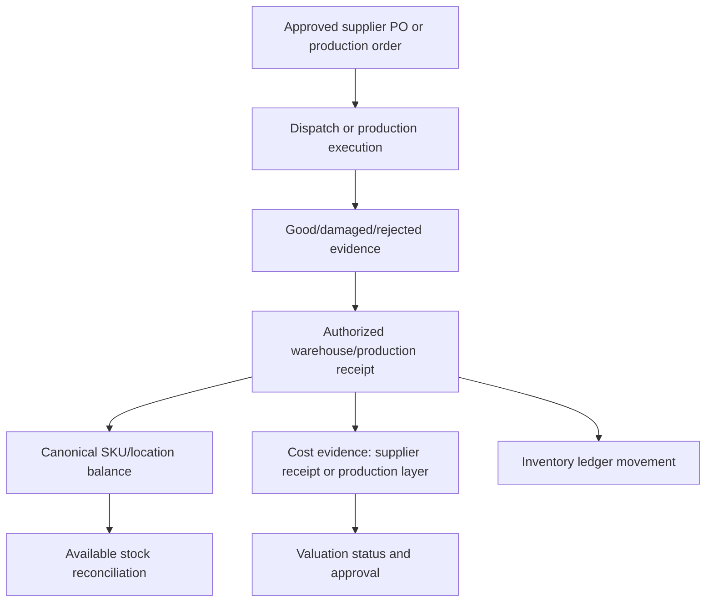
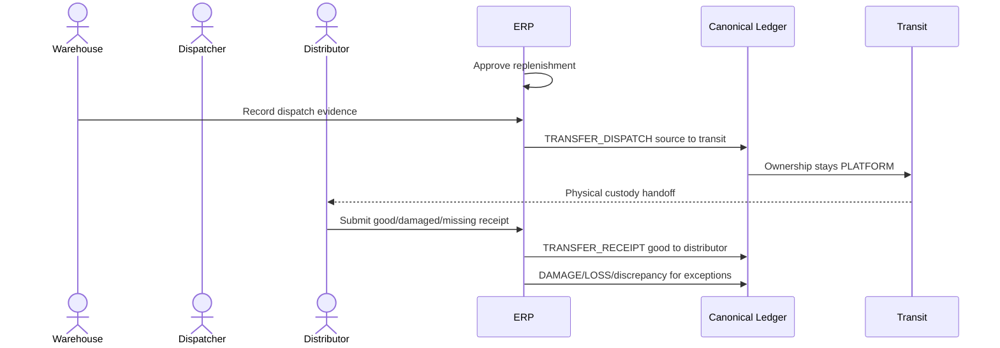
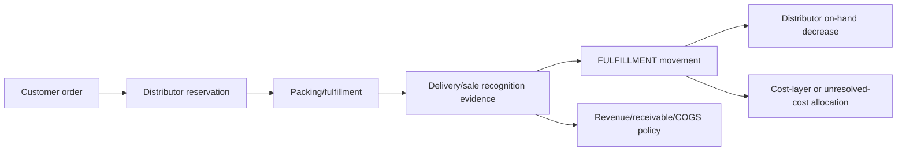
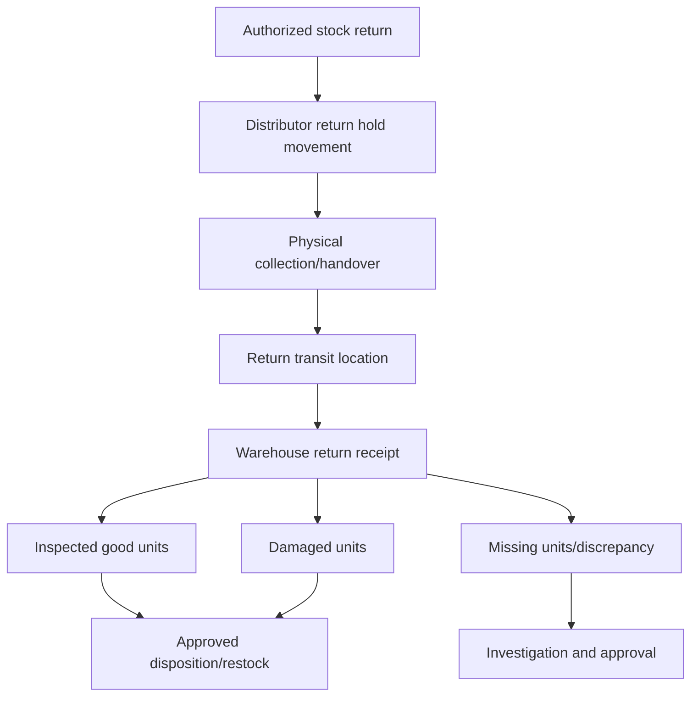
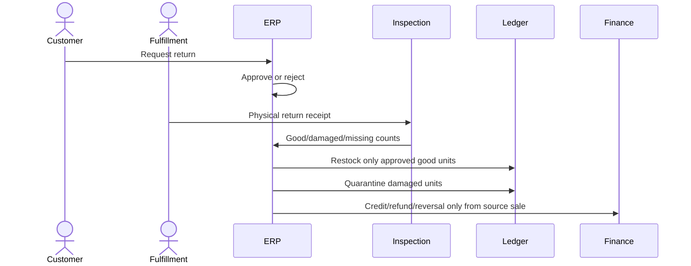
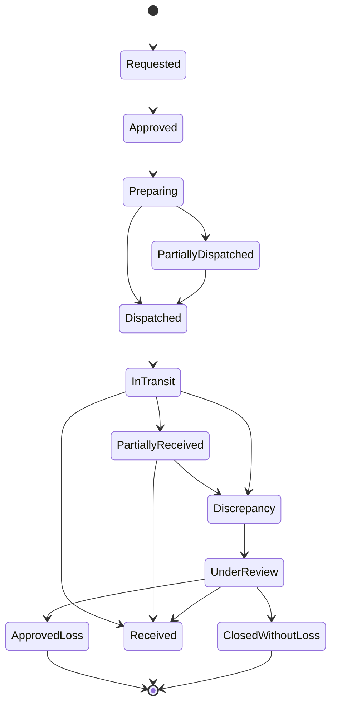
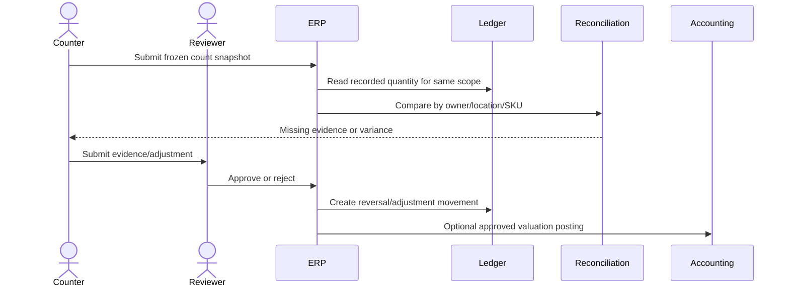

# P6-R2 - Canonical Inventory Architecture and Movement Specification

**Status:** COMPLETE FOR STATIC ARCHITECTURE AND IMPLEMENTATION SPECIFICATION
**Phase status:** Phase 6 remains IN PROGRESS - ARCHITECTURE AND PLANNING
**Production implementation status:** NOT STARTED
**Database/migration status:** NO CHANGES

## 1. Executive summary

This specification defines the target inventory architecture for Aama Clothings without implementing inventory behavior or schema changes. It is grounded in the current routes, services, Prisma models and P5 inventory/reconciliation evidence.

The repository has a canonical SKU/location quantity ledger consisting of:

- `InventorySku`
- `InventoryLocation`
- `InventoryBalance`
- `InventoryLedgerEntry`
- `ManufacturerInventoryCostLayer`
- `StockTransfer*` records
- Stock-transfer shipment, receipt, discrepancy and cost-allocation records

This canonical ledger is not the only active stock source. `Product.stockQuantity`, `Product.variants`, `StockLog`, `ManufacturerInventory`, `ManufacturerInventoryMovement` and direct/legacy return paths remain in use. Consequently, no read, report or UI currently establishes that all quantity projections are mutually reconciled.

The confirmed ownership policy remains controlling:

- Aama Clothings owns all inventory held by distributors.
- Distributors are physical custodians and distribution partners.
- Physical possession does not transfer ownership.
- Warehouse-to-distributor dispatch and distributor receipt are custody/location movements, not sales.
- Neither dispatch nor receipt independently creates revenue or COGS.
- Customer fulfillment/sale, approved return disposition and cost recognition require separate documented commercial evidence.

P6-R2 does not authorize a title or liability interpretation beyond that policy. It does not resolve manufacturer pre-dispatch title, supplier acquisition title, loss responsibility or approved valuation method.

## 2. Current-state evidence

### 2.1 Canonical models

| Model | Current role | Evidence boundary |
|---|---|---|
| `InventorySku` | Canonical product/size/color identity using normalized keys | Reused SKU concepts, but active legacy variant labels can still diverge |
| `InventoryLocation` | Storage/custody location and owner/custodian associations | `kind` includes factory, distributor, transit, quarantine, damaged, lost, return hold and return receipt |
| `InventoryBalance` | Whole-unit on-hand and reserved quantity by location/SKU | Correctly separates two counters, but balance source population may not cover legacy stock |
| `InventoryLedgerEntry` | Quantity, source/destination, movement type, owner, cost-layer, reference and idempotency | Strong replay/audit concept, but not every stock writer creates one |
| `ManufacturerInventoryCostLayer` | Accepted production quantity and unit COGS evidence | Authoritative only for the scoped accepted production |
| `StockTransfer`/line | Requested, approved and dispatched replenishment quantities | Transfer status alone is not proof of physical dispatch or receipt |
| `StockTransferShipment`/line | Shipment quantity and shipment-specific custody evidence | External carrier status remains separate from a ledger dispatch |
| `StockTransferReceipt`/line | Good/damaged/missing quantities with idempotency | Partial and disputed receipt can be represented |
| `StockTransferShipmentLineCostLayer` | Shipment-line quantity allocated to a production layer | Allocation is evidence, not a sale or COGS event |
| `InventoryDiscrepancy` | Quantity discrepancy, custody stage and open/resolution state | An open discrepancy is not a confirmed loss or distributor liability |

Canonical locations and movements store `inventoryOwner = PLATFORM`. `manufacturerId` and `distributorId` describe custody or location association, not a second owner.

### 2.2 Active services and routes

The current implementation includes:

- `backend/routes/inventoryLedgerRoute.js`
  - `/api/admin/inventory-ledger/options`
  - `/api/admin/inventory-ledger/reconciliation`
  - `/api/admin/inventory-ledger`
- `backend/routes/stockTransferRoute.js`
  - distributor request/read/receive
  - manufacturer read/dispatch
  - Admin review, NCM resolution and discrepancy reads
- `backend/routes/manufacturerProductionRoute.js`
  - manufacturer start/completion
  - Admin review and production acceptance
- `backend/routes/distributorRoute.js`
  - inventory reads/decrease
  - direct and assigned order operations
- `backend/routes/productRoute.js`
  - legacy stock adjustment and stock-log read
- `backend/routes/returnsRoute.js`
  - customer, exchange and supplier return workflows
- `backend/routes/adminStockTransferReconciliationRoute.js`
  - P5-R19 read-only reconciliation reader

Principal services are:

- `backend/services/inventoryLedgerService.js`
- `backend/services/stockTransferService.js`
- `backend/services/distributorOrderInventoryService.js`
- `backend/services/manufacturerProductionWorkflowService.js`
- `backend/services/distributorStockReturnService.js`
- `backend/services/stockSyncService.js`
- P5-R16 `stockTransferReconciliationService.js`
- P5-R17 duplicate/cost evidence logic
- P5-R18 `stockTransferReconciliationReportService.js`
- P5-R19 `stockTransferReconciliationDataService.js`

### 2.3 Existing current behavior

#### Production receipt

`completeProduction`/`receiveCompletedProductionLine` can receive accepted good size/color units into an active factory location. The same transaction can create a `ManufacturerInventoryCostLayer`, canonical `PRODUCTION_RECEIPT` movement, ledger balance, manufacturer projection and accounting effects.

This is implemented for supported production paths. Persisted migration state, physical counts and title policy remain unverified.

#### Warehouse-to-distributor replenishment

The `StockTransfer` lifecycle:

1. Distributor submits requested lines.
2. Admin reviews and approves quantities.
3. Manufacturer preparation/dispatch occurs.
4. Dispatch creates a `TRANSFER_DISPATCH` movement to an in-transit custody location.
5. Distributor receipt allocates good units to distributor stock and damaged/missing quantities to discrepancy locations.

This is implemented in source. A booking or shipment status is not receipt; a receipt must be separate and evidenced.

#### Distributor fulfillment

`consumeDistributorOrderInventory` decrements distributor canonical balance and creates `FULFILLMENT` ledger entries. It can allocate selected units to the oldest cost-layer evidence and leaves uncosted quantities explicit.

This is a supported inventory issue path, not proof that every order or every historical SKU has canonical cost linkage.

#### Reservations

Canonical `InventoryBalance.reservedQuantity` represents availability reservation. Reservation is not an on-hand increase/decrease and is not physical dispatch.

#### Adjustments and legacy projections

`POST /api/product/adjust-stock` changes `Product.stockQuantity`/variant JSON and writes `StockLog`, but no canonical inventory movement is created. The same is true for parts of legacy/direct order, return and manufacturer inventory behavior.

The existence of `StockLog`, `ManufacturerInventoryMovement` or `StockLog` is not equivalent to an `InventoryLedgerEntry`.

#### P5-R16 through P5-R19

The P5 stock-transfer reconciliation stack is read-only and synthetic/database-independent:

- P5-R16 validates and reconciles supplied transfer evidence.
- P5-R17 extends duplicate and cost-evidence controls.
- P5-R18 normalizes deterministic JSON/CSV reports.
- P5-R19 loads a bounded page behind Admin authorization and existing P5 services.

This stack can support future stock reconciliation but does not prove full source population or physical custody.

### 2.4 Implemented/partial/missing workflow matrix

The table below contrasts the 14 core inventory lifecycles across current repository implementations, highlighting active routes, domain services, authoritative models, implemented evidence controls, and outstanding architectural gaps.

| Lifecycle / Workflow | Current Status | Routes & Controllers | Services & Prisma Models | Implemented Evidence & Controls | Missing Controls & Architectural Gaps |
|---|---|---|---|---|---|
| **1. Supplier Procurement & Goods Receipt** | `MISSING` | None mounted. (Only supplier returns mounted under `/api/returns/supplier/*`) | Models: `SupplierReturn`, `SupplierCreditApplication`, `SupplierReturnCreditApplication`. No PO or GRN models. | Supplier credit application to existing AP bills is implemented in P5-R12. | No Purchase Order (`PO`) or Goods Receipt Note (`GRN`) lifecycle; no warehouse receiving dock; no 3-way match (PO-GRN-Invoice); no supplier acquisition cost-layer generation; no canonical warehouse receipt movement. |
| **2. Manufacturer Production Completion & Receipt** | `PARTIAL` | `POST /api/manufacturer-production/requests/:id/complete`<br>`POST /api/manufacturer-production/admin/requests/:id/acceptance` (`manufacturerProductionRoute.js`) | `manufacturerProductionWorkflowService.js`, `inventoryLedgerService.js`<br>Models: `ManufacturerProductionRequest`, `ManufacturerProductionLine`, `ManufacturerInventoryCostLayer`, `InventorySku`, `InventoryLocation`, `InventoryBalance`, `InventoryLedgerEntry`, `ManufacturerInventory` | Admin acceptance generates `ManufacturerInventoryCostLayer`, creates `PRODUCTION_RECEIPT` ledger entry, and increments factory `InventoryBalance.quantityOnHand` transactionally for in-scope good units. | Dual-writes to canonical ledger and legacy `ManufacturerInventory`/`ManufacturerInventoryMovement` projections; pre-production title and raw materials are unevidenced in ledger; database transaction atomicity unverified under production load. |
| **3. Warehouse-to-Warehouse Transfer** | `MISSING` | None mounted. | Models: `InventoryLocation` (kinds: `FACTORY`, `DISTRIBUTOR`, `IN_TRANSIT`, etc.). No `WAREHOUSE` location kind. | Location model conceptually supports multiple locations with `PLATFORM` ownership. | No central warehouse entity or warehouse operator RBAC; existing transfer flows strictly assume factory-to-distributor topology; no inter-warehouse transit custody tracking. |
| **4. Central Warehouse to Distributor Replenishment Dispatch** | `PARTIAL` | `POST /api/stock-transfers/:id/dispatch`<br>`POST /api/stock-transfers/:id/ncm-booking` (`stockTransferRoute.js`) | `stockTransferService.js`, `inventoryLedgerService.js`<br>Models: `StockTransfer`, `StockTransferLine`, `StockTransferShipment`, `StockTransferShipmentLine`, `StockTransferShipmentLineCostLayer`, `InventoryBalance`, `InventoryLedgerEntry` | Decrements factory on-hand balance, increments transit location balance, logs `TRANSFER_DISPATCH` ledger entry, creates shipment lines, and binds accepted production cost layers. Retains `PLATFORM` ownership. | Carrier booking does not equal physical custody transfer; dual-updates legacy `ManufacturerInventory` and catalog `Product.stockQuantity`; no independent warehouse pick/pack verification step. |
| **5. Distributor Stock Receipt** | `PARTIAL` | `POST /api/stock-transfers/shipments/:shipmentId/receipt` (`stockTransferRoute.js`) | `stockTransferService.js`, `inventoryLedgerService.js`<br>Models: `StockTransferReceipt`, `StockTransferReceiptLine`, `InventoryDiscrepancy`, `InventoryBalance`, `InventoryLedgerEntry` | Relieves transit location balance, credits distributor location `quantityOnHand`, records damaged/missing quantities into `InventoryDiscrepancy` and condition locations, logs idempotent `TRANSFER_RECEIPT`, `DAMAGE`, and `LOSS` movements. | Relies on distributor self-attestation; discrepancy resolution policy is open; does not synchronously update catalog availability (relies on background stock sync); no physical barcode/tag scanning evidence. |
| **6. Distributor-to-Warehouse Stock Return** | `PARTIAL` | `POST /api/admin/distributors/:id/stock-returns` and Admin collection/receipt/inspection routes (`adminDistributorDetailRoute.js`) | `distributorStockReturnService.js`, `inventoryLedgerService.js`<br>Models: `DistributorStockReturn`, `DistributorStockReturnLine`, `InventoryLocation` (`RETURN_HOLD`, `RETURN_RECEIPT`) | Moves stock from distributor location to `RETURN_HOLD` location, then to `RETURN_RECEIPT` upon receipt inspection. Retains platform ownership. | No central warehouse destination profile; original cost-layer allocation is not automatically unallocated or restored; no integrated accounting credit or damage write-off posting. |
| **7. Customer Order Reservation** | `PARTIAL` | `POST /api/order/place`<br>`POST /api/order-assignment/admin/control` (`orderRoute.js`, `orderAssignmentRoute.js`) | `orderService.js`, `distributorOrderInventoryService.js`<br>Models: `Order`, `OrderAssignment`, `InventoryBalance.reservedQuantity` | Transactionally checks distributor available quantity (`quantityOnHand - reservedQuantity >= qty`) and increments `reservedQuantity` on assigned distributor `InventoryBalance`. | Reservation does not emit an `InventoryLedgerEntry` audit record; no dedicated reservation entity with time-to-live (`TTL`) or expiry daemon; legacy Admin direct orders bypass reservation entirely. |
| **8. Customer Order Fulfillment & Sale** | `PARTIAL` | `POST /api/distributor/assignments/:id/deliver`<br>Delivery webhooks (`deliveryRoute.js`) | `distributorOrderInventoryService.js`, `inventoryLedgerService.js`, `accountingPostingEngine.js`<br>Models: `Order`, `DeliveryOrder`, `InventoryBalance`, `InventoryLedgerEntry`, `ManufacturerInventoryCostAllocation` | `consumeDistributorOrderInventory` relieves distributor `quantityOnHand` and `reservedQuantity`, logs `FULFILLMENT` ledger movement, binds FIFO cost layers, and triggers delivered-sale accounting outbox event. | Admin direct orders mutate legacy `Product.stockQuantity` directly; delivery completion does not establish Treasury cash collection; uncosted quantities are left open without universal inventory valuation method. |
| **9. Customer Return & Restock / Quarantine** | `PARTIAL` | `POST /api/returns/customer/request`<br>`POST /api/returns/customer/admin/:id/decision`<br>`POST /api/returns/customer/admin/:id/inspection` (`returnsRoute.js`) | `returnsController.js`, `returnsService.js`, `stockSyncService.js`<br>Models: `CustomerReturn`, `CustomerReturnItem`, `Product.stockQuantity`, `StockLog` | Inspection distinguishes good vs damaged returned units; approved good items increment catalog `Product.stockQuantity` and create `StockLog` audit rows. | **CRITICAL GAP:** Completely bypasses canonical inventory! Does NOT write `RETURN` ledger entries to `InventoryLedgerEntry` or update `InventoryBalance` at distributor or warehouse locations; does not restore cost layers; damaged units are not moved to canonical `QUARANTINE` or `DAMAGED` locations. |
| **10. Customer Order Cancellation & Reservation Release** | `PARTIAL` | `POST /api/order/admin/control/:orderId/cancel` (`orderRoute.js`) | `orderService.js`, `inventoryLedgerService.js`<br>Models: `Order`, `InventoryBalance.reservedQuantity` | Permitted only for unpaid orders prior to carrier dispatch; decrements `InventoryBalance.reservedQuantity` on the assigned distributor balance. | No ledger entry is created for reservation release (counter-only update); customer self-service cancellation is unmounted in canonical ledger flows; no audit outbox event for stock release. |
| **11. Damage / Write-off Lifecycle** | `PARTIAL` | `POST /api/stock-transfers/admin/discrepancies`<br>`POST /api/accounting/fixed-assets/:id/write-off` (`stockTransferRoute.js`, `accountingController.js`) | `inventoryLedgerService.js`<br>Models: `InventoryDiscrepancy`, `InventoryDiscrepancyReview`, `InventoryLedgerEntry`, `InventoryLocation` (`kind = DAMAGED | LOST`) | `applyInventoryMovement` explicitly supports `DAMAGE` and `LOSS` movement types targeting dedicated condition locations with audit reasons. | No operational route exists for reporting warehouse or distributor floor damage outside transfer receipts; no maker-checker inventory write-off approval workflow; no automatic GL book-loss posting for inventory scrap. |
| **12. Inventory Adjustment (Manual Correction)** | `LEGACY_OR_UNMOUNTED` | `POST /api/product/adjust-stock` (`productRoute.js`) | `productController.js`<br>Models: `Product.stockQuantity`, `Product.variants`, `StockLog` | Admin can adjust product stock quantity with a text reason, recording a legacy `StockLog`. | **CRITICAL GAP:** Mutates catalog `Product.stockQuantity` without updating `InventoryBalance` or writing an `InventoryLedgerEntry`; location and custodian are completely unspecified; no maker-checker control; no accounting cost adjustment. |
| **13. Physical Stock Count & Reconciliation** | `PARTIAL` | `GET /api/admin/accounting/stock-transfer-reconciliation` (`adminStockTransferReconciliationRoute.js`) | `stockTransferReconciliationService.js` (P5-R16/R17), `stockTransferReconciliationReportService.js` (P5-R18), `stockTransferReconciliationDataService.js` (P5-R19) | Read-only reconciliation of transfer shipment, receipt, discrepancy, and cost layers across bounded pages; detects duplicates, uncosted transfers, and discrepancies; exports deterministic JSON/CSV. | Scoped exclusively to stock transfers; does not cover physical warehouse stock counts, distributor shelf counts, customer returns, or supplier receipts; no count freeze/snapshot model; no variance reconciliation workflow to post authorized adjustments. |
| **14. In-Transit Shortage Resolution** | `PARTIAL` | `PATCH /api/stock-transfers/admin/shipments/:shipmentId/ncm-resolution`<br>`GET /api/stock-transfers/admin/discrepancies` (`stockTransferRoute.js`) | `stockTransferService.js`<br>Models: `InventoryDiscrepancy`, `StockTransferShipment`, `StockTransferReceipt` | Tracks open missing quantities and carrier dispute review notes between dispatch and receipt. | Discrepancy review does not execute financial settlement or write-off; distributor liability and carrier insurance claims are not legally defined or automated; missing quantities remain in unresolved discrepancy limbo. |

## 3. Canonical inventory concepts

### 3.1 Legal/economic ownership

Inventory owner is a legal/economic property dimension. For the confirmed distributor policy:

- Company owner: Aama Clothings.
- Custodian: active distributor, manufacturer, warehouse or carrier.
- Neither a manufacturer nor distributor identifier should imply title change.

For canonical movements, `inventoryOwner = PLATFORM` is enforced for active location/movement helpers. This does not establish supplier title or manufacturer pre-dispatch title.

### 3.2 Physical custody

Custody records who physically has or is responsible for handling stock. Custody is separate from ownership and must survive status changes.

Examples:

- Manufacturer factory custody for owned factory stock.
- Carrier custody after handoff in transit.
- Distributor custody after accepted receipt.
- Warehouse custody after approved warehouse receipt.
- Quarantine custodian after return or discrepancy inspection.

### 3.3 Storage location

A location has:

- Stable location ID.
- Human-readable name.
- Location kind.
- Active state.
- Owner/custodian associations.
- SKU balances.

Existing kinds are `FACTORY`, `DISTRIBUTOR`, `IN_TRANSIT`, `QUARANTINE`, `DAMAGED`, `LOST`, `RETURN_HOLD` and `RETURN_RECEIPT`.

The target architecture must preserve location kinds; a status field must not replace location.

### 3.4 Inventory status and availability

The target concept separates:

- `quantityOnHand`
- `reservedQuantity`
- `inTransitQuantity`
- `quarantinedQuantity`
- `damagedQuantity`
- `lostQuantity`
- `goodAvailableQuantity`

The existing canonical balance exposes on-hand and reserved counters. Transit and condition quantities require movement/source location or supporting records rather than a status-only conclusion.

A target availability calculation is:

```text
available = quantityOnHand - reservedQuantity
```

Negative availability is not permitted.

### 3.5 Product and variant identity

Canonical variant identity is product plus normalized size and normalized color. `InventorySku` is the target stock identity in canonical flows.

Catalog `Product.variants` and textual size/color labels may be compatibility projections. Future migrations must map variants deterministically and mark ambiguous labels unresolved rather than guessing.

### 3.6 Quantity and unit of measure

Inventory quantity is a whole-unit integer. The current Prisma `Int` fields and inventory invariants are consistent with whole garments.

Future calculations must not:

- Convert Prisma `Int` quantities to floating point.
- Lose exact quantity through JavaScript Number arithmetic.
- Aggregate quantities across variants or locations.
- Treat UOM conversion as implicit.

### 3.7 Cost and cost-layer evidence

Canonical cost evidence is a separate dimension from quantity.

Current evidence classes:

- `AUTHORITATIVE_COST_LAYER`: accepted production cost layer for its SKU/variant scope.
- `HISTORICAL_COST_SNAPSHOT`: preserved accepted transaction cost, not necessarily a reusable layer.
- `REFERENCE_OR_CATALOG_COST`: mutable `Product.costPrice` or proposal.
- `ESTIMATE`: calculation without receipt or authoritative layer.
- `UNRECONCILED`: evidence conflicts or cannot establish quantity coverage.
- `MISSING`: no evidence record.

`Product.costPrice` is never authoritative merely because it exists. Missing cost evidence is not zero cost.

### 3.8 Reservation and allocation

Reservation is:

- A location/SKU quantity.
- Supported by an order/assignment/source reference.
- Time-bounded or explicit until fulfillment/cancellation.
- Distinct from dispatch and receipt.

Future reservation records should preserve the source transaction and idempotency key. The current `reservedQuantity` counter is useful but is not enough to model independent reservation provenance in all flows.

### 3.9 In-transit inventory

In-transit quantity is stock that has left a source location and has not reached an accepted destination receipt. It remains company-owned inventory.

It must not count as available at:

- The source location.
- The destination location.
- A distributor location.

Only confirmed receipt can move it to a destination.

### 3.10 Source transaction and movement evidence

Every inventory movement should reference:

- Movement header/event ID.
- Inventory owner.
- Source and destination as applicable.
- SKU/variant.
- Quantity and unit.
- Status/condition.
- Authorization.
- Actor.
- Timestamp.
- Source commercial transaction.
- Dispatch/receipt evidence.
- Cost evidence.
- Idempotency key.
- Reversal/correction reference.

No movement should rely on free-text reference alone.

## 4. Canonical movement types

| Movement | Lifecycle and evidence | Authorization | Ledger result | Accounting implication |
|---|---|---|---|---|
| Supplier receipt | PO, supplier acknowledgement, goods receipt, accepted/rejected quantity, invoice and landed-cost evidence | Buyer/warehouse receipt plus independent approval where required | Accepted units enter warehouse; rejected units remain external or discrepancy | Inventory/AP/VAT only from approved matching policy |
| Manufacturer production receipt | Approved production, QA, actual good counts and Admin acceptance | Manufacturer submit; Admin acceptance | Good units enter factory location with production cost layer | Approved production recognition/payable policy, not dispatch |
| Warehouse-to-warehouse | Source authorization, dispatch, transit evidence and destination receipt | Warehouse dispatch and receiving authority | Source decrease, transit, destination increase | Usually custody transfer; no sale |
| Warehouse-to-distributor dispatch | Approved transfer, preparation, shipment and dispatch evidence | Manufacturer/warehouse dispatch plus transfer approval | Source decrease, in-transit increase | No sale, COGS or wholesale receivable |
| Distributor receipt | Physical checklist, good/damaged/missing quantities and idempotent receipt | Authenticated distributor receipt authority | Good units enter distributor location; damaged/missing move to condition/discrepancy | No sale or ownership change |
| Distributor-to-warehouse return | Authorized request, collection/handover, warehouse receipt and inspection | Independent Admin/warehouse approval | Return hold, transit, return receipt/disposition | No automatic write-off or expense |
| Customer reservation | Accepted order/assignment and available-stock check | Order/assignment authorization | Reserved quantity increases; no on-hand movement | No sale or COGS |
| Customer fulfillment/sale | Packed/dispatched/delivered evidence and approved recognition point | Fulfillment authority plus approved sale policy | On-hand decrease and optional reservation decrease | Revenue/receivable/COGS from approved event |
| Customer return | Original sale, return authorization, physical receipt and inspection | Customer request plus Admin/distributor/warehouse review | Good restock or quarantine/damage/missing movements | Credit/refund/reversal only with original source |
| Reservation release/cancellation | Cancellation/assignment change and eligible pre-fulfillment state | Authorized order control | Reserved quantity decreases; on-hand unchanged | No COGS or inventory issue |
| Damage/write-off | Evidence, discrepancy investigation and approved disposition | Independent authorized reviewer | Move to damaged/lost or approved write-off reversal | No automatic liability or financial posting |
| Inventory adjustment | Physical count, reason, approval and before/after quantity | Maker-checker or designated inventory authority | ADD/DECREASE with traceable adjustment movement | Accounting posting only under approved valuation policy |
| Stock count/reconciliation | Count snapshot, location/SKU, counters, evidence and unresolved exception | Independent count authority | No silent balance mutation; approved differences create adjustments | Operational separate from GL/subledger |
| Transit shortage resolution | Dispatch vs receipt quantities, carrier/receipt evidence and investigation | Independent Admin/distributor policy authority | Missing quantity moves to discrepancy/lost only if approved | No distributor liability or loss journal by default |

### 4.1 Supplier receipt

Status-only shipment fields must not establish goods receipt. Supplier receipt requires accepted and rejected quantities, location, receipt evidence and authorized posting.

Partial receipt must create a new receipt line and preserve the outstanding purchase quantity.

### 4.2 Manufacturer production receipt

Post-production actual good size/color quantities create canonical factory receipt. Damaged units require a separate disposition representation; they are not good units.

### 4.3 Warehouse and distributor transfer

The canonical transfer header and shipment/receipt lines should remain distinct:

- Header: commercial and approved quantity.
- Shipment: physical dispatch and custody.
- Receipt: accepted condition and quantity.
- Ledger: source, transit and destination balance changes.

Partial dispatch and partial receipt remain separate quantities.

### 4.4 Customer sale

Reservation does not issue stock. Fulfillment/sale issues stock only at the approved policy boundary. COGS and revenue must be linked to the same source event as the inventory movement.

### 4.5 Customer/distributor return

Return increases require accepted receipt and inspection. A delivery return status or customer request is not enough.

The target return movement must identify:

- Original sale.
- Original SKU and quantity.
- Good/damaged/missing state.
- Restock location.
- Cost restoration evidence.
- Return/reversal/journal links.

### 4.6 Adjustment and correction

Corrections must create reversal or adjustment movements. Historical ledger rows must remain immutable. Balance updates and movement creation must occur in the same transaction.

## 5. Canonical invariants

### 5.1 Enforced currently in supported canonical flows

The source audit verifies these controls in `applyInventoryMovement` or related services:

- Active, platform-owned source/destination locations are required.
- Active canonical SKU is required.
- Source on-hand quantity must cover movement quantity.
- Source available quantity must cover unreserved source movements.
- Destination quantity overflow is rejected.
- Concurrent source/destination balance changes are guarded with optimistic checks.
- Ledger idempotency key replay is accepted only for byte-equivalent movement fields.
- A conflicting movement with an existing idempotency key is rejected.
- Exact whole-unit quantity validation is used in canonical inventory paths.
- Production receipts create cost-layer and movement evidence transactionally in supported acceptance flows.
- Fulfillment replay compares prior movement quantity and rejects mismatched replay.

### 5.2 Enforceable target invariants

1. No negative available quantity.
2. No movement without an active valid source/destination where applicable.
3. No movement with an unknown or inactive variant.
4. No duplicate posting for the same business event/idempotency key.
5. No receipt above authorized/dispatched quantity without an explicit exception.
6. No dispatch above authorized/available quantity.
7. Partial dispatch and partial receipt remain independently representable.
8. Reservation never changes on-hand quantity.
9. Dispatch never decrements destination availability or creates a sale.
10. In-transit quantity is excluded from source and destination availability.
11. Distributor-held good stock remains Aama-owned.
12. Stock return preserves source, custody and movement history.
13. Corrections use reversal/adjustment records, not silent overwrites.
14. Catalog `Product.costPrice` cannot establish authoritative cost.
15. Missing cost evidence is not interpreted as zero cost.
16. A discrepancy does not itself establish loss, damage responsibility or liability.
17. A reconciliation report cannot mutate inventory.
18. Financial posting must reference the same underlying source and movement evidence.
19. All movement and correction effects use actor, timestamp and authorization evidence.
20. Quantity sums use exact integer semantics and location/SKU scope.

### 5.3 Missing controls

The following remain design requirements:

- Universal movement writer across every legacy stock-changing route.
- Canonical restock after every approved customer return.
- A formal physical-count and approved-difference lifecycle.
- Supplier purchase/receipt/cost-layer lineage.
- Central-warehouse profile and supplier receipt operations.
- Universal cost- and valuation-policy selection.
- Full migration/backfill and historical movement reconstruction.
- Conflict and responsibility policy for shortages/damage.
- Independent bank/provider/physical-custody reconciliation.

## 6. Canonical lifecycle diagrams

### 6.1 Supplier/manufacturer to central warehouse



Supplier receipt remains MISSING as a mounted end-to-end flow. Production receipt is the current implemented source for factory good units.

### 6.2 Central warehouse to distributor



### 6.3 Distributor-held stock to customer sale



### 6.4 Distributor return to warehouse



### 6.5 Customer return



### 6.6 Transfer dispatch, transit, partial receipt and exception



This state diagram is conceptual. Carrier, shipment, receipt and ledger transitions remain separate records.

### 6.7 Physical stock count and reconciliation



Reconciliation must not mutate balances itself.

## 7. Target conceptual model

The target model is conceptual and not a request to add every concept into Prisma unchanged.

| Concept | Closest existing model | Reuse/extension decision | Migration implication |
|---|---|---|---|
| Inventory owner | `InventoryLocation.inventoryOwner`, `InventoryLedgerEntry.inventoryOwner` | Reuse platform-owner pattern; retain as explicit scope where ownership evidence is needed | Validate existing rows; reject ambiguous legacy owner |
| Custodian | `InventoryLocation.distributorId/manufacturerId`; location kind | Add explicit custodian/event semantics conceptually; do not infer custodian from ID alone | Resolve current location associations before backfill |
| Location | `InventoryLocation`, `DistributorLocation`, `ManufacturerLocation` | Reuse `InventoryLocation` for stock; retain profile/location models outside stock | Separate warehouse/provenance identifiers if central warehouse is introduced |
| Product variant/SKU | `InventorySku` | Reuse normalized SKU | Map Product variant JSON and labels with ambiguity reporting |
| Quantity/UOM | `InventoryBalance.quantityOnHand`, `reservedQuantity`, ledger `quantity` | Reuse whole-unit `Int`; UOM requires explicit future policy | Do not convert quantities to Decimal or Float |
| Inventory status | Location kind plus transfer/receipt/discrepancy status | Reuse, but status must not replace movement evidence | Preserve existing status values and add canonical mapping |
| Reservation | `InventoryBalance.reservedQuantity` | Counter reuse possible; source reservation records likely needed for provenance | No silent historical reservation reconstruction |
| Movement header | `InventoryLedgerEntry` is currently both movement and balance impact | Conceptually add an explicit header only if group/partial movements require it | Avoid breaking P5/P6 reconciliation IDs |
| Movement line | Ledger entry/transfer receipt line are domain-specific | Reuse or add only if canonical multi-line partial posting gaps require it | Preserve existing IDs and references |
| Dispatch evidence | `StockTransferShipment`/events | Reuse | Reconcile booking status, dispatch timestamp and ledger movement |
| Receipt evidence | `StockTransferReceipt`/line | Reuse | Preserve replay/hash and partial quantities |
| Source transaction | `referenceType/referenceId` on ledger, and domain FKs | Reuse patterns, add typed source reference if free-text gaps remain | Backfill only with deterministic evidence |
| Cost evidence | `ManufacturerInventoryCostLayer`, allocation and ledger cost-layer ID | Reuse production layer; add supplier/acquisition evidence concept when procurement exists | No Product cost fallback as authoritative |
| Reversal/correction | No universal canonical model | Reverse/adjustment records or references needed | Preserve original ledger/actor/idempotency evidence |
| Idempotency/audit | Ledger key, domain unique keys, audit outbox | Reuse and centralize conventions | Audit duplicate/conflicting replay before migration |

Overlapping representations that must not be merged blindly:

- `Product.stockQuantity` is a catalog projection.
- `InventoryBalance` is canonical location/SKU quantity.
- `ManufacturerInventory` is a manufacturer legacy/projection stock source.
- `StockLog` is a compatibility audit record.
- `ManufacturerInventoryMovement` is not an `InventoryLedgerEntry`.
- `StockTransferShipmentLineCostLayer` is allocation evidence.
- `ManufacturerInventoryCostAllocation` is order/layer allocation evidence.

## 8. Service and portal responsibility

### 8.1 Inventory domain service

Future inventory domain services should own:

- SKU/location validation.
- Balance and movement validation.
- Transactional source/destination updates.
- Optimistic concurrency protection.
- Idempotent replay/conflict detection.
- Reservation lifecycle.
- Movement reversal/adjustment.
- Cost-evidence linkage.
- Source reference validation.
- Scope and actor audit metadata.

No controller should update `quantityOnHand` or `reservedQuantity` directly.

### 8.2 Canonical movement service

The closest existing service is `applyInventoryMovement`. It already:

- Validates active platform-owned locations.
- Validates SKU state.
- Updates source/destination balances.
- Guards concurrent balance changes.
- Creates the ledger entry.
- Detects exact idempotency replay.
- Rejects replay conflicts.

Future implementation should reuse this pattern and add only domain-policy gaps, not bypass it with portal or controller writes.

### 8.3 Transfer service

`stockTransferService` should continue to own:

- Request/approval transitions.
- Dispatch and receipt evidence.
- Shipment line quantities.
- Discrepancy creation.
- Cost-allocation state.
- Transfer status derivation.

The ledger service owns balances/movements. A transfer status service must not write a ledger movement on status text alone.

### 8.4 Production service

The manufacturer/production service owns:

- Production authorization.
- Pre/post-production evidence.
- Actual good size/color counts.
- Cost-layer creation.
- Factory receipt command.

The inventory ledger service owns the resulting balance and movement.

### 8.5 Fulfillment service

Distributor fulfillment owns:

- Reservation consumption.
- Customer sale boundary.
- Cost allocation selection.
- Fulfillment movement source reference.

The accounting service owns revenue/receivable/COGS posting, based on approved event policy.

### 8.6 Portal controllers

Controllers should:

- Authenticate and authorize.
- Establish profile/workspace context.
- Validate request shape.
- Invoke domain services.
- Map explicit domain errors.
- Record/report audit context.

Controllers must not calculate canonical stock from aggregate product counters or perform financial posting without a domain service boundary.

### 8.7 Reconciliation service

Reconciliation should consume supplied snapshots and remain read-only. P5-R16/R17/R18/R19 provide a suitable stock-transfer foundation:

- P5-R16: comparison and coverage semantics.
- P5-R17: duplicate/cost evidence controls.
- P5-R18: deterministic JSON/CSV reporting.
- P5-R19: bounded source loading and API integration.

New reconciliation capabilities needed:

- Central warehouse scope.
- Supplier/receipt lineage.
- Legacy-to-canonical population mapping.
- Full location/SKU movement history.
- Balance-to-physical count differences.
- Cost-layer-to-ledger-to-valuation coverage.
- Source period cutoffs and opening-balance lineage.
- Multi-page/full-population duplicate scope.

## 9. Reconciliation requirements

### 9.1 Central warehouse physical vs recorded

Scope:

- Location ID.
- SKU.
- Counted quantity.
- As-of timestamp.
- Recorded on-hand.
- Reserved quantity.
- In-transit or quarantine excluded or reported separately.

Output:

- Exact matched quantity.
- Count variance.
- Missing evidence.
- Unresolved discrepancy.
- Approved adjustment reference.

The reconciliation report must not adjust balances.

### 9.2 Distributor-held company-owned stock

Reconcile:

- Approved transfer dispatch.
- Shipment/receipt.
- Accepted good units.
- Open discrepancy/damage/missing units.
- Distributor on-hand/reserved quantities.
- Fulfillment movement.
- Customer/stock return movements.

Ownership remains Aama throughout; no distributor AP/AR or sale is inferred.

### 9.3 In-transit stock

Reconcile shipment line quantity against:

- Source dispatch movement.
- Shipment line.
- Cost allocation.
- Receipt/discrepancy.
- Remaining transit quantity.

Unknown carrier status remains unresolved, not received.

### 9.4 Reservations and available stock

Reconcile:

```text
onHand = available + reserved
available = onHand - reserved
```

Reservation references must map to one order/assignment/transfer source. An orphan or oversubscribed reservation is an exception.

### 9.5 Supplier/manufacturer receipts

Supplier receipt reconciliation requires PO/GRN/invoice/ledger/cost lineage, which is not yet implemented. Manufacturer reconciliation compares accepted production request/count to cost layer and canonical factory receipt.

### 9.6 Sales and returns

Reconcile order/delivery/fulfillment movements against:

- Customer sale recognition.
- Invoice/receivable.
- COGS evidence.
- Return approval/inspection/restock.
- Original sale reference.

### 9.7 Movement and balance history

For each location/SKU, replay or compare:

```text
opening balance
+ all destination movements
- all source movements
- approved adjustments
= expected on-hand
```

The result must classify missing history, opening lineage and posting conflict separately.

### 9.8 Quantity and valuation evidence

Quantity coverage and valuation coverage are separate:

- Quantity reconciled.
- Cost layer coverage complete.
- Cost evidence partial.
- Cost evidence unresolved.
- Cost reference only.

No valuation report should combine catalog fallback quantities with authoritative layer quantities without disclosure.

### 9.9 Operational vs financial reconciliation

Operational reconciliation:

- Quantity.
- Location.
- Custody.
- Reservation.
- Condition.
- Movement evidence.

Financial subledger reconciliation:

- Inventory control account.
- COGS.
- Payables.
- Receivables.
- Tax and journals.
- External bank/provider evidence.

Operational parity does not prove financial parity.

## 10. Accounting and valuation dependencies

### 10.1 Current costing evidence

Accepted production cost layers are the strongest existing evidence for in-scope production. They contain:

- SKU/variant.
- Manufacturer.
- Production request.
- Produced and available quantity.
- Decimal unit COGS.
- VAT and delivery cost fields.

This evidence does not cover purchased stock, all opening stock, all legacy stock or every return.

### 10.2 Prohibited valuation shortcut

Do not calculate inventory value or COGS using `Product.costPrice` as if it were an authoritative received cost.

Catalog cost may support estimates only with explicit `REFERENCE_OR_CATALOG_COST` disclosure.

### 10.3 Financial posting boundaries

Inventory movement and accounting posting should use separate source records:

- Ledger movement: physical/quantity and custody.
- Cost allocation: cost evidence.
- Accounting document/journal: approved financial recognition.
- Cash/reconciliation: separate payment evidence.

Transfer dispatch/receipt must not post COGS or sales by itself.

## 11. Security, authorization and audit

### 11.1 Portal boundaries

Customer:

- Can request/see own order or return.
- Cannot change canonical stock.
- Cannot approve its own discrepancy.

Distributor:

- `transfer:distributor_request/read/receive`
- `distributor:inventory_read/decrease`
- Fulfillment and transfer workspace context.

Manufacturer:

- `transfer:manufacturer_dispatch/read`
- `manufacturer:production_manage`
- Production and active workspace context.

Admin:

- `transfer:admin_read/review`
- `inventory:ledger_read`
- `inventory:admin_read_all`
- `manufacturer:production_admin`
- `stock:adjust`
- `order:control`

Warehouse/operator permissions do not currently exist as a distinct, complete role set. P6-R3 must add narrowly scoped warehouse permissions instead of relying on broad Admin access.

### 11.2 Required authorization controls

Future inventory mutations require:

- Authentication.
- Active workspace/profile context.
- Permission check.
- Source and location ownership scope.
- Maker/checker separation for loss/write-off/adjustments where policy requires.
- Receipt actor cannot approve their own high-risk disposition.
- Audit actor, IP/correlation/evidence as appropriate.

Frontend-hidden controls are not authorization.

### 11.3 Idempotency

All mutation paths should use stable business idempotency keys. The key must identify:

- Movement type.
- Source transaction.
- Location/SKU.
- Quantity.
- Actor-independent payload hash.

Existing ledger replay requires the normalized movement fields to match exactly.

### 11.4 Audit

Audit events should retain:

- Before/after balance or reservation.
- Source movement and related evidence.
- Cost references.
- Actor and workspace.
- Correlation ID.
- Approval reason.
- Reversal/correction link.

Sensitive bank, provider or customer data must remain outside the reconciliation detail unless necessary.

## 12. Risks and unresolved decisions

1. **Legacy projection divergence:** canonical and legacy stock can disagree.
2. **Supplier procurement:** no mounted PO/GRN/invoice/cost-layer chain.
3. **Central warehouse:** no complete warehouse stock role or lifecycle.
4. **Manufacturer title:** current code is one recognition model; older policy text conflicts.
5. **Costing method:** no approved universal FIFO/weighted-average/specific-identification method.
6. **Customer return restock:** restock/cost restoration is inconsistent in active paths.
7. **Damage/liability:** no approved responsibility or write-off policy.
8. **Historical opening stock:** no complete opening balance/cost lineage.
9. **Physical counts:** no canonical count-to-adjustment lifecycle.
10. **P5-R19 scope:** bounded page/API, not full-population reconciliation.
11. **Decimal/calendar:** still incomplete for broader inventory/financial integration.
12. **RBAC/persistence:** route evidence is static; deployed role assignment is unverified.
13. **Corrections:** no universal reversal model for ledger, subledger and accounting evidence.
14. **Random idempotency:** some legacy return paths require standardization.

## 13. Implementation sequencing

### P6-R2A - Canonical inventory contract freeze

P6-R2A is complete for static documentation and code-audit scope in
[03-canonical-inventory-contract-freeze.md](./03-canonical-inventory-contract-freeze.md).
It does not add tests or production behavior and does not authorize schema,
route, service, or database changes.

### P6-R2C - Legacy-to-canonical source mapping

Status: COMPLETE — STATIC SOURCE MAPPING AND MIGRATION STRATEGY ONLY.

Prerequisites:

- P6-R2A contract freeze.
- P6-R2B whole-project readiness audit.
- Approved source-population, opening-balance, and cutover policies.
- Independently verified isolated database and backup/restore controls for any
  persisted validation; no database access is authorized by this specification.

Scope:

- Read-only legacy/canonical population and SKU/location mapping.
- Ambiguous variant, opening quantity, and historical cost classifications.
- Stock-changing writer and inventory-reader mapping across portals and
  backend domains.
- Read-only reconciliation design using existing P5 services where applicable.

See
[05-legacy-to-canonical-inventory-source-mapping.md](./05-legacy-to-canonical-inventory-source-mapping.md).

Acceptance:

- No historical overwrite, backfill, or cutover.
- Every difference and ambiguity remains explicitly classified.
- Any persisted validation uses a separately approved isolated target.

P6-R2D extends this specification with the static
[inventory write-path and warehouse/RBAC design freeze](./06-inventory-write-path-and-warehouse-rbac-design.md).
It is complete for static scope and does not authorize routes, warehouse models,
migrations or production writes.

P6-R3A hardens the existing
[inventory movement foundation](./07-p6-r3a-canonical-inventory-movement-foundation.md)
with exact validation and database-independent replay tests. P6-R3A does not
integrate a new legacy writer or establish persisted transaction/concurrency
safety.

P6-R3B documents the existing flat location model and database-backed role
permission system in
[08-p6-r3b-warehouse-location-and-scoped-rbac.md](./08-p6-r3b-warehouse-location-and-scoped-rbac.md).
It adds a reusable location-scope helper and applies it to one existing
distributor inventory-decrease route. It does not add warehouse staff
assignments, warehouse models or persisted location isolation.

P6-R3C maps existing stock-transfer, distributor-return and customer/production
receipt evidence and defines a future receiving/put-away contract in
[09-p6-r3c-receiving-and-put-away-contract.md](./09-p6-r3c-receiving-and-put-away-contract.md).
It adds no persisted receipt model or inventory/accounting posting.

P6-R3D verifies that contract and defines receipt identity, evidence,
idempotency, proposed persistence, transaction recovery and historical-migration
readiness in
[10-p6-r3d-receipt-evidence-and-persistence-readiness.md](./10-p6-r3d-receipt-evidence-and-persistence-readiness.md).
It does not implement persistent receiving.

P6-R3E provides the
[persistent receiving implementation blueprint](./11-p6-r3e-persistent-receiving-implementation-blueprint.md).
It proposes schema, API, service, transaction and migration boundaries without
applying them.

P6-R3F audits the complete existing stock-transfer request, reservation,
dispatch, transit, receipt, discrepancy and reconciliation lifecycle in
[12-p6-r3f-stock-transfer-receipt-hardening-readiness.md](./12-p6-r3f-stock-transfer-receipt-hardening-readiness.md).
It adds no persistent hardening or financial resolution.

P6-R3G defines the executable database-independent implementation sequence and
database prerequisites in
[13-p6-r3g-stock-transfer-hardening-implementation-plan.md](./13-p6-r3g-stock-transfer-hardening-implementation-plan.md).
It does not implement the planned transfer changes.

P6-R3H adds a reusable canonical dispatch plan and server-resolved
manufacturer source-location middleware in
[14-p6-r3h-canonical-stock-transfer-dispatch-implementation.md](./14-p6-r3h-canonical-stock-transfer-dispatch-implementation.md).
Receipt, correction and persisted concurrency remain open.

P6-R3I adds database-independent NCM custody/source validation and legacy
projection consistency checks in
[16-p6-r3i-webhook-dispatch-authorization-and-legacy-projection-consistency.md](./16-p6-r3i-webhook-dispatch-authorization-and-legacy-projection-consistency.md).
Persisted webhook identity, reconciliation comparison and database concurrency
remain open.

P6-R3J adds a pure canonical stock-transfer receipt foundation in
[17-p6-r3j-canonical-stock-transfer-receipt-foundation.md](./17-p6-r3j-canonical-stock-transfer-receipt-foundation.md).
It validates dispatch evidence, exact quantities, replay identity and
destination authorization, and returns canonical accepted/damage/loss movement
descriptors without a new persistent writer. The existing bounded
stock-transfer receipt route already persists receipt records and movements;
the R3J helpers are not integrated into that route. P6-R3K verification
identified the remaining evidence-provenance, active-route hardening,
idempotency-adapter and reconciliation gaps in
[18-p6-r3k-receipt-foundation-verification-and-reconciliation-readiness.md](./18-p6-r3k-receipt-foundation-verification-and-reconciliation-readiness.md).
Generic warehouse/supplier receiving and put-away remain unimplemented.

### P6-R3 - Warehouse and canonical inventory implementation

P6-R3 is planned and not started. It depends on P6-R2A, the completed P6-R2B
static readiness audit, completed static P6-R2C source mapping, approved
warehouse/custody and costing policies, a location-scoped RBAC design, and
independently verified database/migration/recovery gates.

The bounded scope may include warehouse context, canonical internal transfer,
physical count, adjustment/disposition, and scoped Admin/warehouse UI. It must
not silently include supplier procurement/PO/GRN/invoice acquisition-cost
policy, which remains a separate P6-R4 iteration.

Admin manual adjustment and customer-return legacy restock require explicit
replacement/gating plans before affected stock is exposed through a new
warehouse writer. Acceptance requires route-level scope tests, exact
idempotency, partial events, concurrency and rollback validation, complete
movement/audit evidence, physical count, and cost/GL reconciliation. These are
future gates, not results of P6-R2A.

## 14. Follow-up P6 inventory iterations

Recommended sequence:

1. P6-R2A: freeze canonical movement, reservation, cost, idempotency, audit/RBAC,
   and accounting-boundary contracts (complete for static scope).
2. P6-R2B: complete the whole-project static readiness audit (complete).
3. P6-R2C: map legacy/canonical sources and define read-only reconciliation
   (complete for static repository scope only; persisted mapping remains open).
4. P6-R2D: freeze write-path remediation and warehouse/RBAC design
   (complete for static scope).
5. P6-R3A: harden the canonical movement/balance foundation
   (complete for database-independent code/tests; persisted validation remains open).
6. P6-R3: implement a bounded warehouse/canonical inventory lifecycle only
   after policy and database safety gates (planned, not started).
7. P6-R4: implement supplier procurement/receipt/landed-cost/AP evidence.
8. P6-R5: complete manufacturer raw-material/stage/cost lineage if required.
9. P6-R6: normalize distributor transfer/fulfillment/return/collection.
10. P6-R7: link customer sale/return/payment to inventory and accounting.
11. P6-R8: publish operational and valuation-basis reports.

Independent architecture and mapping work may proceed before database validation. Mutation implementation must wait for isolated database controls and approved policy.

## 15. Acceptance criteria for P6-R2

- Current repository inventory sources are identified and classified.
- Distributor ownership and custody are explicit.
- Canonical movement types and evidence are specified.
- Reconciliation scope distinguishes quantity, custody, cost and financial evidence.
- Mermaid diagrams cover supplier/manufacturer receipt, transfer, customer sale/return and stock count.
- Existing and proposed Prisma concepts are mapped without speculative fields.
- Service and portal responsibilities are defined.
- Permissions and audit requirements are identified.
- Implementation sequencing and release gates are dependency-aware.
- P6-R2 status can be marked complete for static documentation only.
- P6-R2A contract freeze and the P6-R2 repository audit are explicitly
  classified as static work; P6-R3 implementation remains not started.
- Production implementation remains not started.

## 16. Decisions requiring business approval

- Supplier and manufacturer pre-dispatch title policy.
- Universal inventory costing method.
- Damage/loss responsibility and write-off authorization.
- Central warehouse legal and operational custody model.
- Customer sale/recognition point.
- Approved return restock and cost restoration policy.
- Opening stock and historical cost migration policy.
- Physical count frequency and independent reviewer.
- Whether a movement header is needed as a future schema extension.
- Statutory/entity and professional accounting review.

## 17. Remaining evidence limitations

This static specification does not verify:

- Persisted balances.
- Applied migrations.
- Physical stock/custody.
- Supplier/manufacturer legal title.
- Actual cost population.
- Reconciliation parity.
- Deployed RBAC.
- External bank/provider/supplier/carrier evidence.
- Backup/restore and operational recovery.

P6-R2 is complete only as a static architecture and implementation specification. It does not claim inventory correctness, inventory valuation, physical verification or Phase 4/5 completion.
