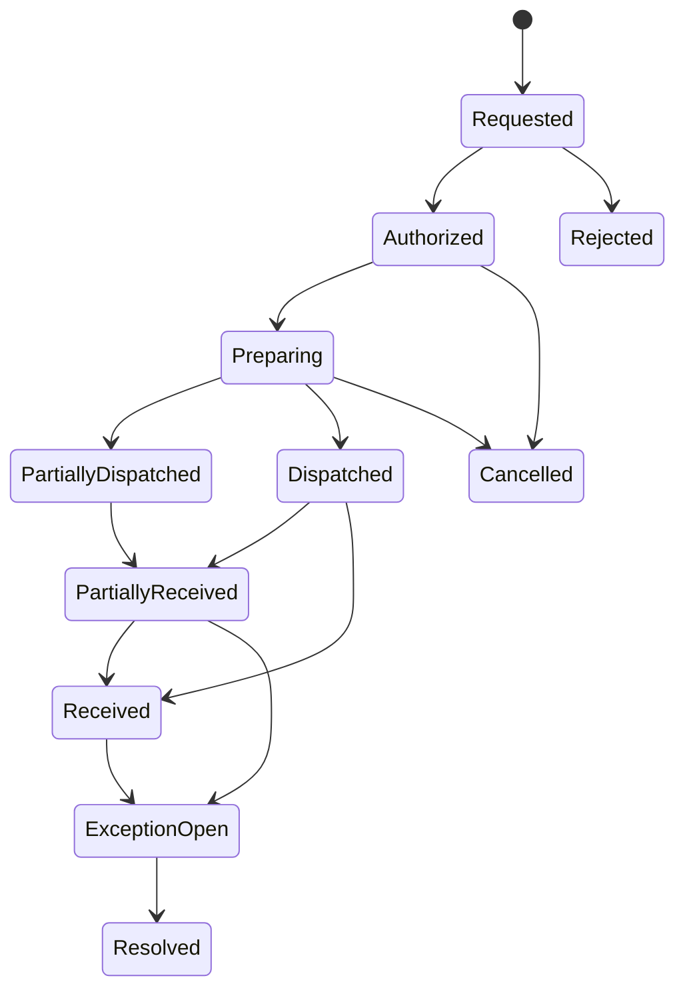

# P6-R2A — Canonical Inventory Contract Freeze

**Status:** COMPLETE — DOCUMENTATION AND STATIC CODE AUDIT ONLY  
**Phase status:** Phase 6 remains IN PROGRESS — ARCHITECTURE AND PLANNING  
**P6-R2 repository audit:** COMPLETE — STATIC SOURCE EVIDENCE  
**P6-R3 implementation:** PLANNED — NOT STARTED  
**Production implementation, schema, migration, and database status:** NO CHANGES

## 1. Purpose, scope, and evidence boundary

P6-R2A freezes the target inventory movement, reservation, ownership/custody,
cost-evidence, idempotency, concurrency, audit, authorization, and accounting
contracts required before implementation. This is a contract and acceptance
document, not a production design approval for unresolved accounting or
commercial policy.

The contract is grounded in the P6-R1 integrated ERP architecture, the P6-R2
canonical inventory specification and implementation audit, P5-R16 through
P5-R19 reconciliation work, and the P5-R7/P5-R8 inventory-cost and supplier
evidence audits.

Only static repository source and documentation were inspected. No database
was connected to, queried, migrated, seeded, reset, or modified. No Prisma
schema, migration, production service, route, stock, inventory, accounting
record, or external integration was changed. No claim is made about deployed
permissions, persisted balances, physical stock, or database-enforced
invariants.

This document supersedes the earlier P6-R2 specification's preliminary
P6-R2C warehouse-implementation label. The current sequence assigns P6-R2B
to the whole-project static readiness audit and P6-R2C to the separate
legacy/canonical source mapping and migration strategy:

1. P6-R2A — contract freeze (this document; complete for static scope).
2. P6-R2B — whole-project readiness audit (complete for static scope).
3. P6-R2C — legacy/canonical mapping and reconciliation design, static-only;
   any persisted validation separately authorized and independently isolated.
4. P6-R3 — warehouse and canonical inventory implementation, planned but not
   started, subject to all listed policy, source, database, and release gates.
5. P6-R4 — supplier procurement and acquisition-cost lifecycle, separately
   planned.

## 2. Decision classifications

The register distinguishes policy from code facts and proposed engineering
controls. A proposed contract is not approved business, accounting, tax, or
commercial policy.

| Classification | Decision or fact | Status / boundary |
|---|---|---|
| CONFIRMED BUSINESS DECISION | All inventory held by distributors remains owned by Aama Clothings; distributors are custodians and distribution partners. | Confirmed in P6-R1/P6-R2 and P5-R14. No distributor liability or automatic shortage receivable is implied. |
| CONFIRMED BUSINESS DECISION | Moving company-owned stock to a distributor is a custody/location transfer, not by itself a sale, revenue event, or COGS event. | Applies to dispatch and receipt; sale and financial recognition require separate evidence and policy. |
| CONFIRMED INTERNAL POLICY | Internal NPR money handling uses two decimal places and HALF_EVEN at approved quantization boundaries, effective 2026-11-15. | Preserve as internal policy only. It is not statutory, tax-authority, or CA approval. Inventory quantities are not monetary values and do not use this rounding rule. |
| EXISTING IMPLEMENTATION FACT | `InventoryBalance` is a current quantity record by location/SKU; `InventoryLedgerEntry` is movement history for supported canonical flows. | Neither establishes that every legacy writer or physical stock population is reconciled. |
| EXISTING IMPLEMENTATION FACT | Supported canonical ledger movement types currently include `OPENING_BALANCE`, `PRODUCTION_RECEIPT`, `TRANSFER_DISPATCH`, `TRANSFER_RECEIPT`, `FULFILLMENT`, `RETURN`, `DAMAGE`, `LOSS`, and `ADJUSTMENT`. | Current service/model evidence only; this list does not approve any missing workflow or accounting treatment. |
| EXISTING IMPLEMENTATION FACT | The canonical location model currently distinguishes platform ownership from manufacturer/distributor location association. | Association describes custody/location, not separate ownership. |
| EXISTING IMPLEMENTATION FACT | Production cost layers and selected transfer/fulfillment allocation flows exist. | This does not establish a universal costing policy or supplier/opening-stock cost completeness. |
| PROPOSED TECHNICAL CONTRACT | Treat each physical or authorized business event as immutable, source-linked evidence; derive status and balances from validated events. | Requires service, schema, uniqueness, concurrency, migration, and regression design before implementation. |
| PROPOSED TECHNICAL CONTRACT | Use explicit reservation records distinct from physical movements and inventory balances. | Current canonical balance has a reserved counter but lacks universal reservation provenance/expiry. |
| PROPOSED TECHNICAL CONTRACT | Enforce exact replay, conflict-on-payload-change, transactional balance updates, and database-level business-event uniqueness. | Implementation details and key scopes must be finalized against supported database isolation and real workflows. |
| UNRESOLVED BUSINESS DECISION | Universal cost-flow method, landed-cost allocation, return cost restoration, and treatment of missing/negative/uncertain layers. | No FIFO, weighted average, or other method is selected here. Fail closed or report as unresolved until approved. |
| UNRESOLVED BUSINESS DECISION | Supplier/manufacturer title transfer, warehouse custody responsibilities, damage/loss liability, write-off authorization, and accounting recognition triggers. | No ownership, receivable, payable, expense, or impairment default is inferred. |
| REQUIRES EXPLICIT APPROVAL | Opening stock/history conversion, warehouse roles and separation of duties, customer-return disposition/refund treatment, count frequency, and production release gates. | Requires named business/finance/operations approval and documented effective date before mutation. |

## 3. Canonical movement contract

### 3.1 Identity and required evidence

Each proposed canonical movement must be identifiable without relying on a
mutable status or a heuristic match. Its future service/schema contract must
carry, directly or through immutable linked records:

| Contract element | Required meaning |
|---|---|
| Movement identity | Stable immutable movement/event ID. A transfer/order/return header is not itself proof that a physical event occurred. |
| Source reference | Stable source domain, source record ID, source line ID, and event sequence or source event ID. Preserve an external carrier or supplier reference separately from the internal source identity. |
| Movement type | Explicit type describing the event (for example authorization, dispatch, receipt, accepted return, damage, loss, or correction). Current ledger movement names are implementation facts, not a complete future event vocabulary. |
| Owner | Legal/economic inventory owner at the event time, separate from location and custodian. Current distributor-held-stock policy is platform-owned. |
| Origin and destination | Explicit location IDs, with a controlled representation for a genuine external source/sink. Same-location, missing-location, and cross-owner semantics require validation rather than inferred defaults. |
| Custodian | Party/workspace accountable for physical custody at each stage; a custodian is not automatically the owner or financially liable party. |
| Product variant and unit | Canonical SKU/variant ID and an explicit base unit. Conversion from cases, bundles, or other units must have an approved exact conversion; do not infer from a label. |
| Quantity stages | Requested, authorized, dispatched, received, accepted-good, rejected/damaged, confirmed-missing, and outstanding quantities, with each stage kept distinct. |
| Effective and recorded times | Effective time of the represented event and system-recorded time, both retained. Corrections append a new record; do not rewrite event time/history. |
| Actor and authority | Authenticated actor, workspace/role, authorization or approval evidence, and independent checker where required. Preserve the actor who records a carrier/vendor event separately from the external evidence source. |
| Evidence references | Evidence type, stable reference or protected object reference, capture/source, timestamp, and integrity metadata where available. Do not copy unnecessary customer, bank, or provider data into general inventory reports. |
| Cost evidence | Cost classification and exact cost-layer references/quantities where available. Unknown cost remains explicit and must not be replaced with `Product.costPrice`. |
| Idempotency identity | Caller request key and payload fingerprint for retries, plus a unique business-event identity for the underlying source event. These identities solve different duplicate problems. |
| Correction/reversal links | Original movement/event ID, reason, approver, and exact compensating event(s). A correction never erases the original record. |
| Audit history | Append-only state/event history sufficient to reconstruct authorization, physical event, receipt/acceptance, changes, exception resolution, and any accounting linkage. |

Existing `InventoryLedgerEntry` fields cover a subset of this contract. Its
current quantity, movement type, owner, locations, source reference, cost-layer
reference, idempotency key, actor, reason, and recorded timestamp do not by
themselves provide every stage quantity, effective time, authorization,
separate receipt acceptance, immutable transition history, or reversal link.
Do not silently overload a status or a nullable field to imply missing facts.

### 3.2 Quantity invariants and stage meanings

Quantities are nonnegative exact counts in the canonical base unit. A quantity
must not be converted through a floating-point representation. For an approved
movement line:

- `authorized <= requested`, unless an explicitly approved amendment creates a
  new auditable authorization version.
- `dispatched <= authorized` and cannot exceed unreserved eligible source stock.
- `received <= dispatched`; a carrier "delivered" signal is evidence to review,
  not automatically an accepted receipt.
- `acceptedGood + rejectedOrDamaged = received`, except for explicitly
  separated received-but-uninspected or disputed quantity. `confirmedMissing`
  is not received quantity; it requires separate evidence and authorized
  resolution.
- At a defined cutoff, reconcile `dispatched = received + confirmedMissing +
  outstanding`. These categories are mutually exclusive; `outstanding` is
  never silently converted into confirmed loss. A later return-to-source is a
  separate counter-movement linked to the original dispatch, not a way to
  rewrite its receipt history.
- Each partial event records its own quantity and source link. Remaining
  authorized quantity is derived from cumulative events, not reset by retry.

These are proposed service and database invariants, not claims about all current
flows.

### 3.3 Event distinctions and lifecycle

Authorization permits a future action; it does not move stock. Physical
dispatch records that custody left the source; it is not receipt. Receipt
records a quantity presented at destination; it is not acceptance into
saleable stock. Acceptance records inspected good units. Rejected, damaged,
missing, and disputed units remain separate evidence and cannot increase
saleable on-hand quantity.

The following conceptual transition sequence is proposed, not a set of existing
status enum values:

Rules:

- Cancellation is allowed only for the unperformed remainder. Already
  dispatched quantities require receipt, return, or other separately evidenced
  resolution.
- Partial dispatch and receipt are first-class events; they do not imply that
  the entire transfer has completed.
- The status is a summary of events. It must not be used as evidence in place
  of actor, source document, timestamp, quantity, and evidence references.
- Accepted-good stock enters an eligible destination balance only after
  acceptance. Rejected/damaged stock goes to an approved non-saleable condition
  location or stays explicitly unresolved; its financial disposition is
  separate.
- Operational completion does not prove accounting posting. Accounting
  linkage, if required by an approved policy, is separately recorded and
  reconciled.
- An open discrepancy stays open until a separately authorized resolution is
  evidenced. Investigation notes alone do not prove liability, write-off, or
  stock movement.

### 3.4 Balance versus movement history

`InventoryBalance` is a current operational quantity projection keyed by
location/SKU. `InventoryLedgerEntry` is the auditable history for supported
movement flows. The balance is not the event history, and the event history is
not independent proof of physical existence. A balance must be reproducible
from an approved opening basis plus posted movements at a stated cutoff; a
physical count is a separate observation and requires an approved adjustment
workflow to change book quantity.

## 4. Reservation contract

A reservation is an authorization/availability claim against eligible
on-hand stock. It is not a physical movement, does not reduce on-hand quantity,
does not create inventory, and does not create COGS merely by being created.

### 4.1 Quantity vocabulary

| Quantity | Contract meaning |
|---|---|
| On-hand | Physically accepted quantity recorded at a specific location/SKU/condition. It may include non-saleable stock only when separated by condition/location and excluded from sellable availability. |
| Reserved | Unconsumed quantity held for a specific authorized demand. It is a subset of eligible on-hand, not an additional stock bucket. |
| Available | Eligible, unreserved on-hand quantity: `eligible on-hand - active reservations`. It must not be negative. |
| Damaged/rejected | Physically present but not eligible for sale or ordinary fulfillment; segregate and do not include in available stock. |
| In-transit | Dispatched but not yet accepted at the destination. It is not destination on-hand or destination-available quantity. |
| Outstanding reservation | Reservation quantity not yet fulfilled, released, expired, or otherwise resolved. |

### 4.2 Reservation creation, fulfillment, and release

A future reservation record must identify its order/source and line, SKU,
location, owner, requested/authorized quantity, remaining quantity, actor,
authorization evidence, creation time, expiry, status, idempotency identity,
and release/consumption history. A balance counter alone is insufficient to
reconstruct these facts.

- Create only for authorized demand under an approved order/payment policy.
  Payment receipt is not fulfillment and does not itself dispatch stock.
- Reserve atomically only if available quantity remains sufficient at commit.
  The check and reservation update must be serialized or protected by an
  equivalent database constraint/locking strategy.
- Partial fulfillment consumes only the fulfilled quantity; remaining
  reservation stays linked to the source demand until it is fulfilled, amended,
  expired, or released.
- Cancellation, failed/voided demand, expiry, and order amendment release only
  the reservation quantity belonging to that source and version. No global
  decrement/increment without matching reservation identity.
- Fulfillment consumes reservation and records the physical issue in a
  transaction whose boundary is defined by the approved fulfillment event.
  Replays return the original result; they do not consume twice.
- Reservation expiry duration, payment prerequisites, backorder handling, and
  whether stock is reserved before or after payment are unresolved business
  decisions. Until approved, affected cases are blocked or held as an explicit
  exception, not assigned an invented default.

## 5. Company-owned inventory and distributor custody

The confirmed policy is that distributor-held inventory remains owned by Aama
Clothings. A distributor is a custodian and distribution partner. The location
or custodian does not change legal/economic ownership.

| Flow | Inventory contract | Financial boundary |
|---|---|---|
| Central warehouse holding | Platform-owned stock at an identified warehouse location, with a location/SKU/condition balance and movement history. | Location designation alone does not establish acquisition cost or a financial posting. |
| Company-location transfer | Two-sided movement preserving company ownership and quantity/cost provenance across source, transit, and destination. | Not revenue, expense, or new acquisition merely because location changed. |
| Distributor custody transfer | Dispatch moves company-owned quantity to transit; distributor receipt and inspection accept good units into the distributor location and segregate damaged/rejected units. | Dispatch and receipt are not a sale, COGS, distributor purchase, liability, or receivable. |
| Distributor sale to customer | Sale evidence, actual fulfillment, and approved customer/recognition policy link the customer event to the exact issued SKU/quantity and cost evidence. | Revenue, payment, tax, and COGS are separate financial events; order creation or payment receipt alone does not establish fulfillment. |
| Customer return | Link to original sale/issue and record physical receipt, inspection, accepted-good/damaged/missing allocation, and destination. | Refund, tax adjustment, revenue reversal, inventory restoration, and COGS reversal are separately governed; inspection alone does not settle them. |
| Distributor count/reconciliation | Compare scoped book quantity with independently observed count; retain count evidence, counter, reviewer, cutoff, and differences. | Shortage/damage is an exception until evidence and authorized disposition exist. Do not create distributor debt or automatic shortage receivable. |

Damage, shortages, loss responsibility, insurance recovery, and write-off
approval remain unresolved. Keep stock in a discrepancy/quarantine/exception
state until a documented, authorized disposition is available.

## 6. Cost evidence and valuation contract

### 6.1 Evidence authority levels

The following classifications must remain distinct. "Authority" here concerns
what evidence a record can support; it does not independently approve a
business policy or accounting conclusion.

| Evidence class | What it can establish | Limitation / treatment |
|---|---|---|
| Supplier quoted cost | Indicative offer for a proposed purchase. | Not accepted acquisition cost or proof of receipt. |
| Purchase-order cost | Internally authorized commercial price and quantity. | Not proof of shipment, receipt, invoice, or final cost. |
| Supplier-invoiced cost | Amount asserted on an invoice with supplier/invoice/date/reference evidence. | Must be reviewed/matched; alone it does not prove accepted quantity or independent authenticity. |
| Accepted receipt cost | Quantity accepted at a location and linked to matched source evidence and authorized cost basis. | May establish cost only after applicable matching and approval rules are defined and satisfied. |
| Freight and landed cost | Separately evidenced freight, customs, duties, and other costs considered for inventory basis. | Inclusion, exclusions, and allocation method require explicit policy; do not automatically capitalize every expense. |
| Estimated cost | Provisional value used for planning or a clearly labeled report. | Never silently promoted to authoritative inventory cost or posted COGS. |
| Verified authoritative inventory cost layer | Immutable quantity/cost basis with source provenance, approval, currency/precision, and remaining/consumed quantities. | Current implementation evidence is strongest for accepted production layers only; no universal method is approved. |
| Historical cost snapshot | Cost copied from a prior source/event with time and provenance. | Not an independently verified current cost layer; preserve source and confidence. |
| Catalog/reference cost | Mutable catalog data such as `Product.costPrice`. | Reference/estimate only; explicitly not an authoritative substitute for missing cost-layer evidence. |
| Unreconciled or missing cost | Conflicting, incomplete, unlinked, or absent evidence. | Preserve `UNRECONCILED`/`MISSING` condition in reports; block authoritative valuation/COGS claims where policy requires. |

These labels describe the target evidence model, not necessarily existing
database enum values.

### 6.2 Required cost lineage

- Each accepted quantity must link to the source cost evidence and a verified
  authoritative layer only after applicable matching/approval.
- Partial receipts create accepted quantity/cost evidence only for quantities
  actually accepted. Unreceived, rejected, damaged, and disputed quantities
  remain separate.
- Invoice/receipt/PO differences are recorded as explicit match variances;
  never overwrite one source amount with another or assume the difference is
  freight or discount.
- Freight and eligible landed costs require a separately approved component
  and allocation policy before being assigned to units/layers.
- Transfers preserve the exact source cost-layer provenance and quantity
  allocations; they do not create new cost or reset layer age.
- Customer returns link to original issue/layer. Restoring to the original
  layer, a current layer, or another basis is unresolved pending policy;
  until resolved, the cost is explicitly unresolved and no authoritative cost
  is fabricated.
- COGS is derived only from exact fulfilled/issued quantities linked to
  authoritative cost layers under an approved cost-flow policy. It is not
  derived from order creation, dispatch, receipt, catalog cost, or an estimated
  unit price.
- If cost evidence is missing, conflicting, over-allocated, or below required
  quantity, expose uncosted/unresolved quantity and block unsupported
  valuation/COGS assertions. Do not use a success-shaped zero cost.

No FIFO, weighted-average, specific-identification, or other method is
selected by this freeze. The fact that selected production fulfillment paths
currently allocate FIFO production layers is an implementation fact, not a
universal approved method.

## 7. Idempotency, concurrency, and transaction integrity

| Concern | Required contract |
|---|---|
| Client request retry | Require a caller-stable key for retryable mutation APIs. Scope it to the operation/source and authenticated context; persist a canonical payload fingerprint. Exact replay returns the prior outcome; same key with changed payload conflicts explicitly. |
| Business-event uniqueness | Enforce uniqueness for the domain source event/line/stage (for example one dispatch event for a particular authorized shipment stage) independently of a client retry key. Define legitimate partial-event sequencing explicitly. |
| Similar-looking events | Similar product, quantity, date, vendor, or destination is not proof of duplication. Do not merge or reject distinct events using heuristic similarity alone. |
| Duplicate dispatch | Atomically claim the authorized quantity/stage, verify available stock, create immutable dispatch/ledger evidence, and prevent a second physical dispatch event for the same source stage. A distinct authorized partial dispatch uses its own event identity. |
| Duplicate receipt | Use a unique receipt identity and payload fingerprint; record accepted/rejected/damaged quantities once. A changed receipt retry conflicts and requires an append-only correction or new inspection event. |
| Duplicate ledger posting | The source-event identity and ledger idempotency identity must prevent a source event from being posted twice. A different event with similar details remains distinct. |
| Concurrent reservation | Recheck eligible on-hand and active reservations at transaction commit under row lock, serializable isolation, compare-and-set, or a proven equivalent. Enforce `reserved <= eligible on-hand` transactionally. |
| Concurrent transfer/adjustment | Check and mutate source/destination balances in one transaction with a concurrency guard. Reject stale or overdrawn writes; never optimistic-success after a failed compare-and-set. |
| Transaction boundary | Persist event, movement ledger entries, balance deltas, source-line quantities, reservations/cost allocations, audit references, and accounting outbox intent atomically where they form one internal event. External carrier/supplier calls remain separate idempotent workflows with explicit pending/unknown/failure states. |
| Retry/failure recovery | A timeout or process crash must be recoverable by looking up stable request/event identity and source state. Unknown external outcomes remain unknown pending reconciliation; they are not retried as a new physical event. |
| Reversal/correction | Append a compensating event linked to the original. Reverse only the uncompleted or exact completed quantities supported by evidence; partial reversal cannot erase the original or silently reverse unrelated lines. |

Unique constraints are required for immutable request idempotency keys,
business-event identity, source stage identity, and any one-time posting
relation. Database-level row locking/conditional writes or an equivalently
verified mechanism is required for reservation, dispatch, receipt, and
adjustment quantity invariants. The exact index shapes and transaction
isolation must be settled during implementation after examining actual
workload and database capabilities; no schema change is authorized by this
document.

## 8. Audit evidence, approval, and warehouse-scoped authorization

### 8.1 Audit record minimum

| Activity | Minimum evidence |
|---|---|
| Manual adjustment | SKU, location, owner, condition, signed quantity, reason, source count/evidence, actor, before/after, request key, independent approval where required, and compensating link if corrected. |
| Transfer authorization | Source/destination, requested and authorized line quantities, eligibility/availability check, approver, timestamp, reason, and approved amendment history. |
| Dispatch | Shipment/event identity, exact dispatched line quantities, source balance, carrier/handover evidence, actor, effective/recorded time, and idempotency identity. |
| Receipt and acceptance | Receipt identity, exact good/damaged/rejected/missing counts by SKU, inspection/evidence, receiving actor/location, timestamp, and open discrepancy references. |
| Customer return | Original sale/issue, received quantity, inspection allocation, destination/condition, inspector, evidence, separate refund/accounting decision links, and original cost-layer lineage where verified. |
| Damage/write-off | Source movement/count, condition, quantity, evidence, custody stage, reviewer, approved disposition, and separate accounting reference if required. |
| Physical count | Count scope/cutoff, location, SKU/condition, counter, independent reviewer, raw count evidence, book quantity, difference, and separately authorized adjustment reference. |
| Reconciliation exception | Report/scope/as-of basis, source IDs, classifications, evidence, owner for follow-up, append-only notes and resolution/correction link. |
| Correction/reversal | Original reference, exact reversal quantities and lines, reason/evidence, maker/checker, new event and ledger reference, and accounting reversal link where applicable. |
| Cost adjustment | Original cost layer/source, amount/quantity component, evidence, policy basis, actor, independent approver, before/after valuation, and affected issue/COGS references. |

Maker/checker is proposed for positive/negative adjustments, write-offs,
material receipt/valuation corrections, and sensitive movement approvals.
Thresholds, emergency overrides, and exact independent-review requirements
remain decisions for management/finance. A user must not approve their own
request where a maker/checker control applies.

### 8.2 Existing permission identifiers and gaps

Permission identifiers below were found in `backend/prisma/seed.js` and/or
mounted route declarations. Reuse is appropriate only where the current scope
matches; the existence in source does not prove deployed grants or warehouse
scope.

| Existing identifier | Current use evidenced | Reusable boundary |
|---|---|---|
| `inventory:ledger_read` | Admin inventory-ledger/reconciliation reads, including P5-R19. | Reuse for read-only ledger/reconciliation if no broader access is exposed; warehouse row-level scope is not currently established. |
| `inventory:admin_read_all`, `inventory:admin_low_stock` | Administrative inventory list/low-stock routes. | Read-only catalog/admin visibility; not mutation or location-scoped access. |
| `stock:adjust`, `stock:logs_read` | Legacy `/api/product/adjust-stock` and stock-log reader. | `stock:adjust` currently authorizes a legacy writer and must not be treated as canonical warehouse adjustment approval. |
| `transfer:distributor_request`, `transfer:distributor_read`, `transfer:distributor_receive` | Distributor stock-transfer request/read/receipt routes with distributor context. | Reusable only for the existing distributor transfer workflow; not general warehouse operations. |
| `transfer:manufacturer_read`, `transfer:manufacturer_dispatch` | Manufacturer transfer read/dispatch routes with manufacturer context. | Reusable only for manufacturer-originated transfer tasks. |
| `transfer:admin_read`, `transfer:admin_review` | Admin transfer and review routes. | Reusable for existing transfer scope; does not establish central warehouse receiving, count, or adjustment authority. |
| `distributor:inventory_read`, `distributor:inventory_decrease` | Active distributor inventory reads and evidence-backed decrease routes. | Workspace-scoped distributor inventory only; no stock increase or general warehouse scope. |
| `returns:admin_read`, `returns:admin_review`, `returns:admin_inspect`, `returns:admin_refund` | Separate customer return review, inspection, and refund routes. | Return lifecycle only; inspection/refund permissions do not prove canonical inventory restock. |
| `manufacturer:admin_inventory_read`, `distributor:admin_inventory_read` | Admin views of manufacturer/distributor ledger inventory. | Read-only detail scopes; not warehouse operators or write permissions. |

No explicit central-warehouse operator context or warehouse-scoped permission
set was found in the inspected route/permission catalog. Do not invent new
permission identifiers in this document. Before implementation, define
warehouse-wide versus individual-location visibility and distinct capabilities
for view, count, adjustment request, dispatch, receipt, approval, write-off,
and reconciliation read. Enforce both authenticated workspace and location
scope on the backend, then update the permission catalog, role mappings,
Admin route map, and tests. UI hiding is not authorization.

## 9. P6-R2 audit findings resolved into acceptance work

### 9.1 Admin manual stock adjustment — critical

1. **Source evidence:** `backend/routes/productRoute.js` mounts
   `POST /api/product/adjust-stock` with `stock:adjust` (the router is mounted
   under `/api/product` in `backend/server.js`);
   `backend/controllers/productController.js`
   `adjustStock` changes `Product.stockQuantity`/variant JSON, creates
   `StockLog`, and records a system audit. Models are `Product` and `StockLog`
   in `backend/prisma/schema.prisma`. It does not create
   `InventoryBalance`/`InventoryLedgerEntry`.
2. **Current behavior:** Product-level or variant-level legacy quantity is
   adjusted in a transaction with stock log and audit history. No location,
   canonical SKU mapping, canonical cost evidence, or explicit approval event
   is required by this path.
3. **Contract conflict:** Catalog quantity may diverge from canonical
   location/SKU quantities; the log is not a canonical movement or
   cost/condition disposition.
4. **Target behavior:** Replace/gate the writer through a location- and
   SKU-scoped adjustment request, count/reason/evidence, authorization,
   maker-checker where approved, idempotent canonical movement and balance
   update; keep the product quantity only as a derived compatibility
   projection.
5. **Historical considerations:** Preserve old `StockLog` and product values
   as legacy evidence. Do not backfill or overwrite until product/variant to
   SKU/location mapping, duplicates, opening quantity, source coverage, and
   cutoff are reviewed. Ambiguous mapping is an exception.
6. **Future iteration:** P6-R2B readiness audit and P6-R2C static repository
   source mapping are complete. Persisted population mapping, policy and
   database gates remain prerequisites before P6-R3 adjustment implementation.
7. **Acceptance tests:** Authorized exact adjustment and exact replay; changed
   payload conflict; unauthorized/wrong-location denial; independent checker
   enforcement; nonnegative/available quantity under concurrent requests;
   canonical ledger/balance/projection consistency; legacy history preserved;
   reversal by linked compensating event; no unsupported COGS/GL posting.

### 9.2 Customer-return restocking — critical

1. **Source evidence:** `backend/routes/returnsRoute.js` mounts
   `POST /api/returns/customer/request`,
   `POST /api/returns/customer/admin/:id/decision`, and
   `POST /api/returns/customer/admin/:id/inspection` (the router is mounted
   under `/api/returns` in `backend/server.js`). Controller:
   `backend/controllers/customerReturnWorkflowController.js`.
   `backend/services/customerReturnWorkflowService.js` implements
   `inspectCustomerReturn`; for `RESTOCKABLE`, it updates
   `ManufacturerInventory` or `Product.stockQuantity`/variants, updates
   production cost allocation/layer counters in selected cases, syncs product
   stock, and writes `StockLog`. `CustomerReturn` in Prisma stores inspection
   and lifecycle fields but does not make this path a complete canonical
   location/SKU return movement.
2. **Current behavior:** A received return is inspected; `RESTOCKABLE` returns
   update legacy stock paths and selected production-layer provenance.
   `DAMAGED`, `MISSING`, and `DISPUTED` create legacy log evidence; this is not
   a uniform canonical quarantine/disposition movement. Financial refund and
   journal behavior is separately present in portions of the service.
3. **Contract conflict:** Receipt, accepted-good quantity, damaged/missing
   quantity, canonical destination/custody, original issue, and original cost
   layer are not consistently represented together. Return status does not
   prove good stock was safely restored.
4. **Target behavior:** Require original sale/fulfilled SKU and quantity
   lineage, physical receipt, per-line inspection allocation, explicit
   destination and condition, canonical return/quarantine movement, and
   provenance-safe cost restoration only under an approved method. Govern
   refund, tax, and accounting reversal separately.
5. **Historical considerations:** Existing return item JSON, `StockLog`,
   layer allocation counters, and accounting records must remain intact.
   Reconcile return quantity to original fulfillment and inspect ambiguous or
   over-returned history; never infer a warehouse or cost layer from catalog
   fields.
6. **Future iteration:** Prioritize replacement/gating as a P6-R3 prerequisite
   for general warehouse stock release; customer-return financial policy and
   cost restoration still require explicit approval.
7. **Acceptance tests:** Return quantity cannot exceed original unreturned
   fulfillment; good/damaged/missing allocations conserve received quantities;
   only accepted good units increase eligible stock; quarantine is excluded
   from available; repeated inspection is idempotent; original cost provenance
   is either preserved under approved policy or explicitly unresolved; refund
   and inventory outcomes can succeed/fail independently without false
   completion.

### 9.3 Supplier PO/GRN/invoice and acquisition-cost lineage — missing

1. **Source evidence:** No mounted PO/GRN/inventory receipt route was found
   under `backend/routes`. `InboundShipment` in `backend/prisma/schema.prisma`
   is legacy Float/JSON-backed evidence without canonical accepted lines.
   `postInboundShipmentAccounting` exists in
   `backend/services/accountingPostingEngine.js`, but the P5-R8 static audit
   found no mounted production caller connected to accepted quantity/cost-layer
   receipt. Expense/AP routes record expense bills, not received inventory.
2. **Current behavior:** Supplier expenses, payables, and supplier return
   workflows exist. They do not form an active PO-to-accepted-receipt-to-cost
   layer chain. The accounting helper/model must not be treated as proof of
   received stock or approved acquisition cost.
3. **Contract conflict:** Purchase authorization, invoice, physical accepted
   quantities, inventory location, landed-cost components, AP, and cost-layer
   provenance cannot currently be reconciled as a complete stock acquisition.
4. **Target behavior:** Define a separately approved PO authorization, partial
   GRN, accepted/rejected/damaged quantities, invoice matching, variance
   handling, eligible landed-cost allocation, canonical receipt, and source
   cost layer. Keep expense/AP recognition and inventory receipt linked but
   distinct.
5. **Historical considerations:** Treat `InboundShipment`, expense bills,
   vendor references, AP and supplier returns as separate historical sources.
   No automatic opening-stock or unit-cost reconstruction from JSON, invoice
   text, `Product.costPrice`, or accounting journals; unresolved matches remain
   reported exceptions.
6. **Future iteration:** P6-R4 procurement/supplier lifecycle, after ownership,
   cost-component, currency, invoice-match, VAT, and landed-cost policy
   approval. P6-R3 may provide warehouse location primitives but does not
   authorize supplier purchasing.
7. **Acceptance tests:** PO/receipt/invoice three-way mismatch classifications;
   partial receipt; rejected/damaged goods excluded from saleable stock;
   duplicate receipt prevention; exact source/cost/quantity linkage; freight
   allocation only when approved; AP and inventory events reconcile without
   duplicate expense/asset; missing invoice or cost blocks authoritative
   layer/COGS claims.

### 9.4 Central warehouse operations and warehouse-scoped RBAC — missing

1. **Source evidence:** `InventoryLocation.kind` currently lists factory,
   distributor, transit, quarantine, damaged, lost, return-hold, and
   return-receipt categories; no implemented central-warehouse operator
   profile/context was found. `backend/routes/stockTransferRoute.js` scopes
   existing manufacturer/distributor transfers; no mounted general warehouse
   receive/dispatch/count route was found. `backend/prisma/seed.js` has
   inventory, stock, and transfer permissions, but no explicit
   warehouse-scoped permission set.
2. **Current behavior:** Supported factory-to-distributor movements and
   distributor returns exist, alongside legacy product-level adjustment.
   They do not implement a general warehouse location operator lifecycle or
   per-location authorization.
3. **Contract conflict:** A user authorized for one portal or transfer
   workflow cannot be assumed authorized to view or mutate all warehouse
   locations; existing `ADMIN`/portal scopes are not a substitute for
   warehouse/location scope.
4. **Target behavior:** Add an explicit location context and backend-enforced
   scope for warehouse read, count, adjustment request, approval, dispatch,
   receipt, exception resolution, and reconciliation. Separate maker/checker
   and custody handoffs. Retain the company-owner field independently from
   the warehouse custodian.
5. **Historical considerations:** Warehouse location identity and old source
   rows require verified mapping and cutoff; no synthetic location or owner
   may be assigned to force a match. Existing balances and audit rows remain
   untouched pending separately approved reconciliation.
6. **Future iteration:** P6-R3, only after the P6-R2B audit, the separate
   P6-R2C source mapping, approved custody/ownership, role/scope matrix, and
   isolated database/migration/backup validation. The supplier PO/GRN chain
   remains P6-R4.
7. **Acceptance tests:** Cross-location read/write denial; permitted scoped
   read and movement; maker cannot approve own request; independent dispatch
   and receipt evidence; partial receipt and discrepancy; no status-only
   stock mutation; audit/history completeness; rollback/retry/concurrency
   validation against a verified isolated target before release.

## 10. Cross-domain accounting contract

The following boundaries are explicit and must not be collapsed into one
status or posting:

- Stock dispatch is not automatically revenue.
- Distributor receipt is not automatically a sale or distributor purchase.
- Customer order creation is not automatically revenue recognition.
- Customer payment receipt is not automatically fulfillment.
- COD delivery status is not proof of cash collection.
- COD customer collection, collector-held cash, carrier remittance, and
  internal Treasury receipt are distinct source events and balances.
- Inventory relief and COGS require the applicable sale/fulfillment evidence
  and an approved authoritative cost basis.
- Customer returns require both physical disposition and separately governed
  refund, revenue/tax, inventory, and COGS treatment.
- A stock shortage or damaged unit is not automatically a distributor
  receivable, write-off, expense, or liability.
- Corrections preserve original source, movement, journal, receipt, allocation,
  and audit evidence through linked reversals/corrections.
- An operationally completed transfer or return is not proof that required
  accounting has posted; an accounting journal is not proof that physical
  stock moved.

Internal NPR values retain the established two-decimal HALF_EVEN policy
effective 2026-11-15 at approved monetary quantization boundaries. That
internal policy does not select an inventory costing method and is not
statutory or CA approval.

## 11. Decision register and safe blocked states

| Decision | Classification | Safe treatment until resolved | Explicit approval required from |
|---|---|---|---|
| Distributor-held inventory ownership | CONFIRMED: Aama owns; distributor is custodian. | Preserve ownership through location/custody movement. | Already confirmed; do not widen to other supplier/manufacturer arrangements. |
| Supplier acquisition title and manufacturer pre-dispatch title | UNRESOLVED BUSINESS POLICY. | Do not infer platform asset recognition or title from physical possession, dispatch, or portal association; hold acquisition/cost recognition as unresolved. | Management and finance, with applicable professional review. |
| Universal cost method and landed-cost allocation | UNRESOLVED BUSINESS POLICY. | Preserve evidence classes and exact quantities; block authoritative valuation/COGS where the basis is not approved. | Management/finance. |
| Customer sale/recognition trigger and return financial treatment | UNRESOLVED OR DOMAIN-SPECIFIC POLICY. | Keep fulfillment, receipt, refund, tax, and journal events separate; fail closed when no approved event/basis exists. | Management/finance and tax review as applicable. |
| Damage/loss responsibility, write-off, and shortage treatment | UNRESOLVED COMMERCIAL POLICY. | Keep discrepancy open; do not create receivable, payable, impairment, or loss posting automatically. | Management/finance and relevant commercial parties. |
| Warehouse custody model and location-role taxonomy | UNRESOLVED OPERATIONAL POLICY. | No general warehouse writer or broad location access; use current supported scopes only. | Operations and management. |
| Reservation TTL, payment gate, backorder, and expiry | UNRESOLVED ORDER POLICY. | Do not silently release or consume reservations on unsupported statuses; record explicit pending/exception state. | Commerce/operations and management. |
| Count frequency, checker thresholds, emergency adjustment | UNRESOLVED CONTROL POLICY. | No unreviewed adjustment; preserve count difference as an exception. | Operations/finance/internal control owner. |
| Opening stock and historical migration | UNRESOLVED DATA/POLICY DECISION. | No backfill or cutover; keep legacy and canonical sources separately identified. | Management/finance/data owner after read-only source mapping and isolated validation. |
| Permission identifiers and warehouse role grants | PROPOSED TECHNICAL CONTRACT. | Reuse existing identifiers only within their current route/workspace scope; do not invent or grant broader permissions in this increment. | Security/operations owner before implementation. |
| NPR internal two-decimal HALF_EVEN policy | CONFIRMED INTERNAL POLICY effective 2026-11-15. | Continue at approved monetary boundaries; preserve source precision caveats. | No new decision from this freeze; no statutory/CA claim. |

## 12. P6-R3 implementation scope and stop gates

P6-R3 is planned, not started. Its eventual scope is an isolated, bounded
warehouse/canonical-inventory lifecycle, not a whole-ERP cutover. It may cover
warehouse location/context and scoped RBAC, canonical internal transfers,
physical counts and adjustment/disposition, and integration with existing
movement and reconciliation contracts. P6-R3 must not silently absorb the
supplier PO/GRN/invoice lifecycle assigned to P6-R4.

Prerequisites before implementation begins:

1. The P6-R2B audit and P6-R2C static repository source mapping are complete.
   The mapping identifies legacy/canonical representations, ambiguous
   SKU/location cases, source gaps, and reconciliation exceptions without
   rewriting history. Persisted population/opening-balance mapping remains
   open and requires separate authorization and verified isolation.
2. Management approves warehouse custody, title boundaries, count and
   adjustment evidence, loss/write-off treatment, and maker/checker controls.
3. Finance approves the cost evidence and accounting boundaries required by
   each included movement; unresolved policy has a blocked/exception path.
4. Customer-return and Admin-adjustment legacy writer replacement is included
   in a bounded plan, with no silent dual-writer window or projection authority.
5. Warehouse permission identifiers, role grants, location scope, independent
   review, and route-level allow/deny tests are designed and reviewed.
6. Any database validation target is independently verified as isolated;
   backup/restore and migration rollback procedures are approved. This task
   did not verify or authorize any database target.
7. Synthetic unit tests cover exact replay/conflict, partial quantities,
   reservations, location scope, discrepancy lifecycle, source/cost evidence,
   corrections, and immutability. Persisted transaction, concurrency, and
   migration tests wait for the separately approved isolated environment.
8. Release gates include source-to-balance reconciliation, physical count,
   cost/GL reconciliation, audit/RBAC review, rollback, and independent
   business sign-off. Passing code tests alone is not release readiness.

Do not begin P6-R3 if ownership, costing, adjustment, return, RBAC, or
historical-mapping policy remains ambiguous for a proposed write path. Leave
the affected flow disabled or explicitly blocked until approved.

## 13. Static acceptance and remaining limitations

P6-R2A is complete for static contract documentation because this document:

- Defines movement identity, quantity stages, lifecycle distinctions,
  evidence, correction, and audit requirements.
- Separates reservations from physical stock and defines concurrency and
  oversell controls.
- Freezes the confirmed distributor ownership/custody rule.
- Classifies cost evidence without selecting an unapproved costing method.
- Specifies idempotency, business-event uniqueness, transactional boundaries,
  retry, recovery, and correction contracts.
- Maps existing permission identifiers and identifies warehouse-scope gaps
  without inventing existing identifiers.
- Documents exact static source evidence and acceptance work for all four
  P6-R2 audit findings.
- Defines accounting boundaries, decision classes, safe blocked states, and
  P6-R3 prerequisites.

This completion does not establish deployed code correctness, applied schema,
database-enforced uniqueness/locking, persisted role assignments, historical
source completeness, actual physical quantity, authoritative cost valuation,
or production readiness. The P6-R2B audit and P6-R2C source mapping are
complete for static scope only; persisted population mapping, P6-R3, and
P6-R4 remain outstanding. Phase 4
remains INCOMPLETE, Phase 5 remains PARTIAL / INCOMPLETE, and Phase 7 remains
BLOCKED.

## 14. Source and documentation references

- [P6-R1 integrated ERP architecture and roadmap](./01-integrated-erp-architecture-and-roadmap.md)
- [P6-R2 canonical inventory architecture and movement specification](./02-canonical-inventory-architecture-and-movement-specification.md)
- [P6-R2 implementation audit](./03-canonical-inventory-implementation-audit.md)
- [P6-R2B whole-project readiness audit](./04-whole-project-erp-implementation-readiness-audit.md)
- [P6-R2C source mapping and migration strategy](./05-legacy-to-canonical-inventory-source-mapping.md)
- [P6-R2D inventory write-path and warehouse/RBAC design freeze](./06-inventory-write-path-and-warehouse-rbac-design.md)
- [P6-R3A canonical inventory movement foundation](./07-p6-r3a-canonical-inventory-movement-foundation.md)
- [P6-R3B warehouse location and location-scoped RBAC](./08-p6-r3b-warehouse-location-and-scoped-rbac.md)
- [P6-R3C receiving and put-away contract](./09-p6-r3c-receiving-and-put-away-contract.md)
- [P6-R3D receipt evidence and persistence readiness](./10-p6-r3d-receipt-evidence-and-persistence-readiness.md)
- [P6-R3E persistent receiving implementation blueprint](./11-p6-r3e-persistent-receiving-implementation-blueprint.md)
- [P6-R3F stock-transfer receipt hardening readiness](./12-p6-r3f-stock-transfer-receipt-hardening-readiness.md)
- [P6-R3G stock-transfer hardening implementation plan](./13-p6-r3g-stock-transfer-hardening-implementation-plan.md)
- [P6-R3H canonical stock-transfer dispatch implementation](./14-p6-r3h-canonical-stock-transfer-dispatch-implementation.md)
- P6-R3H-V and P6-R3I verification/consistency reports:
  [15-p6-r3h-v-dispatch-implementation-verification.md](./15-p6-r3h-v-dispatch-implementation-verification.md),
  [16-p6-r3i-webhook-dispatch-authorization-and-legacy-projection-consistency.md](./16-p6-r3i-webhook-dispatch-authorization-and-legacy-projection-consistency.md)
- [P6-R3J canonical stock-transfer receipt foundation](./17-p6-r3j-canonical-stock-transfer-receipt-foundation.md)
- [Phase 6 iteration tracker](./02-phase-6-iteration-tracker.md)
- [P5-R7 inventory valuation and COGS evidence audit](../accounting/24-p5-r7-inventory-valuation-and-cogs-evidence-audit.md)
- [P5-R8 supplier procurement and payable evidence audit](../accounting/25-p5-r8-supplier-procurement-and-payables-evidence-audit.md)
- [P5-R14 inventory/COGS policy and evidence matrix](../accounting/14-r14-inventory-cogs.md)
- `backend/services/inventoryLedgerService.js`
- `backend/services/customerReturnWorkflowService.js`
- `backend/controllers/productController.js`
- `backend/routes/productRoute.js`
- `backend/routes/returnsRoute.js`
- `backend/routes/stockTransferRoute.js`
- `backend/prisma/seed.js`
- `backend/prisma/schema.prisma`
