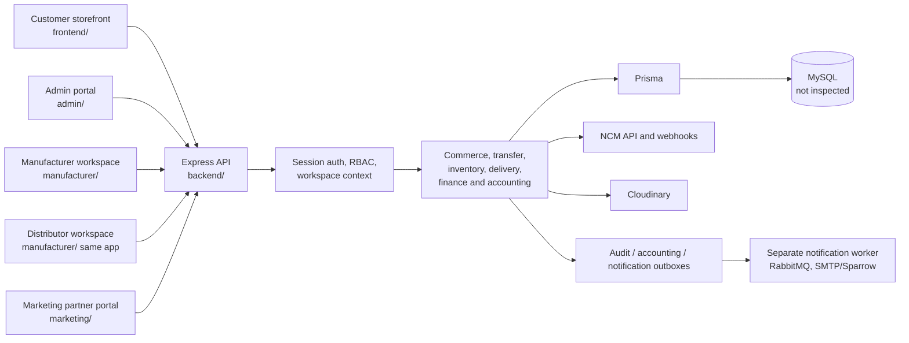
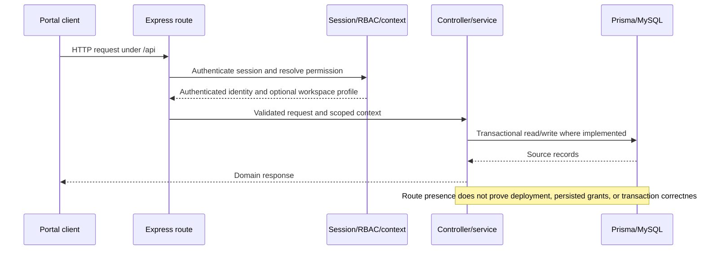
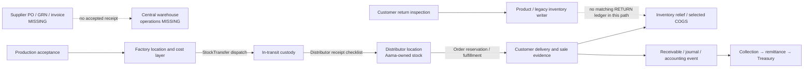
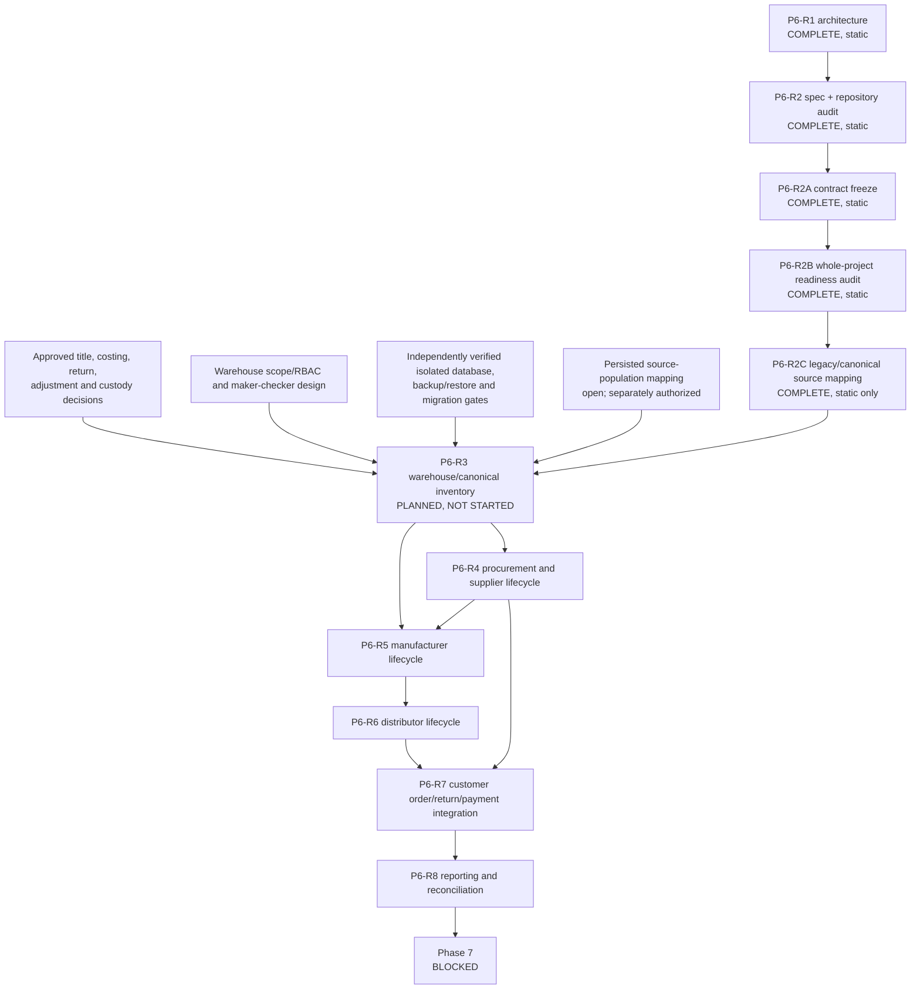

# P6-R2B — Whole-Project ERP Implementation Readiness Audit

**Status:** COMPLETE — STATIC SOURCE AND DOCUMENTATION AUDIT ONLY  
**Production implementation:** NOT STARTED  
**Database, migration, and external-system verification:** NOT PERFORMED  
**P6-R3:** PLANNED — NOT STARTED

## 1. Executive summary

This audit maps the current multi-portal application and backend domains against
the proposed Aama Clothings ERP. It is based on static source, schema,
test-name/test-source, and documentation inspection. It does not establish
deployed behavior, applied migrations, persisted permissions, physical
inventory, supplier evidence, external-provider configuration, or accounting
correctness.

The repository is an active e-commerce and distribution platform with several
substantial production, transfer, delivery, finance, and audit workflows. It is
not yet a unified warehouse/procurement ERP:

1. `InventorySku`, `InventoryLocation`, `InventoryBalance`, and
   `InventoryLedgerEntry` are used in selected production, transfer,
   distributor fulfillment, and return-to-hold flows. Product catalog stock,
   `StockLog`, `ManufacturerInventory`, and other projections remain in use.
2. The Admin product stock-adjustment endpoint and the active customer-return
   inspection path can update legacy stock representations without a matching
   canonical inventory movement. Storefront checkout also updates the catalog
   projection outside the order-creation transaction before a separate
   distributor allocation step.
3. There is no mounted supplier purchase-order, accepted goods-receipt, or
   supplier-invoice matching lifecycle. `InboundShipment` is not evidence of
   an active procurement workflow.
4. The location ledger has no implemented central-warehouse operating model,
   warehouse operator context, warehouse-scoped permission set, or complete
   receive/put-away/pick/pack/count/disposition workflow. The current stock
   transfer is principally factory-to-distributor.
5. Manufacturer production acceptance can receipt good output into a factory
   location and create production cost evidence. It is not a supplier
   procurement flow or a separately accepted central-warehouse receipt.
6. Distributor-held inventory remains owned by Aama Clothings. Existing
   replenishment dispatch/receipt is a custody/location change, not by itself
   revenue, a distributor purchase, or COGS.
7. Stripe and Razorpay package dependencies and configuration names exist, but
   this static search found no active provider initiation, verification, or
   callback implementation. Do not describe online gateway processing as
   implemented or infer payment from `Order.payment`.
8. COD collection, distributor-held cash, remittance, Admin review, Treasury
   posting, and bank reconciliation are separate stages. The first stages are
   represented for supported paths; independent bank-statement reconciliation
   was not found.
9. Session-aware JWT and database-backed permission checks, maker/checker
   workflows, transactional audit outboxes, NCM reconciliation, and notification
   reliability controls are present in selected domains. Warehouse scoping and
   deployed role grants remain unverified.
10. P6-R3 is not ready for production write-path implementation. Its design can
    proceed, but affected legacy writers, source mapping, warehouse RBAC,
    unresolved ownership/cost policies, and isolated database/recovery gates
    must be resolved first.

### Evidence vocabulary

- **Source-verified:** a mounted route/caller and corresponding source path
  exist. This is not a claim that the path is deployed or has correct persisted
  behavior.
- **Partial:** some stages exist, but a material evidence, integration,
  transaction, accounting, or validation stage is missing.
- **Missing:** no mounted end-to-end implementation was found in the reviewed
  repository.
- **Legacy/conflicting:** a parallel writer or representation can disagree
  with the canonical domain path.
- **Unverified:** static inspection cannot establish deployment, database,
  external-provider, physical, or historical facts.
- **Proposed:** target work only; not existing functionality or approved policy.

## 2. Scope, method, and limits

Inspected the four portal source trees and entry points; shared backend server,
route mounts, routes, controllers, services, middleware, configuration,
notifications, scripts, tests, and Prisma schema; implementation trackers and
the P6-R1/P6-R2/P6-R2A and P5 accounting/inventory documentation.

Static repository inventory at audit time:

| Area | Static finding |
|---|---|
| Independent portal apps | `frontend/`, `admin/`, `manufacturer/`, `marketing/` |
| Shared backend | Express API in `backend/`; route, controller, service, middleware, notification, and script directories |
| Distributor app | No separate app directory; distributor workspace is in `manufacturer/` |
| Delivery app | No `delivery/` app directory |
| Shared/support directories | `shared/`, `uploads/`, documentation and database-independent tooling |
| Backend JavaScript source files | 46 route files, 63 controller files, 132 service files, 13 middleware files, 15 notification JavaScript files |
| Prisma | 182 models, 0 Prisma enums, 62 migration directories |
| Backend tests | 208 `*.test.js` files |
| Frontend tests | Standalone Admin and manufacturer decimal-display tests; no portal package defines a test script |

Counts are filesystem/schema text counts, not measures of coverage or deployed
database state. Portal paths and package scripts are independently owned; there
is no root application workspace. The root `README.md` contains legacy claims
about a delivery portal, manufacturer-based order routing, payment providers,
and setup commands that do not match the reviewed source. Prefer this audit,
[Project Overview](../../PROJECT_OVERVIEW.md), and
[Architecture and Backend Reference](../../ARCHITECTURE_AND_BACKEND.md) for
current source-backed descriptions.

No database connection, query, migration, seed, reset, synchronization, build,
test suite, external API, credential value, or customer data was accessed.
The backend startup path connects to MySQL and starts workers/projection work;
it was inspected but not run. Build and database commands were not run.

## 3. Repository and system architecture

The portals are separate Vite/React apps. They consume the shared API and do
not share application code. The manufacturer app also switches into a
distributor workspace for dual-role accounts; this is not a sixth app. There is
no courier-driver portal in the repository.

`backend/server.js` mounts the domain routers and configures request signing,
sanitization, CORS, readiness, logging, workers, and startup behavior. The
usual path is route → authentication/authorization/workspace middleware →
controller/service → Prisma → JSON response, but several controllers still
contain substantial domain logic or direct Prisma writes.

## 4. Portal implementation matrix

| Portal / surface | Implemented responsibilities and source path | Models, permissions, and evidence | Readiness gaps |
|---|---|---|---|
| Customer storefront | Registration, addresses/profile, catalog, cart, checkout, order history, delivery tracking, cancellation, RMA/exchange, loyalty/cards. See `frontend/src/`, `userRoute.js`, `cartRoute.js`, `orderRoute.js`, `returnsRoute.js`, `deliveryRoute.js`. | `AuthAccount`, `User`, `Product`, `Order`, `OrderAssignment`, `DeliveryOrder`, return/exchange records; `customer:*`, `returns:customer_*`, `exchange:customer_*`. Backend tests include auth, order, delivery, and return-accounting suites. | Checkout/order/reservation steps are not one atomic event; catalog and legacy inventory projections remain; online payment provider flow is not source-verified; return restock is not consistently canonical. |
| Admin | Catalog, order control, production approvals, transfer review, delivery/NCM, returns, inventory monitoring, Treasury, AP/AR, GL, access management, reports, audit, and P5 stock-transfer reconciliation. See `admin/src/`, `backend/routes/`, `backend/controllers/`. | Permission-protected routes use `authorize(...)`; notable keys include `order:control`, `inventory:ledger_read`, `stock:adjust`, `accounting:approval_review`, `access:*`, `delivery:*`. | No central-warehouse operations; global product adjustment is not location-scoped; reports do not establish full source-population reconciliation or physical stock. |
| Manufacturer | Production request/start/completion, factory inventory views, finance, and factory-to-distributor shipment preparation/dispatch. See `manufacturer/src/App.jsx`, `manufacturerProductionRoute.js`, `stockTransferRoute.js`. | `ManufacturerProductionRequest*`, `ManufacturerInventoryCostLayer`, `InventoryLocation`, `InventoryBalance`, `InventoryLedgerEntry`; `manufacturer:production_manage`, `manufacturer:production_admin`, `transfer:manufacturer_*`. | Factory production receipt exists for supported paths; raw-material sourcing, universal stage costing, and a distinct Aama central-warehouse handoff are not established. |
| Distributor workspace | Distributor onboarding/profile, replenishment request/receipt, ledger inventory, direct hub orders, assigned customer fulfillment, returns/exchanges, COD evidence, remittance, and settlement. It is selected inside `manufacturer/`. | `Distributor`, `DistributorLocation`, `StockTransfer*`, `DistributorCashEvent`, remittance/settlement records; `setDistributorContext`, `setFulfillmentContext`, and `distributor:*`/`transfer:*` permissions. | Custody is supported, but no ownership transfer is implied. Bank reconciliation, complete cost-layer coverage, and generic warehouse integrations remain open. |
| Marketing partner | Campaign/card, QR validation, redemptions, reports and profile operations. See `marketing/src/`, marketing routes/controllers. | Marketing partner profile and campaign/card/redemption records; `marketing_card:*`; partner-scoped aggregate reporting. | Not a warehouse or payment processor. Historical collaboration tables/records remain distinct from active marketing-card flows. |
| Warehouse operator | No independent portal, profile, context middleware, or complete operational route set found. | `InventoryLocation` and `InventoryBalance` are general location/quantity records, not a warehouse WMS. No `setWarehouseContext` or `warehouse:*` permission was found. | Receiving, put-away, pick/pack, inter-warehouse transfer, physical count, adjustment approval, and warehouse-scoped audit must be designed. |
| Courier/delivery operator | No separate `delivery/` portal. Delivery actions are performed by distributor/manufacturer workspaces and Admin tools; NCM is the external carrier. | Delivery/assignment/NCM models and routes; `delivery:*`, `distributor:delivery_ready`, `manufacturer:delivery_ready`. | Do not plan against a nonexistent courier portal or treat carrier status as company cash collection. |

## 5. Backend domain source map

The following is a compact source map of the 22 requested domains. Permission
names are existing identifiers only; the seed/catalog and route must be checked
together before any change. Test files are examples of the current test
surface, not proof of end-to-end coverage.

| Domain / status | Routes, controller/service, portal consumer | Main records and authorization | Boundaries, tests, and material gap |
|---|---|---|---|
| 1. Identity/access — **partial, source-verified** | `authRoute.js`, `accessManagementRoute.js`; `authController.js`, `unifiedAuth.js`, `authorize.js`; all portals. | `AuthAccount`, `AuthSession`, profile models, `Role`, `Permission`, mappings, MFA/OTP challenges; `access:*`, portal and domain permissions. | Session and database-backed permission checks exist; tests include `authHardening.test.js`, `authRateLimit.test.js`, `rbacAuthorization.test.js`. Deployed grants and least privilege are unverified. |
| 2. Customer management — **partial** | `userRoute.js`, `customerRoute.js`; customer/admin pages. | `User`, `AuthAccount`, addresses/terms/loyalty records; `customer:*`, `access:customer_users_*`. | Account and profile workflows exist. Customer-level ownership still needs route-specific tests; authentication alone is not proof of object scope. |
| 3. Product catalog/variants — **active, conflicting stock projection** | `productRoute.js`, `productController.js`; storefront and Admin. | `Product` (variant JSON and aggregate stock), `InventorySku`; `product:*`, `stock:adjust`, `stock:logs_read`. | Product CRUD/media and normalized SKU identity coexist. The stock adjustment writes `Product`/`StockLog`, not `InventoryBalance`/`InventoryLedgerEntry`. |
| 4. Pricing/promotions — **partial, active** | Location pricing, checkout pricing, shipping, offer, loyalty, marketing-card and gift routes/services; customer/Admin/distributor UIs. | Product and location pricing snapshots; discount, loyalty, card, gift and campaign records; `shipping:*`, `loyalty:*`, `platform:features_manage`, domain read/write permissions. | Server revalidates eligible price/reward data, but older snapshots and Float-backed fields remain. Business-price evidence is not inventory acquisition cost. |
| 5. Cart/checkout — **partial, active** | `cartRoute.js`/controller and `POST /api/order/place`; `orderController.js`, `checkoutPricingService.js`; storefront. | Cart/profile state, `Order.items` JSON, `checkoutGroupId`, pricing snapshots, `InventoryBalance.reservedQuantity`; `customer:cart_*`, `customer:order_place`. | Checkout validates stock/pricing and creates split orders in a transaction. Subsequent legacy catalog stock updates and distributor assignment/reservation are separate work; failure/retry across those boundaries requires explicit reconciliation. |
| 6. Customer orders — **partial, active** | `orderRoute.js`, `orderController.js`, cancellation/control/assignment controllers; storefront/Admin/distributor. | `Order`, `OrderAssignment`, `Order.items` JSON, `DeliveryOrder`; `order:*`, `customer:order_*`. | Assignment and cancellation controls exist. A single order row is not payment, delivery, sale, or collection evidence; direct order paths differ in inventory and cash treatment. |
| 7. Payments — **partial; gateway flow not found** | Finance/accounting order-receipt routes and services; Admin. | `Order.payment` Boolean, `CashTransaction`, `FinancialAccount`, `AccountingDocument`, journals; `finance:receivable_collect`, Treasury and accounting permissions. | No dedicated Stripe/Razorpay payment transaction or provider callback path found in routes/controllers/services. Installed npm packages and env names do not prove an integration. |
| 8. Refunds/cancellations — **partial** | `returnsRoute.js`, customer return/exchange controllers/services, `orderCancellationService.js`; customer/Admin/distributor. | `CustomerReturn`, return events, `OrderExchangeRequest`, `SalesInvoiceAdjustment`, AP/cash/journal records; `returns:*`, `exchange:*`, `order:customer_cancel`. | Approval, receipt/inspection, evidence and refund stages exist. Return stock mutation is not a canonical movement; paid cancellations route to refund controls. |
| 9. Delivery/fulfillment — **active, partial** | `deliveryRoute.js`, `stockTransferRoute.js`, delivery/NCM controllers and services; distributor/manufacturer/Admin. | `DeliveryOrder`, `DeliveryEvent`, `NcmRequestAttempt`, `NcmWebhookEvent`, shipment events; `delivery:*`, workspace permissions. | Server-side NCM calls, webhook history, ambiguity states and reconciliation exist. Provider deployment, missed callbacks, status semantics, and COD cash remain separately unverified. |
| 10. Inventory/movements — **partial, dual representation** | `inventoryLedgerRoute.js`, `stockTransferRoute.js`, `distributorRoute.js`; `inventoryLedgerService.js`, `stockTransferService.js`, `distributorOrderInventoryService.js`, `stockSyncService.js`. | `InventorySku`, `InventoryLocation`, `InventoryBalance`, `InventoryLedgerEntry`, transfer/receipt/discrepancy/cost-layer records; `inventory:ledger_read`, `transfer:*`, `distributor:inventory_*`. | Canonical movements are transaction/idempotency-aware for supported flows. Not every legacy writer posts them; product stock is a derived projection in supported distributor flows but still a legacy write target elsewhere. |
| 11. Warehouses/locations — **missing as an operating domain** | Inventory ledger routes and Admin views only; no warehouse router/context. | `InventoryLocation.kind` is a string for factory, distributor, transit and condition/return kinds; no warehouse profile/model or warehouse permission scope found. | A location row is not receiving, bin, put-away, pick/pack, count, or independent approval functionality. |
| 12. Procurement/suppliers — **missing end-to-end** | Supplier-return routes and AP/expense routes; no mounted PO/GRN/invoice lifecycle found. | `AccountingParty`, `OperatingExpense`, AP, `SupplierReturn`, legacy `InboundShipment`; no active PO/GRN/supplier invoice model family found. | Supplier bill/AP and supplier-return credits exist, but they are not accepted inventory or acquisition-cost evidence. Three-way match and supplier cost layers are missing. |
| 13. Manufacturing/production — **partial, source-verified** | `manufacturerProductionRoute.js`, `manufacturerProductionWorkflowService.js`; manufacturer/Admin. | `ManufacturerProductionRequest`, lines, `ManufacturerInventoryCostLayer`, factory location/balance/ledger, payable/journal. | Supported Admin acceptance records good-unit factory receipt and cost evidence. Production and raw-material title/consumption/warehouse receipt are not a complete supplier or central-warehouse lifecycle. |
| 14. Distributor operations — **partial, active** | `distributorRoute.js`, transfer, delivery, returns, finance and gift routes; distributor workspace. | `Distributor`, `DistributorLocation`, ledger, `StockTransfer*`, cash/remittance/settlement, stock-return records; `distributor:*`, `transfer:*`. | Authenticated profile context scopes supported endpoints. Distributor-held inventory remains Aama-owned; no automatic shortage receivable/liability is approved. |
| 15. Treasury/cash — **partial, active** | Financial/Treasury routes and controllers/services; Admin and supported distributor finance. | `FinancialAccount`, `CashTransaction`, remittance batches, distributor cash events; `finance:treasury_*`, `finance:cash_transfer`, settlement permissions. | Internal receipt/payout paths exist. No bank statement line/import and independent bank reconciliation domain was found. |
| 16. Accounting/GL — **partial, active** | `accountingRoute.js`, financial routes, `accountingPostingEngine.js`, journal/outbox services; Admin. | `Account`, `JournalEntry`, `JournalLine`, `AccountingEvent`, fiscal periods/close events; `accounting:*`. | Double-entry posting, reversal policy, approval queue, reporting and period-close workflows exist in scoped paths. Source completeness, persisted reconciliation, and broad deployment state remain open. |
| 17. Receivables/payables — **partial, active** | Finance, Treasury, manufacturer/distributor settlement, supplier-return routes/services. | `AccountReceivable`, `AccountPayable`, `AccountingParty`, `AccountingDocument`, `AccountingAllocation`, `FinancialPayout`. | Source-linked collections/payouts and correction workflows are present in selected areas; historical/source population and external settlement evidence remain incomplete. |
| 18. Valuation/COGS — **partial, policy-blocked** | Production cost, order fulfillment, COGS/report services; Admin/manufacturer/distributor. | `ManufacturerInventoryCostLayer`, `ManufacturerInventoryCostAllocation`, transfer line cost-layer links, order snapshots, `Product.costPrice`, legacy manufacturer cost fields. | Some accepted production cost is allocated to supported flows. No universal approved costing method, supplier cost chain, or complete cost-layer population; catalog cost is not authoritative acquisition cost. |
| 19. Reconciliation — **bounded, read-only** | P5-R16–R19 calculator/formatter/loader/Admin route; finance and Admin reports. | Transfer/shipment/receipt/discrepancy/ledger/balance evidence; `inventory:ledger_read`. | P5-R19 reads bounded transfer pages and reports incomplete coverage. It is not physical count, all-inventory, procurement, bank, or full accounting reconciliation. |
| 20. Reporting/dashboards — **partial, active** | Product analytics, Admin finance/GL, distributor/manufacturer views, reconciliation APIs; respective portals. | Aggregates from orders, invoices, ledgers, costs, journal/subledgers; scoped report permissions. | Several reports explicitly disclose estimates/exclusions. Reports do not prove complete source coverage or external settlement. |
| 21. Audit/compliance — **partial, active** | `accessManagementRoute.js`, audit services/outbox, domain event histories; Admin. | `SystemAuditLog`, `SystemAuditOutbox`, `AuthAuditLog`, accounting approvals and domain histories; `access:audit_*`, domain audit permissions. | Transactional audit-outbox use and redaction exist for supported changes. Read access is not universally logged; application append-only convention is not tamper-proof storage. |
| 22. Notifications/background processing — **partial, separate worker** | `backend/notifications/`, notification routes, startup workers, scheduled one-shot reconciliation scripts. | `Notification`, `NotificationOutbox`, queue records; notification configuration and channel gates. | At-least-once queue behavior, bounded retry and `UNKNOWN` state are documented. Most business flows do not notify automatically; inbound SMS has no business processor; provider delivery is not guaranteed. |

## 6. Prisma model and relationship inventory

This section describes schema declarations only. It does not establish that
migrations are applied, constraints deployed, records populated, or relations
consistent in any database.

### 6.1 Domain families and relationships

| Domain | Representative models and relationships | Important limitation |
|---|---|---|
| Identity/RBAC | `AuthAccount` → `AuthSession`, account-role mappings → `Role` → `Permission`; profiles include `User`, `Admin`, `Manufacturer`, `Distributor`, and `MarketingPartner`. | Static role catalog is not deployed-role evidence. |
| Customer/catalog | `User`; `Product` → normalized `InventorySku`; product variants/options and many historical order snapshots remain JSON. | `Product.stockQuantity` and variant JSON are not a location ledger. |
| Orders/payments | `Order` relates to customer, assignment/delivery, distributor, invoice, cost allocations, cash events and returns; items are stored as JSON. `Order.payment` is a Boolean marker. | No normalized `OrderLine`/gateway `Payment` model was identified; item and payment evidence are split among snapshots and finance records. |
| Inventory | `InventorySku` → `InventoryBalance` → `InventoryLocation`; `InventoryLedgerEntry` links SKU, optional source/destination locations and optional production cost layer. | `InventoryLocation.kind` is free-form string; location record does not provide warehouse operations or access scope. |
| Transfers | `StockTransfer` → lines → shipments/line cost allocations, shipment events, receipts/receipt lines, discrepancies and reviews. | Multiple transfer/shipment statuses coexist with ledger evidence; a status is not proof of dispatch or accepted receipt. |
| Manufacturer | `ManufacturerProductionRequest` → lines, `ManufacturerInventoryCostLayer`, cost allocations and legacy `ManufacturerInventory`/movement records. | Supported production layers are not supplier acquisition layers or universal valuation. |
| Distributor | `Distributor`, `DistributorLocation`, cash/remittance/settlement, `DistributorStockReturn` → collections/receipt/inspection/events. | These represent custody/operations; they do not approve distributor ownership or automatic liability. |
| Returns | `CustomerReturn`/events, `OrderExchangeRequest`/events, `SalesInvoiceAdjustment`, supplier and distributor return records. | Return lifecycle is operationally richer than canonical inventory restock; disposition, costing and financial treatment remain distinct. |
| Procurement/AP | `AccountingParty`, `OperatingExpense`, `AccountPayable`, `SupplierReturn`, credit applications, legacy `InboundShipment`. | No active PO, accepted GRN, supplier invoice matching, or acquisition-cost layer chain was found. |
| Accounting/Treasury | `Account`, `JournalEntry`/`JournalLine`, `AccountingDocument`/allocations, `AccountPayable`, `AccountReceivable`, `FinancialAccount`, `CashTransaction`, `AccountingActionApproval`. | No database-backed balance/reconciliation verification was performed. No bank-statement line model was identified. |
| Audit/events | `SystemAuditLog`/`SystemAuditOutbox`, `AuthAuditLog`, `AccountingEvent`, `NotificationOutbox`, delivery/NCM and transfer event histories. | Different domains use distinct event identities, status history and idempotency scopes; they are not one universal event ledger. |

### 6.2 Duplicate, weak, or ambiguous representations

- **Stock quantity:** `Product.stockQuantity`, `Product.variants`, `StockLog`,
  `ManufacturerInventory`, `ManufacturerInventoryMovement`, and canonical
  balances/movements overlap. `stockSyncService.js` derives the product
  projection from active distributor ledger balances for supported checkout
  paths; other code still writes the projection directly.
- **Movement/status:** order status, fulfillment status, delivery status,
  transfer status, shipment status, webhook history and ledger movement each
  describe different facts. A status cannot substitute for actor, quantity,
  evidence, or a movement.
- **Orders:** `Order.items` JSON snapshots are not normalized line foreign
  keys. Cost allocations and returns must match product/variant snapshots
  without assuming every historical line has canonical SKU identity.
- **Payments/refunds:** the order Boolean does not identify gateway, settlement,
  cash receipt, or invoice allocation. Refund operation spans return records,
  payables/cash, sales adjustments and journals.
- **Cost:** production layers and selected per-order snapshots coexist with
  Float-backed `Product.costPrice` and older manufacturer fields. No universal
  approved method exists.
- **Procurement:** `InboundShipment` is legacy/unmounted evidence, not a
  current three-way match. Supplier AP/expense records do not prove quantity
  received or accepted.
- **Precision:** canonical inventory quantities are Prisma `Int`; older JSON
  quantities may be parsed through JavaScript `Number`. Monetary fields include
  both Decimal and legacy Float values. Internal Decimal helpers cannot recover
  precision already lost in Float-backed sources.
- **Uniqueness:** canonical ledger entries have a unique idempotency key and
  SKU/location balances have compound uniqueness in the schema. Other domains
  have local idempotency keys, but no single business-event uniqueness contract
  covers every legacy writer or external callback.
- **Ownership/custody:** canonical location and movement records distinguish
  platform ownership from manufacturer/distributor/custodian association.
  Supplier and manufacturer title boundaries remain unresolved outside the
  confirmed distributor ownership rule.
- **Schema deployment:** unique/index/FK declarations are Prisma source facts
  only; applied migrations and database-level enforcement remain unverified.

The pure legacy reconciliation planners in `inventoryLedgerService.js` can
classify selected manufacturer inventory differences. The guarded
`backfillInventoryLedger.js` script has a dry-run/apply distinction and an
explicit confirmation gate; it was not run. This does not constitute a
full-population source map, a verified backup, or authorization to backfill.

## 7. Cross-domain journey evidence

| Journey | Implemented stages and source evidence | Integrity and control boundary | Missing work / acceptance requirement |
|---|---|---|---|
| **A. Procurement → warehouse** | Supplier party/AP/expense and supplier-return functions exist. Schema search found no mounted PO, accepted GRN, supplier invoice-match or supplier acquisition cost-layer workflow. | An expense, supplier invoice reference, `InboundShipment`, or AP balance is not proof of accepted units. No inventory receipt transaction exists for this chain. | Design supplier identity/PO versioning, partial receipt and rejection, invoice/receipt match, cost evidence and location receipt; acceptance must reconcile PO–GRN–invoice–AP–ledger without inferring cost or VAT. |
| **B. Manufacturing → warehouse** | Admin production request → manufacturer pre-check/start/completion → QA/actual good counts → Admin acceptance. Supported acceptance can write a production cost layer and `PRODUCTION_RECEIPT` to a factory location. | Good output receipt and cost records share a source transaction in supported paths. This is factory stock; no separate warehouse dispatch/receipt or raw-material evidence follows automatically. | Approve title/recognition, raw-material scope, central warehouse handoff and independent receiver; test good/damaged quantities, retry, rollback and cost-layer/ledger/payable ties. |
| **C. Warehouse → distributor** | Existing `StockTransfer` request/review, preparation, local/NCM booking, custody dispatch, in-transit state, distributor good/damaged/missing receipt and discrepancies. | Owner remains Aama. Dispatch, carrier delivery and distributor accepted receipt are separate. A transfer is not revenue, distributor purchase or COGS. Supported operations use transaction/idempotency controls; persisted concurrency is unverified. | Generalize source to approved warehouse locations only after warehouse scope/RBAC and source mapping; prove partial shipment/receipt, duplicate replay, discrepancy and physical count. |
| **D. Distributor → customer** | Storefront stock availability uses distributor ledger projection and assignment; supported fulfillment consumes canonical distributor stock and selected cost layers. Direct distributor orders have a ledger-backed path. | Order placement, payment marker, delivery, sale posting, collection and remittance are distinct. Storefront order creation, product projection decrement and later distributor assignment are not one atomic transaction. Some older direct/admin paths use legacy stock. | Unify supported order writers/reservations; require shipment/order-to-ledger linkage and explicit payment/collection evidence; report uncosted units without choosing a costing policy. |
| **E. Central warehouse → customer** | No central-warehouse customer allocation, pick/pack/dispatch or customer delivery source was found. Customer availability is based on distributor hubs. | A generic `InventoryLocation` does not provide central fulfillment capability. Do not silently route factory or transit stock to checkout. | Only add after warehouse operations, location authorization, reservation and delivery evidence are approved and tested. |
| **F. Customer return** | RMA request, Admin decision, NCM handoff/unknown-outcome resolution, physical-return milestone and inspection/refund flows exist. `inspectCustomerReturn` can reverse selected cost-layer allocations, then writes legacy `ManufacturerInventory`/projection or `Product` stock and `StockLog`; no matching canonical `RETURN` movement is present in that path. | Return received/inspected good units, damaged units, refund payable, and accounting posting are separate. Current path can change stock without a canonical location/custody movement. | Make the approved return quantity/location and cost-restoration action canonical; preserve original sale and evidence; keep refund/credit and physical disposition separately authorized. |
| **G. Distributor return** | Separate stock-return authorization, collection, transit, receipt and inspection workflows exist; stock remains in return-hold/receipt locations and discrepancies can be recorded. | Inspection/proposed disposition is not final restock, write-off, liability or GL posting. Cost layer is not automatically restored/unallocated. | Approve central receiving location, final disposition, cost restoration and any financial treatment; keep shortage/damage in an exception state until resolved. |
| **H. COD collection** | Supported distributor self-delivery has bounded collection/OTP evidence, `DistributorCashEvent`, remittance submission/review and Treasury posting paths. NCM delivery and customer payment state remain separate. | Delivered status is not cash collection. Collector-held cash is not company Treasury. Remittance review is not an independent bank statement match. | Add independently sourced bank/cash reconciliation and exact source allocation; prove COD order → collection → remittance → Treasury → bank with reversals and idempotency. |
| **I. Stock adjustment** | `POST /api/product/adjust-stock` requires authentication and `stock:adjust`, and audits a legacy product update plus `StockLog`. | No location/custodian, canonical balance/movement, cost layer, or maker/checker disposition is part of this route. | Replace/gate it with a scoped, approved canonical adjustment; record evidence, actor, exact SKU/location, before/after, reason, cost/GL assessment and reversal link. |
| **J. Period-end accounting** | Journal, GL, trial balance, financial statements, subledger reports, fiscal periods, monthly close/reopen approval, and period-close pack workflows exist. | Close evidence references are not independently validated source documents. Source population, bank reconciliation, historical openings, inventory valuation, and some Decimal/report coverage remain partial. | Complete phase-specific source-to-subledger/GL reconciliations, cutoff and exception coverage, BS/AD boundary tests, immutable approval/reversal and independent Finance review before close reliance. |

### 7.1 Cross-domain transaction and replay observations

- `applyInventoryMovement` is the canonical movement writer for supported
  flows and uses the caller transaction, exact movement identity, and
  idempotency key. A unit test covers atomic/idempotent behavior with a mock;
  that is not proof of database locking or rollback.
- Stock transfer and supported production completion have transactional
  business paths. NCM order creation is one-shot where the outcome can be
  ambiguous; unknown outcomes require reconciliation rather than optimistic
  success.
- Storefront checkout creates order records before later projection updates
  and distributor assignment. Treat partial completion as a reconciliation
  state, not as evidence every side effect committed.
- Return inspection is transactional for its selected business writes, but
  the inventory mutation remains in legacy sources. Transactionality does not
  make a noncanonical stock writer canonical.
- Accounting and audit outboxes provide replay boundaries in selected domains.
  Each domain has distinct identifiers and transaction scope; no global
  exactly-once transaction spans MySQL, NCM, RabbitMQ, Cloudinary, SMTP, or a
  bank.

## 8. Financial and accounting readiness

### Confirmed boundaries

- The internal NPR policy is two decimal places with HALF_EVEN quantization at
  approved boundaries, effective **2026-11-15**. It is internal bookkeeping
  policy, not statutory tax guidance or CA approval.
- Order creation is not automatically revenue recognition. Payment receipt is
  not automatically fulfillment. COD delivery is not proof of cash collection.
- Customer collection, collector-held cash, remittance, Admin review, and
  internal Treasury receipt are separate evidence and accounting events.
- Distributor-held inventory remains Aama-owned; transfer/receipt is custody,
  not distributor sale, revenue, receivable, or COGS.
- A supplier estimate, quoted cost, product catalog price/cost, or user-entered
  invoice reference is not independently verified acquisition cost or
  recoverable input VAT.
- No FIFO, weighted-average, or other universal cost-flow method is selected.
  Supplier/manufacturer title, landed-cost allocation, damage/loss liability,
  return valuation, and inventory recognition timing remain unresolved unless
  an approved source policy applies.

### Current implementation and remaining Phase 4/5 gaps

- Accounting journal/posting, source-linked documents, AP/AR, Treasury,
  account mappings, selected maker/checker actions, monthly period close, and
  report-basis disclosures are implemented in scoped flows.
- Phase 4 remains **INCOMPLETE**: Decimal adoption is not universal; legacy
  `Float` sources include order amounts, catalog costs and manufacturer
  inventory/cost data. Nepali calendar support is implemented in scoped
  reports/periods but historical and cross-domain conversions still require
  validation.
- Phase 5 remains **PARTIAL / INCOMPLETE**: source population, opening
  balances, subledger-to-GL completeness, payment-provider/bank evidence,
  supplier acquisition cost, inventory valuation/COGS, refunds and report
  coverage remain incomplete.
- P5-R16–R19 is a bounded, read-only stock-transfer reconciliation stack. It
  is not a physical count, full inventory source census, supplier
  reconciliation, bank reconciliation, or accounting close validation.
- Tax, seller-registration, VAT, tax filings and financial statements are
  internal workflows/workpapers. This audit makes no statutory compliance,
  tax-authority, auditor, or professional approval claim.

Do not post estimated values as authoritative costs or recoverable VAT. Keep
unknown cost, incomplete evidence, and unresolved policy visible as exceptions.

## 9. Security, authorization, and operational controls

### Existing controls verified in source

- `unifiedAuth.js` validates session/profile/workspace context and exposes
  `req.userId` for customer requests. Manufacturer/distributor context
  middleware derives the active profile and removes client-supplied profile
  overrides.
- `authorize.js` resolves database-backed permission mappings. The
  manufacturer/distributor dual-role union is a bounded special case, not a
  general role union.
- Protected routes generally compose authentication and a permission code.
  Admin control routes in inspected examples also require an Admin role.
- `all:function` exists as a full authorization bypass and must remain excluded
  from ordinary Admin roles; built-in broad Admin grants are not a least-
  privilege audit.
- `SystemAuditOutbox`/`SystemAuditLog`, auth audit events, redaction, request
  correlation, rate-limit signals, maker/checker approval records, and domain
  events exist in selected paths.
- Secure upload middleware checks allowed image MIME types, magic bytes, and
  size limits. Cloudinary and local evidence upload paths are external/storage
  boundaries, not proof of retained evidence availability.
- NCM webhook routes are excluded from the general request-signature
  middleware and use the NCM webhook secret path. Event history and duplicate
  handling exist for supported webhook flows.

### Material gaps and required validation

1. **Warehouse isolation:** no warehouse context/profile/permission scope was
   found. `stock:adjust` is product-global and does not specify location.
   Introduce narrow location-scoped permissions only after role/scope design;
   do not invent existing identifiers.
2. **Resource scope:** authenticate/permission is not sufficient by itself.
   Verify each customer, distributor, manufacturer, return, transfer and
   financial object lookup uses the authenticated principal/workspace. Static
   inspection confirmed customer identity is populated by auth middleware on
   the order-history path; dynamic cross-profile authorization tests were not
   run.
3. **Request-signature secret:** `VITE_HMAC_SECRET` is embedded in browser
   bundles and is not confidential. Treat request signing as compatibility
   integrity only; JWT/session/RBAC and webhook verification remain required.
4. **Webhook configuration:** the delivery webhook accepts the configured
   secret through multiple request locations. Code permits an absent secret
   outside exact `NODE_ENV=production`; staging or unspecified environments
   must not rely on that permissive fallback. Configure/verify callback auth,
   logging redaction, replay handling, and provider allowlists in deployment.
5. **Rate limiting:** the auth limiter is process-local; multiple backend
   replicas do not share counters without a distributed mechanism.
6. **Audit limits:** routine reads are not universally audited; application
   append-only history is not immutable against database administrators.
   Access review, retention, archive, and incident-response controls are
   operational prerequisites.
7. **Credential hygiene:** existing notification documentation flags a
   tracked manufacturer environment file as requiring credential rotation and
   repository-security remediation. This audit did not read any environment
   file or credential value. Handle rotation/removal through a separate
   approved security operation.
8. **Deployment state:** no live role grants, MFA configuration, CORS
   allowlist, webhook secret, file-store configuration, rate-limit deployment,
   backup, or retention policy was inspected.

No route was probed or tested against a live service. The route evidence above
is a static authorization map, not a penetration test.

## 10. External integrations and failure boundaries

| Integration | Source-verified use | Authentication/idempotency/retry | Reconciliation and limitation |
|---|---|---|---|
| Stripe | `stripe` dependency and configuration names are present. No active server call, payment initiation, verification, or webhook route found in the reviewed routes/controllers/services. | No executable flow verified. | Treat as unimplemented/unverified; package presence is not integration evidence. |
| Razorpay | `razorpay` dependency and configuration names are present. No active server call, payment initiation, verification, or webhook route found in the reviewed routes/controllers/services. | No executable flow verified. | Same limitation; do not infer payment settlement or customer `Order.payment` from provider configuration. |
| Nepal Can Move (NCM) | Server-side `ncmClient.js` used for delivery, stock-transfer booking, branch/rate, tracking, returns and Admin operations. | Server credential; one-shot booking for ambiguous create, bounded reads/retries where allowed; webhook secret and event deduplication in supported flows. | Unknown/failed handoffs remain unresolved; manual sync/reconciliation exists. No live vendor account, callback registration, rate limit, or end-to-end carrier evidence inspected. |
| COD/distributor collection | Delivery and distributor workflows record OTP/collection evidence, cash events, remittance, Admin review and Treasury posting for supported paths. | Application idempotency and accounting controls vary by workflow. | No bank statement integration or independently verified settlement source found. |
| Cloudinary | Server-side media/contract/upload adapter is present. | Upload validation is present at selected route boundaries; provider credentials are server-side by design. | No remote call made; deployment, object retention, access policy and deletion state unverified. |
| Email/SMS | Separate worker, RabbitMQ, SMTP/Sparrow providers, notification outbox, MFA/recovery callers. | At-least-once delivery; bounded retry; ambiguous provider outcome remains `UNKNOWN`, not auto-retried; channel gates are documented. | Provider acceptance is not delivery. Most business flows do not send notifications; inbound SMS is stored but has no business processor. |
| MySQL/Prisma | Primary persistence path; startup connects and initializes services. | Transactions and uniqueness are code/schema scoped; DB safety scripts guard migration/maintenance/integration entry points. | No connection or database verification performed. Schema and migration files do not establish applied state. |
| Other services | No additional active external integration was source-verified in the reviewed backend domain paths. | Not applicable. | Do not infer integrations from UI libraries or env-name presence. |

## 11. Tests and assurance

The backend has 208 `*.test.js` files using Node's test runner. Fifteen file
names contain `integration`, `database`, or `migration`; the source tree
includes a database-safety test harness and database integration tests that
are gated/opt-in. There are also pure tests, mocked service/controller tests,
API-shaped route tests, concurrency-labeled tests, and regression suites.
Portal packages do not expose test scripts; two standalone decimal-display
tests exist in Admin/manufacturer source trees.

Representative existing tests include:

- Canonical inventory/transfer: `inventoryLedgerService.test.js`,
  `stockTransferService.test.js`, `stockTransferReconciliation*`.
- Production/distributor: `manufacturerProductionWorkflowService.test.js`,
  `distributorOrderInventoryService.test.js`,
  `distributorStockReturnService.test.js`.
- Order/delivery/COD: `orderShipmentSplitting.test.js`,
  `orderPaymentAccountingService.test.js`, `deliveryAutomation.test.js`,
  `distributorDeliveryOtp.test.js`.
- Finance/accounting: accounting posting, ledger, outbox, subledger, period
  close, supplier-return, payout and selected concurrency tests.
- Auth/permissions: `authHardening.test.js`, `authRateLimit.test.js`,
  `rbacAuthorization.test.js`, `accessManagementService.test.js`.

Assurance gaps:

- Most unit/service and route tests use mocks or synthetic fixtures; they do
  not establish persisted transaction isolation, foreign-key/unique constraint
  deployment, rollback, migration state, or historical population.
- No database-backed test, build, migration, or full suite was run for this
  documentation-only audit. The isolated-database target was not independently
  verified.
- No dedicated warehouse/procurement/accepted-GRN test suite exists because
  those complete domains were not found.
- No portal end-to-end test runner or workflow suite was found.
- Add targeted route ownership/permission tests, database concurrency/rollback
  tests in an explicitly isolated environment, migration tests, and source to
  subledger/GL reconciliation before release. Do not describe mocks as
  persisted correctness.

## 12. Duplicate, conflicting, and legacy implementation register

| Responsibility | Parallel representations | Current authority / conflict | Safe direction |
|---|---|---|---|
| Product sellable stock | `Product.stockQuantity`, variant JSON, `StockLog`, canonical distributor ledger projection | Ledger is source for supported checkout allocation; direct legacy stock writers remain. | Make projection read-only/derived for canonical paths; inventory mutations must name SKU/location and ledger source. |
| Factory stock | `InventoryBalance`/`InventoryLedgerEntry`, `ManufacturerInventory`, `ManufacturerInventoryMovement` | Supported production/transfer paths dual-write selected legacy projections; historic coverage is unknown. | Map and reconcile before retiring or backfilling legacy data. |
| Cost/COGS | Production cost layers, per-order snapshots/allocations, legacy product/manufacturer cost fields | Scoped verified production evidence plus incomplete/legacy fallbacks; no universal method. | Preserve source tier and provenance; do not use `Product.costPrice` as authoritative substitute. |
| Order state | `Order.status`, `fulfillmentStatus`, assignment, `DeliveryOrder`, provider events | Each represents a distinct lifecycle stage. | Define source event and transition ownership; do not infer dispatch, sale, or payment from one status. |
| Transfer evidence | `StockTransfer.status`, shipment status/provider history, receipt checklist, ledger entries, discrepancy | Related but not interchangeable facts. | Reconcile line quantity across approved/dispatched/received/good/damaged/missing/transit. |
| Return | RMA lifecycle, legacy product/manufacturer stock, stock logs, cost allocations, refund/AP/journal | Operational state and cost reversal coexist without a canonical return movement in customer-return inspection. | One approved physical disposition event plus separate financial treatment and reversal links. |
| Supplier evidence | Expense/AP, supplier return/credit, `InboundShipment` | Does not represent PO acceptance, GRN, inventory receipt, or 3-way match. | Design procurement before adding supplier inventory/cost writes. |
| Customer payments | `Order.payment`, cash receipts, receivables, invoice allocations, provider package dependencies | No gateway evidence model/callback found; multiple internal states can be confused. | Explicit payment/collection/settlement records and reconciliation; never treat Boolean as a provider transaction. |
| Audit and history | System audit, auth audit, domain events, accounting events, provider events | Different retention/idempotency and transaction boundaries. | Keep domain history source-linked; define cross-domain reconciliation without merging identifiers. |

## 13. Consolidated gap and dependency register

Risk ratings describe business impact if the gap is relied on without controls;
they are not breach or loss determinations.

| ID / priority | Classification and evidence | Business impact | Dependencies and proposed remediation | Recommended phase / acceptance |
|---|---|---|---|---|
| G1 — **Critical: canonical stock writes** | Legacy/conflicting. `productController.adjustStock`, `orderController.placeOrder`, and `customerReturnWorkflowService.inspectCustomerReturn` update product/legacy stock without a matching canonical movement. | Sellable catalog quantity can disagree with location, custody, reservation, and cost evidence. | Define affected sources, replacement/gating plan, ownership/location and adjustment/return policy; use one transactional ledger writer. | R3 prerequisite. Every supported writer produces idempotent SKU/location movement and balance; replay/conflict, rollback and physical count reconcile. |
| G2 — **High: warehouse operating model** | Missing. Location schema exists; no warehouse operations/context/permission set found. | No controlled central receiving, internal transfer, pick/pack, count, or disposition. | Approve location taxonomy, operator scope, separation of duties and event evidence. | R3. Route deny/allow tests prove location scope; partial receive/dispatch/count and correction trace to ledger/audit. |
| G3 — **High: source mapping** | Unverified/open. Reconciliation planners and guarded backfill script exist; full legacy/canonical source mapping was not done in this audit. | Backfill/cutover may duplicate, omit, or misclassify quantity/cost history. | Separately schedule read-only mapping; independently verify isolation/backup before persisted validation. | Open prerequisite before R3 writes. Every population maps or remains explicit exception; no history rewrite or heuristic duplicate conclusion. |
| G4 — **High: procurement and inventory acquisition** | Missing. No PO/GRN/invoice acceptance and cost-layer chain. | Received units, AP, cost, VAT evidence and stock cannot be reconciled end to end. | Approve supplier/title/receipt/landed-cost policy; design alongside warehouse receipt. | R4 after R3 foundations. Partial PO-GRN-invoice match and accepted-unit provenance reconcile through AP/GL. |
| G5 — **High: customer-return stock** | Partial/conflicting. Active inspection can adjust legacy inventory and cost allocations but not canonical return movement. | Returned units can change sellable stock without explicit location, custody, or ledger evidence. | Resolve disposition and cost restoration; gate legacy path; preserve refund/accounting independence. | R3/R7 dependency. Every good/damaged/missing unit has distinct authorized disposition and source-linked ledger movement. |
| G6 — **High: valuation/COGS** | Partial/business-decision blocked. Production cost layers exist; supplier cost absent; legacy Float/catalog fallback remains. | Margin, inventory value and COGS may be estimates or incomplete. | Management/Finance approves method, landed-cost allocation, returns and uncertain-cost treatment. | R4–R8. Reports disclose exact cost coverage; no method or cost is silently inferred. |
| G7 — **High: customer order transaction chain** | Partial. Order creation, catalog update and distributor assignment/reservation have separate boundaries. | Retries/failures can leave order, stock projection and reservation state out of sync. | Define stable request/business-event keys and transactional/idempotent assignment. | R7. Injected failures/retries leave one order, one reservation and consistent ledger/projection. |
| G8 — **High: customer/distributor payment evidence** | Partial/unverified. No active Stripe/Razorpay path; cash/COD and accounting records exist. | Order paid status may be mistaken for gateway settlement or collection. | Implement only after provider/business approval; explicit event/source, verification, replay and clearing reconciliation. | R7. Provider or manual receipt matches order, currency/amount and settlement; ambiguous outcomes remain pending. |
| G9 — **High: COD/bank reconciliation** | Partial. Cash declaration/remittance/Treasury routes exist; no bank-line source found. | Internal review cannot independently prove bank settlement or unmatched funds. | Define bank evidence, reconciliation workflow, variance, reversal and custody model. | R6/R8. Statement lines independently match Treasury receipts and retain unmatched/ambiguous exceptions. |
| G10 — **High: warehouse RBAC/resource scope** | Missing/unverified. No warehouse context or scoped role identifiers; deployed role assignments not inspected. | Cross-location data or mutation may exceed intended operator scope if built on generic Admin permissions. | Review role matrix; add identifiers only through approved RBAC change; test object scope server-side. | Before R3 route implementation. Unauthorized location/profile IDs are denied at service/route tests. |
| G11 — **Medium: external callback security/configuration** | Blocked by external deployment. NCM webhooks and event deduplication exist, but environment/provider callback setup is unverified; code has permissive no-secret non-production behavior. | Forged, replayed, missed, or ambiguous external status could corrupt operational state if deployment assumptions are wrong. | Confirm secrets, ingress, redaction, replay and provider contract with operations. | Before external release. Signed/configured callback tests, replay/stale tests and manual recovery path demonstrated. |
| G12 — **Medium: report and source completeness** | Partial. P5 reconciliation is bounded to transfer evidence; reports have source-specific exclusions. | A clean subset can be mistaken for complete ERP reconciliation. | Maintain explicit coverage metadata and separate physical, cost, GL, bank and supplier reconciliation. | R8. Report status cannot be complete if source/page coverage is incomplete. |
| G13 — **Medium: Phase 4/5 evidence** | Partial/blocked by release controls. Decimal, historical data, subledger population and report coverage remain incomplete. | Precision, period cutoff, balance and tax evidence may not be suitable for release decisions. | Continue scoped Phase 4/5 work; verify migration/rollback and independent accounting review. | Prior to any financial reliance; acceptance requires source-to-report and persisted isolated validation. |
| G14 — **Medium: test assurance** | Partial. Many synthetic/mocked suites; no warehouse/procurement E2E; no suite run in this audit. | Unit-level success can be misread as deployed transaction correctness. | Add narrowly targeted tests and safe isolated integration/UAT gates. | Each implementation increment. Required transaction, concurrency, rollback, permission, and reconciliation tests pass in verified isolation. |
| G15 — **High operational security hygiene** | Existing docs flag a tracked environment file requiring credential rotation; values not inspected here. | Exposed credentials could affect external accounts if still valid. | Separate approved security incident/credential-rotation and repository-history operation; do not handle values in this audit. | Before production; rotate/verify providers and confirm repository remediation without exposing secrets. |

## 14. Security and integration review summary

### Route and workspace scope

- Existing backend permission IDs include `stock:adjust`,
  `inventory:ledger_read`, `inventory:admin_read_all`, `transfer:*`,
  `manufacturer:*`, `distributor:*`, `returns:*`, `delivery:*`,
  `finance:*`, and `accounting:*`; they are defined in the RBAC seed and used
  at routes. No `warehouse:*` or `setWarehouseContext` source was found.
- Manufacturer/distributor routes use profile-context middleware in the
  reviewed paths. This is stronger than accepting the request's profile ID,
  but it is not warehouse-level isolation.
- Customer order-history requests pass through `authenticate`, which binds
  the authenticated customer profile into `req.userId`/request context. Static
  route review did not execute cross-account tests.
- Generic Admin role access and `all:function` require deployed-role review;
  code presence alone does not establish least privilege.

### Input, uploads, webhooks, and audit

- Shared request signing is not a confidential factor because the matching
  `VITE_` value is client-visible. Continue to rely on session JWT, server RBAC,
  profile ownership and independent webhook validation.
- NCM webhook acceptance must be environment-configured; non-production
  fallback is permissive if no webhook secret exists. Verify staging and
  unspecified environments rather than inferring safety from production code.
- Secure upload validation provides MIME, magic-byte, filename and size gates
  on selected routes. Static inspection does not establish malware scanning,
  retention, access-control or provider deletion guarantees.
- Audit/outbox events provide traceability for selected mutations; they are
  not complete read telemetry, database-admin tamper evidence, or forensic
  attribution.

## 15. Dependency-aware Phase 6 roadmap

### P6-R3 readiness verdict

**Not ready for production implementation or migration.** The following
prerequisites remain open:

1. Persisted legacy/canonical population and opening-balance mapping with an
   approved read-only scope and verified isolation. P6-R2C is complete for
   repository source mapping only; neither P6-R2B nor P6-R2C inspected
   persisted populations.
2. Business/Finance decisions for warehouse custody, inventory title outside
   distributor-held stock, supplier/manufacturer acquisition/production
   recognition, cost method/landed cost, customer-return restoration,
   adjustment/disposition, and loss/write-off.
3. Warehouse location model, workspace/resource scope, narrow permission IDs,
   maker/checker rules and allow/deny route tests.
4. A replacement/gating plan for Admin adjustment and customer-return legacy
   stock writers, with no silent dual-writer or projection-authority period.
5. Independent verification of isolated database target, backup/restore,
   migration rollback and release authorization. No target was verified here.
6. Synthetic replay/partial/concurrency/rollback tests followed by separately
   approved isolated persisted tests, physical count and cost/GL reconciliation.

Architecture, acceptance criteria, pure calculation design, and source inventory
can proceed without database access. Do not create inventory mutations, routes,
models, migrations, UI, or cutover behavior under this audit.

### Recommended sequencing

1. Keep P6-R1/R2/R2A/R2B as completed static artifacts; retain Phase 4 and 5
   gaps as independent prerequisites.
2. Schedule the open source-mapping/reconciliation gate with an iteration ID
   only after explicit planning approval. Use read-only mapping first; leave
   ambiguous records as exceptions.
3. Design procurement receipt and cost evidence alongside warehouse location
   semantics, before implementing accepted acquisition receipts. Do not make
   procurement a hidden side effect of P6-R3.
4. Start P6-R3 only after mapping, policy, warehouse RBAC, test and
   database/recovery gates; limit the first implementation to a bounded
   warehouse movement/count/adjustment lifecycle.
5. Integrate supplier receipt/cost/AP (R4), manufacturer (R5), distributor
   custody/returns/cash (R6), customer order/payment/returns (R7), then
   complete source-basis reporting (R8).
6. Preserve Phase 7 as blocked; no statutory/professional validation or
   production cutover is implied.

## 16. Decision register

| Classification | Decision/fact | Treatment |
|---|---|---|
| Confirmed business policy | Distributor-held inventory remains owned by Aama Clothings; distributor is custodian and distribution partner. | Preserve in all transfers, reports and future permissions. Do not create automatic distributor liability or receivable. |
| Confirmed business policy | Transfer/receipt alone is not a sale, revenue, or COGS event. | Require separate customer-sale and approved cost evidence. |
| Confirmed internal policy | NPR monetary quantization is two decimals, HALF_EVEN, effective 2026-11-15. | Internal bookkeeping only; no statutory or CA approval claim. |
| Existing implementation fact | Canonical balance/ledger and cost-layer paths exist for selected production, transfer and distributor fulfillment flows. | Reuse where contract matches; do not imply universal coverage. |
| Existing implementation fact | Checkout, returns, stock adjustments, supplier/AP, COD, notifications and audit use distinct source records and transaction boundaries. | Preserve source identity; reconcile rather than merge unrelated statuses. |
| Proposed technical contract | One canonical writer per approved physical stock event; explicit SKU/location/custodian, event source, actor, evidence, idempotency, reversal, and cost classification. | Requires detailed source mapping and implementation review. |
| Proposed technical contract | Warehouse-scoped authorization, independent approval for consequential stock corrections, and complete request-to-business-event replay semantics. | Permission names/role grants and schema constraints are not existing facts. |
| Unresolved business decision | Supplier/manufacturer title and recognition points; approved cost-flow method; landed-cost allocation; return cost restoration; negative/missing cost; damage/loss responsibility and write-off. | Block affected postings or report explicit unresolved evidence. Do not use catalog cost or infer liability. |
| Unresolved business decision | Central warehouse locations, custody stages, count frequency, physical evidence, emergency adjustments, and maker/checker thresholds. | No new warehouse write path until operations/management approval. |
| Unresolved technical/release decision | Legacy conversion scope, canonical source precedence, database isolation, migration/recovery and cutover sequencing. | Open source map and release gate; no DB validation performed. |
| Requires explicit approval | Online gateway provider and settlement model; independent bank reconciliation; customer revenue-recognition policy; phase/iteration assignment for source mapping. | Do not infer implementation or schedule from npm dependency, existing code, or prior tracker labels. |

## 17. Database and release safety blockers

- No database was connected to, queried, migrated, seeded, reset or modified.
- No prohibited database or test database was accessed or assumed safe.
- No Prisma schema, migration, seed, stock, inventory, accounting or financial
  record was changed.
- No API, Admin UI, portal, production service, integration, or external system
  was changed or called.
- No environment file, credential, token, personal data or provider response
  was read or copied into this report.
- `npm test`, portal tests, builds, Prisma generation, migrations, database
  scripts, startup, and workers were not run. Some of these commands load
  Prisma, connect to MySQL, or modify generated/application state.
- The database safety guards and opt-in test design were inspected statically;
  they do not independently verify isolation or authorize a future run.
- A source declaration or synthetic test cannot establish applied migrations,
  real transaction isolation, physical inventory, cost valuation, deployed
  role grants, external settlement, backup/restore, or production readiness.

## 18. Source references

### Architecture and portal boundaries

- [Backend server and route mounts](../../backend/server.js)
- [Authentication/workspace context](../../backend/middleware/unifiedAuth.js)
- [Permission authorization](../../backend/middleware/authorize.js)
- [Manufacturer/distributor workspace switch](../../manufacturer/src/App.jsx)
- [Project overview](../../PROJECT_OVERVIEW.md)
- [Legacy root README](../../README.md)

### Commerce, inventory, returns, and transfer

- [Order routes](../../backend/routes/orderRoute.js)
- [Order controller](../../backend/controllers/orderController.js)
- [Product stock routes](../../backend/routes/productRoute.js)
- [Product stock controller](../../backend/controllers/productController.js)
- [Inventory ledger service](../../backend/services/inventoryLedgerService.js)
- [Stock projection service](../../backend/services/stockSyncService.js)
- [Stock-transfer routes](../../backend/routes/stockTransferRoute.js)
- [Manufacturer production routes](../../backend/routes/manufacturerProductionRoute.js)
- [Customer return routes](../../backend/routes/returnsRoute.js)
- [Customer return workflow service](../../backend/services/customerReturnWorkflowService.js)
- [Distributor stock-return service](../../backend/services/distributorStockReturnService.js)
- [NCM client](../../backend/services/ncmClient.js)
- [Delivery routes](../../backend/routes/deliveryRoute.js)
- [Delivery webhook controller](../../backend/controllers/deliveryController.js)

### Data, accounting, audit, and external boundaries

- [Prisma schema](../../backend/prisma/schema.prisma)
- [RBAC seed/catalog](../../backend/prisma/seed.js)
- [Inventory backfill script — inspected, not run](../../backend/scripts/backfillInventoryLedger.js)
- [Accounting routes](../../backend/routes/accountingRoute.js)
- [Financial routes](../../backend/routes/financialRoute.js)
- [Notification worker documentation](../../backend/notifications/README.md)
- [Database safety tests](../../backend/tests/integrationDatabaseSafety.test.js)
- [P5-R7 inventory valuation and COGS audit](../accounting/24-p5-r7-inventory-valuation-and-cogs-evidence-audit.md)
- [P5-R8 supplier procurement and payables audit](../accounting/25-p5-r8-supplier-procurement-and-payables-evidence-audit.md)
- [P5-R19 stock-transfer reconciliation API](../accounting/37-p5-r19-admin-stock-transfer-reconciliation-api.md)
- [P6-R1 integrated ERP roadmap](./01-integrated-erp-architecture-and-roadmap.md)
- [P6-R2 canonical inventory specification](./02-canonical-inventory-architecture-and-movement-specification.md)
- [P6-R2 implementation audit](./03-canonical-inventory-implementation-audit.md)
- [P6-R2A contract freeze](./03-canonical-inventory-contract-freeze.md)

## 19. Completion and status

P6-R2B is complete for static whole-project readiness mapping only. P6-R2C
source mapping is complete for static repository evidence only; persisted
population mapping remains open and is tracked in
[05-legacy-to-canonical-inventory-source-mapping.md](./05-legacy-to-canonical-inventory-source-mapping.md).
P6-R2D is complete for static scope as the
[inventory write-path and warehouse/RBAC design freeze](./06-inventory-write-path-and-warehouse-rbac-design.md).
P6-R3A is complete for database-independent movement-foundation code/tests as
documented in
[07-p6-r3a-canonical-inventory-movement-foundation.md](./07-p6-r3a-canonical-inventory-movement-foundation.md).
P6-R3B is complete for existing-schema location/profile/RBAC mapping and a
small middleware example documented in
[08-p6-r3b-warehouse-location-and-scoped-rbac.md](./08-p6-r3b-warehouse-location-and-scoped-rbac.md).
P6-R3C is complete for static receipt/put-away contract and database-independent
quantity validation in
[09-p6-r3c-receiving-and-put-away-contract.md](./09-p6-r3c-receiving-and-put-away-contract.md).
P6-R3D is complete for receipt evidence and persistence readiness in
[10-p6-r3d-receipt-evidence-and-persistence-readiness.md](./10-p6-r3d-receipt-evidence-and-persistence-readiness.md).
P6-R3E is complete for implementation blueprint scope in
[11-p6-r3e-persistent-receiving-implementation-blueprint.md](./11-p6-r3e-persistent-receiving-implementation-blueprint.md).
P6-R3F is complete for
[stock-transfer receipt hardening readiness](./12-p6-r3f-stock-transfer-receipt-hardening-readiness.md).
No writer migration or database validation occurred. P6-R3 overall remains planned and
not started. Phase 4 remains
**INCOMPLETE**, Phase 5 remains **PARTIAL / INCOMPLETE**, Phase 6 remains
**IN PROGRESS — ARCHITECTURE AND PLANNING**, and Phase 7 remains **BLOCKED**.

This audit is a source-backed implementation map, not a live inventory
reconciliation, accounting validation, security penetration test, release
approval, or production-readiness determination.
