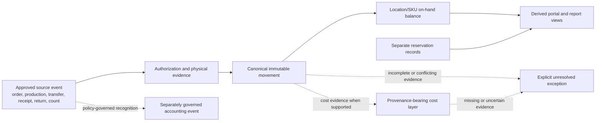

# P6-R2C — Legacy-to-Canonical Inventory Source Mapping and Migration Strategy

**Status:** COMPLETE — STATIC SOURCE MAPPING AND MIGRATION STRATEGY ONLY  
**P6-R2B:** COMPLETE — STATIC WHOLE-PROJECT READINESS AUDIT  
**P6-R3:** PLANNED — IMPLEMENTATION NOT STARTED  
**Phase status:** Phase 4 INCOMPLETE; Phase 5 PARTIAL / INCOMPLETE; Phase 6 IN PROGRESS; Phase 7 BLOCKED  
**Database, migration, production inventory, and accounting status:** NOT ACCESSED OR CHANGED

## 1. Executive summary

This increment maps the repository's inventory records and source-code read/write
paths to the P6-R2A canonical movement contract. It is a static repository
audit and transition plan. It does not reconcile persisted rows, decide which
stock exists, establish legal title, select a costing method, or authorize a
backfill or production change.

The central finding is that the codebase has a capable SKU/location ledger for
selected workflows, but no universal inventory source of truth:

1. `InventoryBalance` and `InventoryLedgerEntry` are the strongest current
   quantity evidence for the supported canonical production, transfer,
   distributor fulfillment, and selected return/disposition paths.
2. They are not exhaustive. Product fields and JSON variant quantities,
   `StockLog`, `ManufacturerInventory`, and
   `ManufacturerInventoryMovement` still participate in stock reads or writes.
   Some operations write canonical and legacy representations together; other
   paths write only one.
3. `Product.stockQuantity` is an operational catalog projection in supported
   paths, but legacy writers can mutate it directly. It cannot safely be
   interpreted as a complete physical or location-specific balance.
4. `InventoryBalance.reservedQuantity` mixes reservation use cases. A separate
   universal order-reservation record, with full provenance and expiry, was
   not established by this static review.
5. Production cost layers carry useful provenance for accepted production;
   they do not prove the cost of supplier receipts, all opening stock, every
   return, or all layerless quantities. `Product.costPrice` is not an
   authoritative inventory layer.
6. There is no mounted end-to-end supplier PO/accepted-GRN/invoice-to-canonical
   receipt and cost-layer path, nor a complete central-warehouse operating and
   location-scoped RBAC model.
7. P5-R16–R19 provide useful stock-transfer exception logic and a bounded,
   read-only Admin page API. That report is transfer-scoped; it is not a
   full-company inventory census, cost valuation, physical count, or GL
   reconciliation.

No persisted discrepancy is asserted. Coexistence creates possible
inconsistency scenarios that can only be quantified after a separately
authorized, independently isolated data review. The safe transition is
inventory, source, and history discovery first; every ambiguous row remains an
exception. Never copy or sum legacy and canonical quantities into a new
balance, manufacture missing events, or choose one projection merely because
it is largest or newest.

## 2. Scope, evidence, and decision classes

This mapping reconciles the P6-R1 architecture, P6-R2 specification and
implementation audit, P6-R2A contract freeze, P6-R2B whole-project audit,
P5-R7 valuation/COGS evidence audit, and P5-R15–R19 transfer reconciliation
design and implementation with current repository source.

Evidence labels:

- **SOURCE-VERIFIED** — source path exists in the checked-in repository. This
  does not prove deployment, persisted behavior, or physical evidence.
- **PARTIAL** — only a subset of a business lifecycle or source population is
  covered.
- **LEGACY** — an older or parallel representation/writer remains active.
- **DERIVED** — calculated or synchronized view; not an independent movement.
- **UNVERIFIED** — needs persisted records, independent source evidence, or
  physical verification.
- **MISSING** — no mounted end-to-end repository workflow was found.
- **PROPOSED** — target contract, not current behavior or approved policy.

The P6-R2A decisions remain controlling. Confirmed: distributor-held stock is
Aama-owned; a distributor is custodian, and transfer/receipt alone is not a
sale, revenue, or COGS event. Proposed technical controls are not business
approvals. Universal costing, opening-balance conversion, supplier/manufacturer
title boundaries, loss liability, customer-return disposition, and warehouse
approval policy remain unresolved where noted.

Static inspection only was performed. No database or environment file was
accessed; no test, build, migration, seed, database command, external service,
or production workflow was run.

### 2.1 Documentation and source conflicts

| Earlier description or assumption | Source-backed clarification | Treatment in this mapping |
|---|---|---|
| Canonical model names can be read as proof that the canonical ledger is the sole inventory authority. | P5-R7 and P6-R2B identify active legacy quantity writers and readers alongside canonical paths. | Canonical balance/ledger are authoritative candidates only for covered paths; all-source completeness remains unverified. |
| `Product.stockQuantity` is routinely synchronized, so it can be treated as a canonical stock count. | Current sync code derives the projection in supported flows, while order, adjustment, return, supplier-return, and manufacturer paths can still write legacy values directly. | Treat it as a mixed derived/legacy projection, not physical or location-specific stock. |
| A reserved counter or transfer status proves a physical stock event. | P5-R16 distinguishes reservations from dispatch, and status values can represent pending booking/approved remainder. | Require exact movement and physical-event evidence; preserve ambiguity. |
| A P6-R2C label was previously used for warehouse implementation, and source mapping had no iteration ID. | P6-R2A documents the reassignment of P6-R2C to source mapping; P6-R3 is the warehouse implementation increment. | The tracker now records P6-R2C for this mapping and retains P6-R3 as planned/not started. |
| Static documentation describes architecture but can imply production completeness. | Code and schema establish only checked-in paths; no database, applied migration, permission grant, physical count, or financial population was inspected. | State evidence limits in each classification; never present this report as persisted reconciliation. |

## 3. Inventory representation inventory

| Representation | Source fields / meaning | Classification and trust boundary | Proposed eventual role |
|---|---|---|---|
| `InventorySku` | Product plus normalized variant identity; includes active state and normalized variant keys. | **Authoritative candidate** for SKU identity in supported ledger workflows; legacy JSON variants can have different normalization/labels. | Canonical SKU dimension after an explicit alias/ambiguity map; unresolved variants remain exceptions. |
| `InventoryLocation` | Location kind and active state, `inventoryOwner`, optional manufacturer/distributor association. Kinds include factory, distributor, transit and non-saleable/return locations. | **Authoritative candidate** for location/custody scope in supported flows. Current service restricts canonical ownership to `PLATFORM`; it does not prove independent legal title. A complete central `WAREHOUSE` operating workflow was not found. | Canonical location and custody identity, with approved warehouse/operator scope and separate owner/custodian semantics if policy requires them. |
| `InventoryBalance` | Unique location/SKU current integer `quantityOnHand` and `reservedQuantity`. | **Current balance candidate** for locations and paths using canonical movement services; **partial** global source coverage. Reserved counter aggregates different reservation use cases and is not itself movement history. | Transactionally maintained projection from accepted canonical events and explicit reservation records; periodically checked against full history. |
| `InventoryLedgerEntry` | SKU, source/destination locations, positive whole-unit quantity, movement type, owner, reference, idempotency key, actor/reason, optional cost-layer link and creation time. | **Historical evidence** for supported canonical writes. Not exhaustive of all stock-changing operations. Some movement-to-shipment links are encoded in reference/key conventions rather than direct foreign keys. | Immutable, source-linked movement history; never infer a missing historical entry or treat it as physically verified by itself. |
| `Product.stockQuantity` | Product-level integer catalog quantity. | **Legacy/derived projection** in supported stock-sync flows; some order, adjustment, return, supplier-return, and manufacturer paths write directly. No location, condition, reservation, owner, or cost-layer dimension. | Replace with canonical read/projection; retain only as compatibility output while every writer is controlled, then retire only after consumer inventory and reconciliation gates. |
| `Product.variants` | JSON variant records including size/color and quantity values. | **Legacy/derived projection**, with direct writers and variant alias/shape ambiguity. It is not a location balance. | Replace with canonical SKU/location reads. Preserve historical snapshots for audit; do not reconstruct from lossy JSON. |
| `StockLog` | Product/variant, previous/new/change quantities, reason and optional order/source fields. | **Historical evidence / legacy audit**, not a canonical movement ledger. Atomicity and coverage vary by writer; no universal owner/location/cost-layer linkage. | Retain as immutable historical evidence; do not promote to canonical movement by synthetic backfill without attributable source evidence. |
| `ManufacturerInventory` | Manufacturer/product quantities, reservation and variant JSON; proposed/agreed cost and price state. | **Legacy operational representation** still read/written by manufacturer paths and selected order/return paths. Does not encode canonical owner/location/cost layer. | Migrate readers to location/SKU ledger; retain historical records and any approved compatibility projection only while documented consumers remain. |
| `ManufacturerInventoryMovement` | Manufacturer inventory movement/audit quantities and reasons. | **Legacy historical evidence**, not equivalent to `InventoryLedgerEntry`; writer coverage and movement semantics differ. | Preserve history. Do not merge into canonical movement history unless an evidence-backed mapping is approved and each row's source/location/owner is resolvable. |
| `ManufacturerInventoryCostLayer` | Production request/SKU/variant, produced/available/reserved/consumed quantities, Decimal costs and provenance. | **Authoritative cost-layer candidate** only for the accepted production scope it records. Layer counters are not a complete physical quantity ledger and may not cover layerless stock or all return/transfer paths. | Cost provenance for supported production quantities; reconcile allocations and canonical movement references separately. |
| `ManufacturerInventoryCostAllocation` | Order/item/layer quantity, state and returned quantity. | **Historical allocation/cost evidence** for linked order quantities; does not prove a corresponding canonical movement or complete return coverage. | Link issue and return events to exact source layer allocations; preserve original allocation evidence. |
| `StockTransfer`, lines, shipment/receipt records | Requested/approved/dispatched and reserved shipment quantities; shipment booking/handoff state; receipt good/damaged/missing quantities and evidence. | **Operational source evidence**, with mutable summary counters/statuses. Status alone is not proof of dispatch/receipt; P5-R19 ties selected related evidence to ledger rows. | Commercial authorization and physical-event source records linked to canonical movement entries; never substitute for the movement itself. |
| `InventoryDiscrepancy` | Reported custody-stage quantity, evidence, status and review data. | **Exception evidence**, not proof of cause, liability, loss, or accounting recognition. | Open investigation linked to source movements; resolution requires authorized evidence and a separate movement/accounting treatment if approved. |
| `InboundShipment` | Schema-level shipment and freight/customs/tax/item-cost attributes. | **Unverified/partial** acquisition evidence; no mounted end-to-end supplier acceptance and canonical receipt/cost-layer path was established. | Preserve as source evidence if used; do not treat as accepted stock or authoritative acquisition cost absent verified matching/receipt linkage. |
| `Order` / order items / assignments / delivery | Ordered quantity, product/variant snapshots, fulfillment/payment/delivery lifecycle and associated cost snapshots. | **Commercial/fulfillment evidence**, not a general on-hand balance. Order creation, reservation, dispatch, delivery, collection and accounting posting are distinct. | Link each accepted reservation/issue/return to stable source events; do not derive physical stock from order status alone. |
| Return/RMA and inspection records | Requested, approved, received/inspected quantities, disposition, refund/exchange details. | **Operational/financial evidence** with mixed legacy and canonical quantity effects. Receipt, inspection, acceptance, restock, refund and journal treatment are not equivalent. | Preserve source case and inspection; make each physical disposition a separate canonical movement and financial treatment separate. |
| Gift/promotional stock | Gift assignments and gift-specific stock events in the gift domain. | **Separate domain**, not garment stock valuation or merchandise COGS. | Keep separate unless a specifically approved shared merchandise SKU/location workflow is designed. |

The schema comment on `ManufacturerInventory.quantity` calls it actual physical
stock. That describes the legacy model's intended meaning; it does not make
the record a location-scoped count or prove consistency with
`InventoryBalance` or physical evidence.

### 3.1 Canonical quantity facts and present classifications

| Inventory fact | Current source and assessment | Classification | Target authority |
|---|---|---|---|
| Physical on-hand | Canonical balance by location/SKU for covered flows; legacy product/manufacturer quantities remain. No independent physical count is represented as universal truth. | **Partial, unverified globally** | Canonical balance is operational book quantity derived from accepted movements; physical count is independently evidenced and reconciled, not inferred. |
| Reserved quantity | `InventoryBalance.reservedQuantity`; stock-transfer reservation counters/records; order assignment/allocation state. No universal separately proven reservation ledger/source covering all paths. | **Partial, multiple sources** | Explicit reservation records and transactionally guarded availability; reservation does not reduce on-hand. |
| Available quantity | Calculated for covered location views, commonly on-hand less reserved (and excluding ineligible locations/conditions); also legacy inventory arithmetic exists. | **Derived** | Calculated from canonical eligible on-hand less active reservations; never independently stored as another authority. |
| In-transit quantity | Canonical source/destination movement to transit for supported dispatches plus shipment/handoff records. NCM booking can reserve without on-hand dispatch; carrier state is separate. | **Partial; event-specific** | Open custody movement quantity between dispatch and evidenced receipt/return/correction. |
| Distributor-held quantity | PLATFORM-owned canonical distributor location balances for supported paths; legacy `ManufacturerInventory` and product projections also exist. | **Partial; ownership policy confirmed** | Aama-owned, distributor-custodied balance by location/SKU/status. |
| Damaged/quarantined quantity | DAMAGED/LOST/return/quarantine locations for selected canonical flows; other paths can hold only an exception or legacy record. | **Partial** | Separate non-saleable quantity disposition with evidence; no liability/write-off inference. |
| Returned quantity | Customer return cases, stock-return receipts, selected ledger `RETURN` events, and legacy stock increments. | **Multiple / conflicting** | Receipt, inspection, acceptance, and restock are separately evidenced canonical events. |
| Production output | Production actuals/QA, accepted good counts, factory location receipt and cost layers in supported completion flow; rejected/damaged output has separate evidence but not universal canonical receipt. | **Partial, source-supported** | Accepted good receipt only; damaged/rejected counts retained in explicit non-saleable disposition evidence. |
| Supplier receipt | `InboundShipment` schema evidence and supplier/AP/return functions exist; no complete active accepted PO/GRN-to-ledger receipt path found. | **Missing end-to-end** | Approved purchase/receipt event; only accepted quantities move into canonical on-hand. |
| Inventory cost | Production layers in scoped flows; order cost snapshots, manufacturer/catalog fields, supplier item costs, and estimates elsewhere. | **Partial; methods unresolved** | Approved authoritative layers with source provenance and separately approved valuation policy. |
| Movement history | `InventoryLedgerEntry` for supported canonical writers; legacy `StockLog`, manufacturer movement and business events for other paths. | **Partial, multiple histories** | Canonical immutable movement history plus original commercial/approval/physical evidence; no invented events. |
| Accounting impact | Journals/outboxes and cost snapshots are linked for some production/delivery/return workflows, but stock movement coverage and source-to-GL completeness vary. | **Partial** | Explicit accounting event linkage and reconciliation to movement/cost evidence; posting is not implied by every movement. |

## 4. Stock-changing workflow register

The table classifies source-code behavior, not persisted stock or operational
use. Route authorization is the checked-in route contract; deployed grants and
current records are unverified. Route and permission references below were
checked against the mounted route modules.

| Workflow / entry | Current source path and records changed | Transaction, replay, and current quantity effect | Canonical target and controls |
|---|---|---|---|
| Storefront order placement | `POST /api/order/place` (`customer:order_place`) → order controller/service; writes `Product.stockQuantity`, `Product.variants`, `StockLog`, order/assignment-related records. See [order routes](../../backend/routes/orderRoute.js), [order controller](../../backend/controllers/orderController.js). | Catalog decrement and subsequent distributor allocation/reservation are distinct transaction boundaries. The projection change is not a canonical fulfillment movement. A failure between stages can leave order/projection/allocation out of sync. | Create order and reservation with stable client/business idempotency; availability lock/transaction at selected distributor location. Do not decrement physical stock at order creation. |
| Automatic/admin distributor allocation and reservation | `/api/assignment/assign` (`assignment:create`) and Admin manual/reassignment routes (`assignment:manual_assign` / `order:control`); [assignment route](../../backend/routes/orderAssignmentRoute.js), [assignment controller](../../backend/controllers/orderAssignmentController.js). Canonical `InventoryBalance.reservedQuantity` plus assignment/transfer context. | Supported distributor paths check active stock and reserve in a transaction; cancellation/reassignment release reservation. Reservation is not on-hand movement. Other assignment branches/legacy records remain. | Explicit reservation record/provenance, expiry/amendment handling, concurrency guard, exact replay and no negative available stock. |
| Distributor delivery/fulfillment | Assignment status `/api/assignment/status/:id` (`distributor:assignment_status_update`, fulfillment context) and self-delivery `/api/distributor/orders/:id/status` (`distributor:assignments_read`, distributor context) → `consumeDistributorOrderInventory`; canonical balance decrement and `FULFILLMENT` entries; cost-layer allocations where available; product projection sync. | Supported transaction paths are idempotent and source-linked; sale accounting may be posted by a later accounting event/outbox transaction. Layerless quantity remains explicit in some flows. | Atomic canonical issue at approved fulfillment milestone; retain sale, delivery, collection and accounting as distinct evidence with replay/reversal handling. |
| Distributor direct sale | `/api/distributor/orders/direct` (`distributor:direct_order_create`, distributor context) → distributor order inventory service; creates order/assignment and canonical `FULFILLMENT`; linked layers or uncosted legacy quantity; product projection sync. | Supported direct order transaction includes inventory issue. Direct cash/COD/receivable accounting follows route-specific controls; not all historic paths are uniform. | Same canonical fulfillment contract; explicit payment/collection evidence and cost coverage; no product-only decrement. |
| Admin direct order | `POST /api/order/admin-create` (`order:admin_create`) → `createAdminDirectOrderWithStock`; updates product/variant projection and `StockLog`, then distributor allocation is separate. See [order routes](../../backend/routes/orderRoute.js), [order controller](../../backend/controllers/orderController.js). | Serializability protects the legacy order/product write in its transaction; subsequent allocation is not part of that transaction and no canonical issue is created at order creation. | Convert to canonical reservation/fulfillment service with one stable source reference; preserve distinct order/fulfillment events. |
| Manufacturer direct order / legacy manufacturer assignment | `manufacturerDirectOrderRoute.js` declares routes, but `server.js` does not mount that router. A legacy manufacturer assignment branch remains in `orderAssignmentController`. | The unmounted direct-order controller is not an active route; the assignment branch and its legacy stock/cost behavior must be assessed separately from distributor fulfillment. No canonical factory fulfillment movement for that direct-sale path was established in P5-R7. | Do not treat the unmounted route as a live workflow. Before enabling or retaining any manufacturer sale/assignment path, explicitly approve its scope and implement a source-linked canonical issue and accounting boundary. |
| Production completion / Admin acceptance | `POST /api/manufacturer-production/requests/:id/complete` (`manufacturer:production_manage`, manufacturer context); Admin `/api/manufacturer-production/admin/requests/:id/acceptance` (`manufacturer:production_admin`, Admin role) → production controller/workflow; actuals, `InventoryBalance`, `InventoryLedgerEntry(PRODUCTION_RECEIPT)`, cost layer, manufacturer projection and payable/journal in supported transaction. | Accepted good size/color units are received at factory location. Service uses transaction/idempotency controls. Physical existence/title remain independently unverified; damaged units are not universally a canonical damaged-location receipt. | Keep production completion distinct from warehouse receipt; record only accepted good units, rejected/damaged separately, preserve cost source and same-transaction invariants. |
| Stock-transfer request/review/preparation | `/api/stock-transfers/requests` (`transfer:distributor_request`, distributor context), Admin review (`transfer:admin_review`), manufacturer preparation (`transfer:manufacturer_dispatch`, manufacturer context); `StockTransfer`, `StockTransferLine`, authorization/preparation fields. See [stock transfer route](../../backend/routes/stockTransferRoute.js). | Request/review/edit has serializable checks in supported paths. Transfer creation lacks universal request idempotency; similar requests are not proof of duplicates. | Keep request/authorization separate from physical movement; stable business-event key where approved, preserve checker and audit evidence. |
| Manual/own-store transfer dispatch | `POST /api/stock-transfers/:id/dispatch` (`transfer:manufacturer_dispatch`, manufacturer context) → `dispatchManualStockTransfer` / `dispatchShipmentStock`; `StockTransferShipment*`, canonical `TRANSFER_DISPATCH`, source/transit balance, legacy manufacturer quantity and Product projection. | Supported transaction updates ledger and selected legacy projections together. Dispatch keys are idempotent in canonical movement; externally asserted handoff remains separate evidence. | Canonical transit movement only on evidenced dispatch; migration must eliminate dual-writing authority or make legacy field a derived projection. |
| NCM transfer booking and webhook | Booking route/service reserves quantities/layers; NCM webhook path may later apply custody-confirming dispatch movement. | Booking alone is not dispatch. Unknown/failed provider outcome remains unresolved; external calls were not made. | Preserve booking status separately; only verified physical handoff produces canonical transit movement; deterministic provider-event deduplication and reconciliation. |
| Distributor stock-transfer receipt | `POST /api/stock-transfers/shipments/:shipmentId/receipt` (`transfer:distributor_receive`, distributor context) → `receiveStockTransferShipment`; `StockTransferReceipt*`, canonical receipt/DAMAGE/LOSS movements and balances, discrepancies, projection. | Receipt requires idempotency key; transaction records good/damaged/missing quantities; accepted good increases distributor on-hand, damaged/lost route separately. | Retain separate receipt checklist and accepted stock; no revenue/COGS or liability from custody receipt. |
| Distributor stock decrease for damage/loss | `POST /api/distributor/inventory/decrease` (`distributor:inventory_decrease`, distributor context) → `distributorInventoryController` / stock decrease service; discrepancy plus canonical `DAMAGE`/`LOSS` movement from distributor to non-saleable location. | Requires client idempotency key and evidence; supported path is transaction-scoped. It is not a universal cost-layer consumption or write-off journal. | Preserve evidence, use approved disposition, cost/GL assessment separately; do not infer distributor liability. |
| Distributor customer return/exchange | Self-delivery return `POST /api/distributor/orders/:id/return` (`distributor:assignments_read`, distributor context); exchange `POST /api/returns/exchange/distributor/:id/process` (`distributor:delivery_return`, fulfillment context). See [distributor route](../../backend/routes/distributorRoute.js), [returns route](../../backend/routes/returnsRoute.js), [self-delivery service](../../backend/services/distributorSelfDeliveryService.js), [exchange service](../../backend/services/distributorExchangeService.js). | Self-delivery directly upserts `InventoryBalance` and inserts `RETURN`/`DAMAGE` rows; its idempotency key includes random bytes and it does not call `applyInventoryMovement`. Exchange return uses the shared helper and deterministic key; replacement dispatch directly updates the balance and inserts `FULFILLMENT`. Neither path is a transfer receipt. | Distributor inventory can increase from customer returns under existing flows, so the repository rule restricting increases to transfer receipt is not universal in current code. Preserve source/condition and resolve approved return custody, retry/idempotency and cost-layer policy before treating as compliant. |
| Distributor stock return to platform | Admin `/api/admin/distributors/:id/stock-returns...` routes (`distributor:admin_stock_return`, Admin role) → `distributorStockReturnService`; `RETURN` to return-hold, subsequent received/inspected quantities and discrepancies. | Supported stages preserve evidence and plan layer allocations; uncosted units remain explicit; not automatic restock or write-off. | Keep custody return, receiving inspection and final disposition distinct; explicit accepted destination and cost treatment. |
| Customer RMA return inspection/restock | `POST /api/returns/customer/admin/:id/inspection` (`returns:admin_inspect`) → `customerReturnWorkflowService.inspectCustomerReturn`; changes `Product` / `ManufacturerInventory`, `StockLog`, selected layer allocations and refund/journal records. | No universal canonical return movement; cost layer restoration can cover less than legacy quantity increment. Physical receipt, inspection, restock and refund have separate boundaries. | Gate until approved disposition/location/cost policy; canonical return/quarantine/damage movement and financial reversal separately linked; exact returned-unit layer coverage. |
| Supplier return | `POST /api/returns/supplier/create` (`returns:supplier_create`) → `supplierReturnService`; product decrement and `StockLog`, supplier return/AP/expense records; submitted `unitCostPrice` used for accounting in described path. | No canonical inventory issue or original accepted supplier cost layer linkage found. | Block inventory/valuation claim until linked to accepted source receipt/layer; distinct supplier return and credit/refund events. |
| Admin product stock adjustment | `POST /api/product/adjust-stock` with `stock:adjust` → `productController.adjustStock`; updates `Product.stockQuantity`/variant JSON, `StockLog`, system audit. | No canonical location/SKU balance or ledger event; no location/cost-layer/GL disposition in this route. | Replace or gate with scoped authorized `ADJUSTMENT`, before/after, reason, actor/checker, evidence, stable idempotency, cost/GL assessment. |
| Admin product create/update | `POST /api/product/add` (`product:create`) and `POST /api/product/update` (`product:update`) → `productController.addProduct` / `updateProduct`; accepts catalog `stockQuantity` and variant quantities. | These are catalog writes, not canonical opening receipts or adjustments; the creation path's `StockLog` does not supply canonical location, owner, or movement evidence. | Make product fields catalog-only after cutover; opening quantity must use a separately authorized, source-evidenced opening/receipt workflow. |
| Manufacturer inventory update | `POST /api/manufacturer-inventory/update` (`manufacturer:inventory_update`, manufacturer context); writes `ManufacturerInventory`, `ManufacturerInventoryMovement`, audit; increases restricted to completed production in reviewed path, while eligible decreases remain legacy. | Does not generally decrement canonical factory balances or production layers as a manual adjustment. | Replace/gate with canonical production/adjustment event and explicit location, evidence and reversal. |
| Physical count/reconciliation | Admin ledger reconciliation compares selected SKU/location balance with ledger net; stock-transfer report is read-only and page-bounded. No universal count-to-adjustment route found. | No physical count evidence, full-population legacy comparison, or automatic correction. | Count is an independent observation; variance remains an exception until approved adjustment and evidence. |

### 4.1 Accounting and existing-test coverage matrix

Accounting and inventory evidence are separate. The following summarizes
source-level boundaries and names focused test files found in the repository;
it does not assert that every listed branch is covered by those tests. No tests
were run for this documentation increment.

| Workflow group | Observed accounting boundary | Focused test files identified | Coverage gaps / limitations |
|---|---|---|---|
| Product create/update, manual adjustment, storefront/admin order creation | Catalog stock changes and order creation do not by themselves establish COGS or revenue. Payment/receivable posting, if present, follows its separate order/accounting path. | `adminDirectOrderService.test.js`, `orderAmount.test.js` | No focused product-route test was identified for direct stock fields on create/update or `adjustStock`; no canonical opening/adjustment movement is produced there. |
| Reservation, distributor fulfillment and direct sale | Reservation has no financial posting. Supported fulfillment may link cost-layer allocations and separate sale/payment/accounting events; layerless quantities remain uncovered rather than costed by catalog fallback in the movement. | `distributorOrderInventoryService.test.js`, `inventoryLedgerService.test.js`, `orderPaymentAccountingService.test.js` | Service tests do not prove all mounted route scopes or persisted ledger/GL completeness. Self-delivery return behavior has separate, inconsistent retry semantics. |
| Transfer request, dispatch, booking and receipt | Custody transfer/receipt is not revenue, sale or COGS. Manufacturer-paid local/manual freight can create a separate manufacturer payable at dispatch; NCM booking is not physical handoff. | `stockTransferService.test.js`, `stockTransferReconciliationService.test.js`, `stockTransferReconciliationReportService.test.js` | Bounded transfer tests/report do not prove all-history source coverage, external carrier outcomes, cost valuation, or GL completeness. |
| Production and manufacturer inventory | Accepted production completion records production cost evidence and a payable/journal in the supported transaction. Legacy manufacturer quantity updates are not an equivalent cost or accounting event. | `manufacturerProductionWorkflowService.test.js`, `manufacturerInventoryProjection.test.js`, `manufacturerInventoryAudit.test.js` | Tests do not establish physical acceptance, warehouse custody, universal layer coverage, or persisted cost/GL reconciliation. |
| Distributor customer return/exchange and stock return to platform | Physical return, inspection, replacement fulfillment, refund/credit, discrepancy resolution, and any accounting correction are distinct. No automatic distributor liability/write-off is inferred. | `orderExchangePolicy.test.js`, `distributorReturnRefund.test.js`, `distributorStockReturnService.test.js` | No focused test file was identified for the self-delivery return's random idempotency key and direct balance/ledger writes; exchange helper use and direct replacement writes are different paths. |
| Customer RMA and supplier return | Customer refund/journal handling is separate from physical restock. Supplier return credit/AP treatment does not prove that the returned quantity was relieved from an authoritative acquisition-cost layer. | `customerReturnAccounting.test.js`, `supplierReturnService.test.js`, `supplierReturnCreditApplication.test.js` | No universal canonical return/issue plus cost-layer reversal is present; route-level tests and end-to-end accepted-receipt lineage remain gaps. |
| Physical counts and full inventory reconciliation | No universal physical-count-to-ledger adjustment or full-company inventory valuation/accounting report was found. P5 reconciliation is transfer-scoped. | No focused physical-count suite identified; P5 transfer tests listed above | Static source inspection cannot establish existence, condition, ownership, or full persisted quantity/cost/GL correctness. |

### 4.2 Read and projection register

The same value can have multiple consumers with different scopes. These readers
are not interchangeable evidence.

| Reader / endpoint | Source and consumer | Classification / limitation |
|---|---|---|
| Product catalog and storefront availability | Product APIs read `Product.stockQuantity`/variant JSON; supported catalog synchronization projects unreserved balances from active distributor locations. See [ShopContext](../../frontend/src/context/ShopContext.jsx) and [Product page](../../frontend/src/pages/Product.jsx). | **DERIVED / legacy mixed.** Checkout must use distributor ledger allocation checks; product projection is not a physical count. |
| Admin inventory and order forms | Product catalog APIs and [Inventory](../../admin/src/pages/Inventory.jsx), [List](../../admin/src/pages/List.jsx), and [CreateOrder](../../admin/src/pages/CreateOrder.jsx); product and variant catalog fields. | **LEGACY operational projection.** Does not identify location, reservation, condition or cost. |
| Bundle variant availability | `Product.stockQuantity`, product variant quantities and reserved values in [combo bundle helper](../../frontend/src/utils/comboBundleVariants.js) and Admin [ComboBundles](../../admin/src/pages/ComboBundles.jsx); backend eligibility in `comboBundleController`. | **LEGACY / derived mixed.** Does not represent canonical location availability or a reservation record; bundle selection is not a stock movement. |
| Admin manufacturer inventory monitor | Admin inventory endpoint aggregates canonical platform factory/distributor `InventoryBalance` by SKU/location; see [monitor page](../../admin/src/pages/ManufacturerInventoryMonitor.jsx). | **Canonical-scope query, not globally complete.** Label is on-hand ledger quantity, not verified physical stock. |
| Manufacturer inventory page | `/api/manufacturer-inventory/my` and `ManufacturerInventory` with its movement history; see [manufacturer inventory](../../manufacturer/src/pages/Inventory.jsx). | **LEGACY / operational.** Not interchangeable with factory canonical balance or layer valuation. |
| Admin low-stock alerts | Manufacturer-inventory low-stock endpoint reads legacy `ManufacturerInventory`. | **LEGACY / population mismatch** with canonical monitor. |
| Distributor inventory page | `/api/distributor/inventory` reads active platform-owned distributor and damaged-location balances and derives available quantity; see [distributor inventory](../../manufacturer/src/pages/DistributorInventory.jsx) and [direct orders](../../manufacturer/src/pages/DirectOrders.jsx). | **Canonical-scope view.** It does not establish physical stock, cost, or GL value. |
| Inventory ledger audit | `/api/admin/inventory-ledger` and selected-SKU/location reconciliation read `InventoryLedgerEntry` and `InventoryBalance`. | **Canonical history/balance evidence** for loaded scope, not full source/physical/cost reconciliation. |
| Stock-transfer report | P5-R19 endpoint reads bounded transfer/shipment/receipt/discrepancy/ledger/balance sources and P5-R16–R18 calculator/formatter. | **Read-only, page-scoped.** `hasMore` and coverage indicate incompleteness; not a full-company inventory result. |
| Cost/COGS calculator and product analytics | Product/variant and manufacturer quotes, order snapshots, selected cost layers and catalog fallbacks. | **Estimate/operational or scoped COGS**, not universal inventory valuation or posted GL. |
| Finance Dashboard inventory value | Current platform balance/layer data with catalog cost fallback for uncosted quantities. | **Estimate.** Not a complete authoritative 1140 inventory schedule. |
| Accounting Health valuation comparison | Scoped balance/layer source compared with GL 1140. | **Partial reconciliation.** Exclusions, uncosted quantities, source coverage and current-period limitations remain. |
| GL / financial statements | Posted journal lines for configured periods. | **Posted-ledger evidence** only; does not independently prove physical stock or source completeness. |
| Customer order history | Order/product snapshots and delivery/payment states. | Commercial status; not a live inventory valuation reader. |

See the [P5-R7 inventory valuation and COGS audit](../accounting/24-p5-r7-inventory-valuation-and-cogs-evidence-audit.md)
for the detailed report-basis matrix and costing limits.

## 5. Coexistence, consistency, and migration risks

These are source-derived possible failure modes, not claims that persisted
records are currently inconsistent.

| Risk | Source basis / possible scenario | Impact and severity | Detection and proposed prevention |
|---|---|---|---|
| Two inventory authorities | Direct `Product`/`ManufacturerInventory` writers coexist with canonical ledger writers. | Catalog availability and physical/custody book quantities can disagree. **Critical** for checkout and cutover. | Compare each source by normalized SKU/location where evidence exists; classify unmappable rows. Retire direct writers before treating projection as derived. |
| Double counting on migration | Both canonical balance and a legacy product/manufacturer quantity are copied or summed into opening stock. | Duplicate units and overstated assets/availability. **Critical.** | Do not sum. Require chosen source population, unique source row mapping, approved opening evidence and dry-run exception report before any separately approved migration. |
| Missing canonical movement | Adjustment, RMA, supplier return or manufacturer direct-sale changes legacy quantity without canonical entry. | Ledger-derived quantity misses a business event; cost/GL link may be orphaned. **Critical.** | Writer census, source-to-movement controls, deny-by-default cutover, atomic shared movement service and tests for every writer. |
| Stale or conflicting projections | A projection sync runs alongside direct legacy updates or is called only on selected paths. | Portal disagreement, stock display errors, oversell/under-sell. **High.** | Designate one canonical read path; rebuild projections from canonical balances after reconciliation, monitor sync lag and remove direct writes. |
| Reservation counter ambiguity | `reservedQuantity` aggregates order/transfer-related usage without universal explicit reservation provenance. | Available stock may be overstated/understated; releasing the wrong reservation can oversell. **High.** | Reconcile reservation sources independently; use explicit reservation identity and transactionally scoped idempotent reserve/release/consume. |
| Booking mistaken for transit | NCM booking/reservation, transfer status, or carrier status is treated as physical dispatch. | Transit and source on-hand can be misstated; incorrect custody reporting. **High.** | Require dispatch evidence and `TRANSFER_DISPATCH`; preserve booking-unknown and handoff-unknown states. |
| Receipt before inspection | A return or destination receipt is made sellable before inspection/acceptance. | Damaged/unverified units become available; refunds and stock diverge. **High.** | Distinct receipt, inspection, acceptance and disposition events; default unresolved quantity to non-saleable/exception, subject to approved policy. |
| Duplicate movement/posting | Retry after ambiguous commit, separate legacy writer, or random return key creates a second semantically similar event. | Quantity or journal duplicate; ledger idempotency does not cover bypass paths. **High.** | Stable business-event key, immutable payload hash, DB uniqueness/locking in approved design, and reconciliation of source-to-entry counts. Similarity alone is only a candidate, not proof. |
| Partial transaction boundary | Order/projection commit precedes allocation; manufacturer direct-sale cost/accounting and legacy update may be separate. | Order, reservation, balance, projection and financial records can diverge after failure. **High.** | Define event transaction boundary per workflow; failure injection, rollback and outbox recovery tests before release. |
| Historical cost gap | Layerless stock or returns lack exact cost-layer lineage; catalog/quote cost is used as fallback. | Inventory value/COGS may be estimated or unsupported. **High** for financial reporting. | Report cost coverage independently; preserve unknown/uncosted state. Never fill with `Product.costPrice` as authoritative cost. |
| Transfer evidence mismatch | Mutable transfer/status counters, shipment/receipt evidence and ledger entries are separate records and can disagree. | False completed transfer or unmatched transit/distributor balance. **High.** | Reuse P5-R16–R19 source-linked checks and open exceptions; do not infer physical custody from status. |
| Ownership confusion | Custodian IDs, manufacturer profiles, inventory owner fields, and legacy model names can be read as title. | Incorrect revenue, payable, liability or inventory ownership conclusion. **High.** | Preserve confirmed Aama ownership for distributor-held inventory; leave other title policy blocked pending explicit approval. |
| Negative/impossible quantities | Invalid or historic source values, incomplete undo or counter drift can violate source constraints. | Invalid availability or unreliable financial and operational report. **High.** | Validate exact whole-unit nonnegative quantities; quarantine invalid rows as exceptions, never clamp/repair silently. |

Severity prioritizes control work; it does not state that loss, fraud, or a
persisted discrepancy occurred.

## 6. Target source-of-truth architecture

The following is a **proposed technical target** under P6-R2A, not a claim
about complete current behavior or a schema approval.

1. **Business/source evidence:** commercial request, approval, shipment,
   receipt, count, return, and inspection records explain why an operation was
   authorized or reported. They do not alone prove that a quantity was posted.
2. **Canonical movement history:** immutable, exact-SKU, exact-quantity,
   source-linked movements record accepted physical/authorized stock events,
   with location, owner, custodian, status/disposition, actor, time, evidence,
   cost references, stable idempotency identity, and correction/reversal links.
3. **Canonical location/SKU balances:** transactionally maintained on-hand
   projection derived from accepted movement events; not a second history.
   Negative/invalid balance transitions fail explicitly.
4. **Reservations:** separate, source-linked non-physical commitments with
   authorized/remaining quantity, scope, expiry if approved, release/consume
   events, and concurrency controls. They affect availability, not physical
   on-hand or COGS merely by existing.
5. **Transit and condition:** in-transit, damaged, lost, quarantine, return
   hold/receipt are separate locations or statuses only where the approved
   model supports them. A carrier booking is not a stock movement.
6. **Ownership and custody:** inventory owner is separate from location and
   custodian. Distributor-held company inventory remains Aama-owned. Unknown
   title stays blocked/exception; no owner is inferred from a model name.
7. **Cost evidence:** exact cost layers and provenance attach only where
   authoritative evidence supports the quantity. Transfers preserve layer
   provenance; returns point to original issue/layer where available. Missing
   cost remains explicitly uncosted pending policy; no universal FIFO,
   weighted-average or other method is selected here.
8. **Accounting:** commercial and physical events produce accounting events
   only under approved recognition policy. Inventory movement is not
   automatically a journal, revenue, payable, liability, or COGS event.
   Accounting outbox/journal evidence is separately reconciled.
9. **Portal/report projections:** portal availability, admin monitors,
   dashboards and exports become read-only derived views with declared source,
   cutoff, coverage and incompleteness. Reports never become a write authority.

### 6.1 Legacy field end-state options

No schema change is approved by this mapping. For each legacy field, choose one
target only after mapping its consumers and historical role:

- **Replace by canonical read:** preferred for inventory readers after the
  canonical population is complete and reconciled.
- **Compatibility projection:** temporarily retain a field as generated or
  synchronized output with a single canonical writer; reject direct writes.
- **Historical evidence:** retain immutable records needed for audit, but do
  not count them as current on-hand.
- **Remove:** only after consumer search, controlled migration, rollback plan,
  archival/retention review, and accepted reconciliation.
- **Rebuild from canonical movements:** only after complete opening evidence
  and every source-changing writer is migrated; never rebuild from partial
  history or mixed legacy values.

`Product.stockQuantity`/variant JSON and `ManufacturerInventory` should not
remain independent stock authorities. `StockLog` and
`ManufacturerInventoryMovement` should not be rewritten into synthetic
canonical ledger rows. Their long-term retention/removal is a separate
compatibility and historical-evidence decision.

## 7. Staged transition and migration strategy

No stage below authorizes production writes or database operations. Any
persisted validation, migration, or cutover requires separate approval,
independently verified isolation, backup/recovery evidence, and a tested
rollback/reconciliation plan.

| Stage | Preconditions and required evidence | Work and reconciliation | Principal risk / rollback | Acceptance gate |
|---|---|---|---|---|
| **A — Inventory source discovery** | P6-R2/R2A contracts; checked-in route/model/service inventory; scope approval for any future data access. | Inventory all readers/writers and exact fields, keys, transaction boundaries, permissions, source populations and test coverage. Source-code map is this increment's purpose. | Missing a legacy writer creates dual authority. Rollback: documentation corrections only. | Every discovered stock write/read maps to a source and target role or stays explicit unknown; P6-R2C static evidence review complete. |
| **B — Reconciliation preparation** | Approved population/time cutoff and variant/location matching rules; separately verified isolated dataset and recovery controls if persisted validation is later approved. | Design a read-only comparison among Product/variant, manufacturer records, canonical balances/ledger, transfer transit/receipt, reservations, returns, cost layers, and accounting. Identify opening-balance evidence: physical count, source document, owner/custodian, effective time, exact SKU/location/status and reviewer. | Ambiguous joins can duplicate or omit units; no implicit “best” value. Rollback: discard read-only report artifacts, no row mutation. | Every source row matched uniquely or assigned a named exception; quantities and source coverage separately shown; no inferred opening balance. |
| **C — Canonical implementation** | Source maps and policy approvals; movement/reservation service boundary, location/owner/custody model, uniqueness/concurrency design, transaction strategy and regression plan. | Introduce approved canonical writes additively, with exact events and current balance updates in one transaction. Feature-gate each bounded workflow. | Dual write, duplicate movement, race, or rollback gap. Rollback is disable feature plus source-preserving correction/reversal, not deletion of history. | Replay/conflict, partial quantities, concurrent writers, transaction rollback, audit/RBAC and source-to-balance tests pass in safe test environments. |
| **D — Controlled integration** | Canonical service validated; a workflow's policy and route/UI scope approved; direct legacy writer gated/replaced for that same population. | Migrate Admin adjustment, transfers/warehouse, production, distributor fulfillment/returns, customer returns, and procurement in bounded increments. Do not transition all domains at once. | Legacy and canonical writes overlap or a workflow is partially migrated. Rollback: disable new path without reverting or deleting recorded events; provide explicit reconciliation. | Each migrated workflow has one write authority, source and movement linkage, exact idempotency, permissions, audit and regression coverage. |
| **E — Compatibility and reporting** | New write authority stable for the scoped population; view consumers and report basis inventoried. | Replace portal readers with canonical queries; compatibility fields, if retained, are explicitly derived; reports disclose source, time and coverage. | A stale projection or old report is mistaken for current truth. Rollback: route reads to known safe view; preserve source and log cutoff. | All consumers use documented source; projection drift alert and read-basis tests exist; report incompleteness is explicit. |
| **F — Legacy retirement** | All known writers disabled; all readers migrated; retention/legal/evidence policy approved; full population and physical/valuation/accounting gates independently reviewed. | Remove obsolete writes/fields only with additive, recoverable migration and evidence archive plan. Canonical balances may be rebuilt only from a complete approved history including supported opening events. | Irrecoverable historical loss, omitted consumer, or false cutover. Rollback requires tested backup restore or forward correction; do not delete event history. | Independent source-to-balance, physical count, cost coverage, subledger/GL, audit and recovery signoff; no unresolved high-risk exceptions hidden. |

### 7.1 Opening stock and historical migration rules

Opening quantity must be supported by approved evidence and declared effective
time, SKU identity, location, owner/custodian, status/condition, unit, count
method, actor/checker, and source reference. The opening movement type may be
used only when the chosen opening source is approved; it must not be used to
paper over a missing movement history or to force a target balance to match a
legacy number.

Never:

- Sum `Product`, `ManufacturerInventory`, and `InventoryBalance`.
- Select max/latest quantity to resolve disagreement.
- Generate synthetic transfers, receipts, returns, or adjustments.
- infer cost from catalog price, quote, expected receipt, or unrelated product.
- silently exclude missing locations, unresolved variants, or negative values.
- delete or overwrite prior movements to make the opening report balance.

## 8. Historical and conflicting evidence handling

Migration tooling should be read-only by default and produce deterministic
source-row identity, matched canonical candidate, quantity, evidence basis,
confidence/classification, and exception code. It must not automatically
resolve exceptions.

| Evidence condition | Required handling |
|---|---|
| Balance without movement history | `OPENING_EVIDENCE_MISSING`; retain balance as an observed source only. Require approved opening-count/document evidence; do not synthesize history. |
| Movement without corresponding balance | `BALANCE_HISTORY_MISMATCH`; verify complete ledger, location state, movement validity and transaction scope. Do not recreate or delete balance automatically. |
| Duplicate historical records | `POSSIBLE_DUPLICATE_SOURCE`; preserve each ID and evidence. Exact idempotency identity/payload can identify replay; heuristic similarity is only a review candidate. |
| Transfer without complete receipt evidence | `TRANSFER_RECEIPT_INCOMPLETE`; preserve dispatched, booked, received and discrepancy quantities separately. Do not treat carrier status as accepted receipt. |
| Return without inspection/disposition evidence | `RETURN_DISPOSITION_UNRESOLVED`; do not increase saleable stock or infer refund/restock. Preserve original sale and return case. |
| Distributor quantity with unclear source | `CUSTODY_SOURCE_UNKNOWN`; ownership policy for known distributor-held inventory remains Aama's, but source event/location and cost stay unresolved. No automatic receivable/liability. |
| Manufacturer output without warehouse receipt | `PRODUCTION_NOT_WAREHOUSE_RECEIPT`; accepted factory output remains distinct from warehouse transfer/receipt. Do not claim central stock. |
| Uncosted stock | `COST_EVIDENCE_MISSING` or `UNCOSTED_QUANTITY`; keep quantity and cost coverage separate. Do not fill from `Product.costPrice`. |
| Product/variant conflict | `VARIANT_QUANTITY_CONFLICT`; preserve both raw source IDs/values and require approved normalization mapping. Do not combine quantities across variants. |
| Negative or impossible quantity | `INVALID_QUANTITY`; stop aggregation for affected key and retain exact input as exception. Do not clamp to zero. |
| Missing location | `LOCATION_UNMAPPED`; do not assign default warehouse/factory/distributor. |
| Missing or conflicting owner | `OWNERSHIP_UNRESOLVED`; do not infer from custodian or entity naming. Distributor-owned-by-Aama policy applies to the confirmed distributor-held population. |
| Duplicate SKU normalization/alias | `SKU_MAPPING_AMBIGUOUS`; retain all source identities until reviewed; do not collapse by display name. |
| Reserved count without source | `RESERVATION_SOURCE_UNRESOLVED`; do not treat it as physical stock or release it to available. |
| Cost allocation without issue/receipt movement | `COST_MOVEMENT_LINK_MISSING`; preserve cost record, expose mismatch and block authoritative valuation claim. |

Resolution requires a documented decision, named approver where policy
requires, evidence references, effective date, and an additive correction or
reversal event if a persisted change is separately authorized. Original
evidence remains immutable.

## 9. Portal and domain access boundaries

This target matrix is proposed and does not invent or assert deployed warehouse
permissions.

| Actor / portal | Read scope | Initiate / authorize | Physical event confirmation | Must not infer/access |
|---|---|---|---|---|
| Customer storefront | Sellable availability and own orders/returns within existing customer authorization. No internal cost/layer/other-customer data. | Place orders, request cancellation/return according to approved workflow. | Customer reports delivery/return facts only where current workflow asks; cannot accept company warehouse stock. | Other locations, company cost layers, internal discrepancies or another customer's data. |
| Admin operations | Current operational, transfer and exception views under existing permission/resource scopes; broader access must be expressly granted. | Review/approve transfer or adjustment only under approved permission and maker/checker rules. | Cannot treat status or carrier data as physical count/receipt without source evidence. | Do not bypass workspace/warehouse scope or use global product adjustment as canonical authority. |
| Manufacturer workspace | Own production and applicable factory/transfer records under authenticated manufacturer context. | Start/complete production and dispatch authorized transfer quantities where existing route allows. | Confirm production actuals and dispatch evidence for own authorized scope. | Distributor/customer data outside assigned scope; no self-approval where checker required. |
| Distributor workspace | Own distributor location on-hand/reserved/available and related transfer/fulfillment evidence. | Request replenishment, report receipt/damage, fulfill customer orders and returns through approved workflow. | Confirm its receipt/custody, condition and fulfillment evidence. | Does not own company stock, decide liability/write-off, inspect another distributor, or post company valuation. |
| Proposed warehouse operator | Only assigned warehouse/location/SKU quantities and operational tasks. | Receive, pick, transfer, count, or propose adjustment within approved scope. Separate checker authorization for high-risk actions. | Confirm physical receipt/count/dispatch only at assigned location with evidence. | Other warehouses, company-wide cost/GL, approval of own sensitive adjustment; no permission IDs asserted as existing. |
| Accounting/Finance | Cost evidence, approved valuation basis, movement-to-journal links, exceptions and authorized financial reports. | Approve cost policy and financial posting/correction per governance; cannot create physical receipt by journal. | Review evidence; physical confirmation remains operational custodian/independent count responsibility. | Does not silently alter on-hand or resolve custody based on journal balance. |

Existing permission codes such as `stock:adjust`, `inventory:ledger_read`,
`inventory:admin_read_all`, `transfer:*`, `manufacturer:*`, and
`distributor:*` are present in selected RBAC routes/catalog. They are not a
complete warehouse-scoped permission set. Verify their current source usage in
the route and seed files before extending; deployed role grants were not read.
Do not invent an existing `warehouse:*` permission or treat frontend hiding as
authorization.

## 10. Reconciliation design and P5 reuse

P5-R16–R18 implement a pure transfer calculator/formatter with exception
classification, deterministic JSON/CSV and incomplete-coverage semantics.
P5-R19 loads a bounded source page and exposes a permission-protected,
read-only Admin API. These are reusable for **transfer-level** movement,
receipt, discrepancy, cost-evidence and source-coverage analysis.

P5-R19 cannot establish:

- Full company SKU/location population or legacy-source completeness.
- Opening balances or complete all-history ledger coverage.
- Physical existence or independently verified custody.
- Universal reservation provenance/available quantity.
- Supplier receipt, PO/invoice match, acquisition cost, or complete landed cost.
- Complete cost-layer coverage or approved valuation method.
- Full inventory asset roll-forward, COGS, AP, or GL reconciliation.
- That every legacy projection is synchronized or safe to retire.

The future source-mapping report should keep independent results for:

1. **Source completeness:** enumerated sources, read status, caps, cutoff and
   unmapped/ambiguous population.
2. **Movement integrity:** movement source, event uniqueness, valid source and
   destination, quantity stages, actor/evidence and reversals.
3. **Physical count:** count source, location, time, SKU, unit, checker and
   independent evidence; never infer from ledger equality.
4. **Balance agreement:** canonical all-history net movement vs stored balance
   and mapped legacy quantity, with opening evidence and reservation separated.
5. **Valuation agreement:** quantity-to-layer coverage, cost provenance,
   valuation method and excluded/uncosted quantities.
6. **Accounting reconciliation:** inventory asset/COGS subledger to posted GL,
   accounting event status and cutoff; no report may infer it from quantity
   equality.

A transfer report with no exceptions can still be partial or incomplete. Keep
outcomes/source coverage visible; do not call a clean selected page a successful
whole-company inventory reconciliation. Use synthetic fixtures for pure
calculator validation; any persisted source comparison requires separate
authorization and independently verified isolated database/recovery controls.

## 11. P6-R3 readiness checklist

### Engineering prerequisites

- [x] Complete repository source-to-target mapping and classify known gaps.
- [ ] Map persisted source populations and classify unresolved rows after
  separate authorization and independent database-isolation verification.
- [ ] Choose one canonical movement service boundary per stock-changing
  workflow and eliminate uncontrolled direct writes.
- [ ] Define canonical balance ownership, location/custody/status and opening
  source population.
- [ ] Decide whether legacy fields are compatibility projections, retained
  historical evidence, replaced reads, or retired; identify all consumers.
- [ ] Specify stable request/business-event keys, database uniqueness,
  concurrency, transaction boundaries, replay/conflict, correction and
  recovery.
- [ ] Define reservation provenance and multi-writer available-stock locking.
- [ ] Design central warehouse workflows, operator context, least-privilege
  location scope, audit and maker/checker.
- [ ] Add targeted regression/failure tests for all writers, reads, partial
  events, duplicates, concurrent reserve/dispatch/receipt, reversals and
  projections.

### Business-policy prerequisites

- [ ] Approve opening-stock evidence and effective-date/cutover policy.
- [ ] Approve warehouse custody, adjustment approval and count/disposition
  evidence.
- [ ] Approve customer-return inspection, good/damaged/missing disposition and
  cost-restoration/refund boundaries.
- [ ] Approve damage/loss/write-off treatment without inferring distributor
  liability or automatic receivable.
- [ ] Resolve supplier/manufacturer ownership and accepted receipt policy for
  the workflows being implemented.
- [ ] Approve a costing/valuation method only where the implementation needs
  one; until then keep affected valuation blocked/unresolved.

### Release and assurance prerequisites

- [ ] Independently verify the isolated database endpoint; do not use
  `localhost:3306/clothing` or assume a database is safe by name.
- [ ] Verify recoverable backup and restore, migration forward/rollback, and
  data retention with approved operators.
- [ ] Define a no-dual-writer rollout and reconciliation/cutover sequence.
- [ ] Validate persisted constraints, transaction isolation, concurrency,
  permissions and rollback only in the independently verified test target.
- [ ] Reconcile source populations, physical counts, cost coverage and
  subledger/GL with independent review before release reliance.

**Verdict:** P6-R3 production inventory writes are **NOT READY**. Static design,
route/service boundary planning, synthetic test design, consumer mapping and
policy decision preparation can continue without database access. Schema,
service, controller, route, UI, migration, backfill, and production write-path
changes remain outside P6-R2C and blocked by the gates above.

P6-R2C completion means the **repository source/model map** is documented and
validated. It does not mean persisted row populations have been mapped,
opening balances established, or canonical/legacy quantities reconciled. That
data-level mapping remains a separately authorized prerequisite to any
cutover or affected production write path.

## 12. Outstanding decisions and evidence gaps

- Which legacy/historical populations are in scope for any eventual opening
  conversion, and who approves the evidence/cutoff?
- What exact mapping rules resolve historical product/variant aliases and
  location/custody association?
- What cost-flow method, landed-cost allocation, return restoration and
  missing-cost treatment will Finance approve?
- What title/receipt and risk-of-loss policies apply to supplier receipts,
  manufacturer production before/after acceptance, and warehouse handoffs?
- What warehouse roles, location scope, checker separation, count frequency
  and adjustment limits are approved?
- What customer-return and distributor-return disposition creates saleable,
  quarantine, damaged, lost or unresolved quantities?
- Which legacy projections are contractual API output versus removable
  implementation details?
- Which reporting and accounting cutoffs establish full population and
  persisted reconciliation?

No answer is inferred. Unresolved policies block affected mutation or remain
explicitly incomplete.

## 13. Source references

### Core inventory, transfers, and workflow evidence

- [Prisma schema](../../backend/prisma/schema.prisma)
- [Inventory ledger service](../../backend/services/inventoryLedgerService.js)
- [Stock sync service](../../backend/services/stockSyncService.js)
- [Stock transfer service](../../backend/services/stockTransferService.js)
- [Distributor order inventory service](../../backend/services/distributorOrderInventoryService.js)
- [Manufacturer production workflow service](../../backend/services/manufacturerProductionWorkflowService.js)
- [Distributor stock return service](../../backend/services/distributorStockReturnService.js)
- [Customer return workflow service](../../backend/services/customerReturnWorkflowService.js)
- [Distributor self-delivery service](../../backend/services/distributorSelfDeliveryService.js)
- [Distributor exchange service](../../backend/services/distributorExchangeService.js)
- [Supplier return service](../../backend/services/supplierReturnService.js)
- [Distributor inventory controller](../../backend/controllers/distributorInventoryController.js)
- [Distributor stock-return controller](../../backend/controllers/distributorStockReturnController.js)
- [Customer return controller](../../backend/controllers/customerReturnWorkflowController.js)
- [Exchange controller](../../backend/controllers/orderExchangeController.js)
- [Manufacturer inventory controller](../../backend/controllers/manufacturerInventoryController.js)
- [Product stock controller](../../backend/controllers/productController.js)
- [Order controller](../../backend/controllers/orderController.js)
- [Manufacturer direct-order route (unmounted)](../../backend/routes/manufacturerDirectOrderRoute.js)
- [Order assignment controller](../../backend/controllers/orderAssignmentController.js)
- [Stock transfer route](../../backend/routes/stockTransferRoute.js)
- [Distributor route](../../backend/routes/distributorRoute.js)
- [Product route](../../backend/routes/productRoute.js)
- [Order assignment route](../../backend/routes/orderAssignmentRoute.js)
- [Manufacturer inventory route](../../backend/routes/manufacturerInventoryRoute.js)
- [Manufacturer production route](../../backend/routes/manufacturerProductionRoute.js)
- [Returns route](../../backend/routes/returnsRoute.js)
- [Backend route mounts](../../backend/server.js)
- [RBAC seed and permission catalog](../../backend/prisma/seed.js)
- [Storefront availability consumer](../../frontend/src/context/ShopContext.jsx)
- [Admin inventory consumer](../../admin/src/pages/Inventory.jsx)
- [Manufacturer inventory consumer](../../manufacturer/src/pages/Inventory.jsx)
- [Distributor inventory consumer](../../manufacturer/src/pages/DistributorInventory.jsx)
- [Inventory ledger audit consumer](../../admin/src/pages/InventoryLedgerAudit.jsx)

### Relevant existing regression test files

These are static references only; no tests were run for this documentation
increment. Their presence does not establish route-level, persisted-data, or
physical-count coverage.

- [Inventory ledger service tests](../../backend/tests/inventoryLedgerService.test.js)
- [Stock transfer service tests](../../backend/tests/stockTransferService.test.js)
- [Transfer reconciliation service tests](../../backend/tests/stockTransferReconciliationService.test.js)
- [Transfer reconciliation report tests](../../backend/tests/stockTransferReconciliationReportService.test.js)
- [Distributor order inventory tests](../../backend/tests/distributorOrderInventoryService.test.js)
- [Distributor stock service tests](../../backend/tests/distributorStockService.test.js)
- [Distributor stock-return tests](../../backend/tests/distributorStockReturnService.test.js)
- [Manufacturer production workflow tests](../../backend/tests/manufacturerProductionWorkflowService.test.js)
- [Manufacturer inventory projection tests](../../backend/tests/manufacturerInventoryProjection.test.js)
- [Customer return accounting tests](../../backend/tests/customerReturnAccounting.test.js)
- [Order exchange policy tests](../../backend/tests/orderExchangePolicy.test.js)
- [Supplier return service tests](../../backend/tests/supplierReturnService.test.js)

### Reports, policy, and architecture

- [P6-R1 integrated ERP roadmap](./01-integrated-erp-architecture-and-roadmap.md)
- [P6-R2 canonical inventory specification](./02-canonical-inventory-architecture-and-movement-specification.md)
- [P6-R2 implementation audit](./03-canonical-inventory-implementation-audit.md)
- [P6-R2A contract freeze](./03-canonical-inventory-contract-freeze.md)
- [P6-R2B readiness audit](./04-whole-project-erp-implementation-readiness-audit.md)
- [P5-R7 valuation and COGS evidence audit](../accounting/24-p5-r7-inventory-valuation-and-cogs-evidence-audit.md)
- [P5-R15 transfer report design](../accounting/33-stock-transfer-reconciliation-report-design.md)
- [P5-R16 calculator](../accounting/34-p5-r16-stock-transfer-reconciliation-calculator.md)
- [P5-R17 duplicate and cost-evidence controls](../accounting/35-p5-r17-duplicate-transfer-and-cost-evidence-controls.md)
- [P5-R18 report/export layer](../accounting/36-p5-r18-reconciliation-report-and-export-layer.md)
- [P5-R19 bounded Admin reader](../accounting/37-p5-r19-admin-stock-transfer-reconciliation-api.md)

## 14. Completion and limits

P6-R2C is **COMPLETE — STATIC SOURCE MAPPING AND MIGRATION STRATEGY ONLY**.
The repository model/field inventory, discovered stock-writing and reading
paths, checked-in route permissions, coexistence risks, proposed transition,
historical exception handling, internal documentation references and existing
focused test-file references have been reviewed. Completion does not establish
persisted population mapping, inventory correctness, physical stock, deployed
authorization, authoritative valuation, database-enforced behavior,
successful migration, accounting reconciliation, or production readiness.

P6-R2B remains complete for static evidence. P6-R3 remains planned and not
started. Phase 4 remains incomplete, Phase 5 remains partial/incomplete, Phase
6 remains in progress, and Phase 7 remains blocked.

P6-R2D continues this static increment with the [inventory write-path and
warehouse/RBAC design freeze](./06-inventory-write-path-and-warehouse-rbac-design.md).
P6-R2D is complete for static write-path and warehouse/RBAC design validation.
